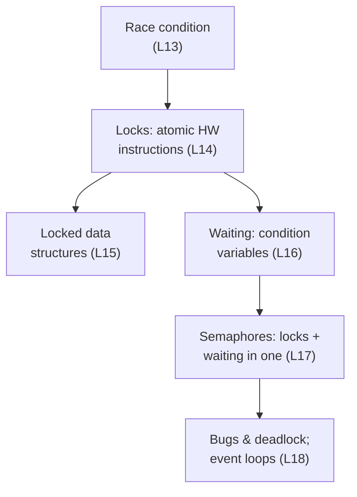

# Part II · Concurrency

**The question:** how do threads share memory without corrupting it, and how do they wait for each other?

Two tools solve almost everything here: **locks** for mutual exclusion, **condition variables** (or semaphores) for ordering. The rest is learning where people misuse them.

**Lessons:** L13–L18. **Time:** ~5 hours.
