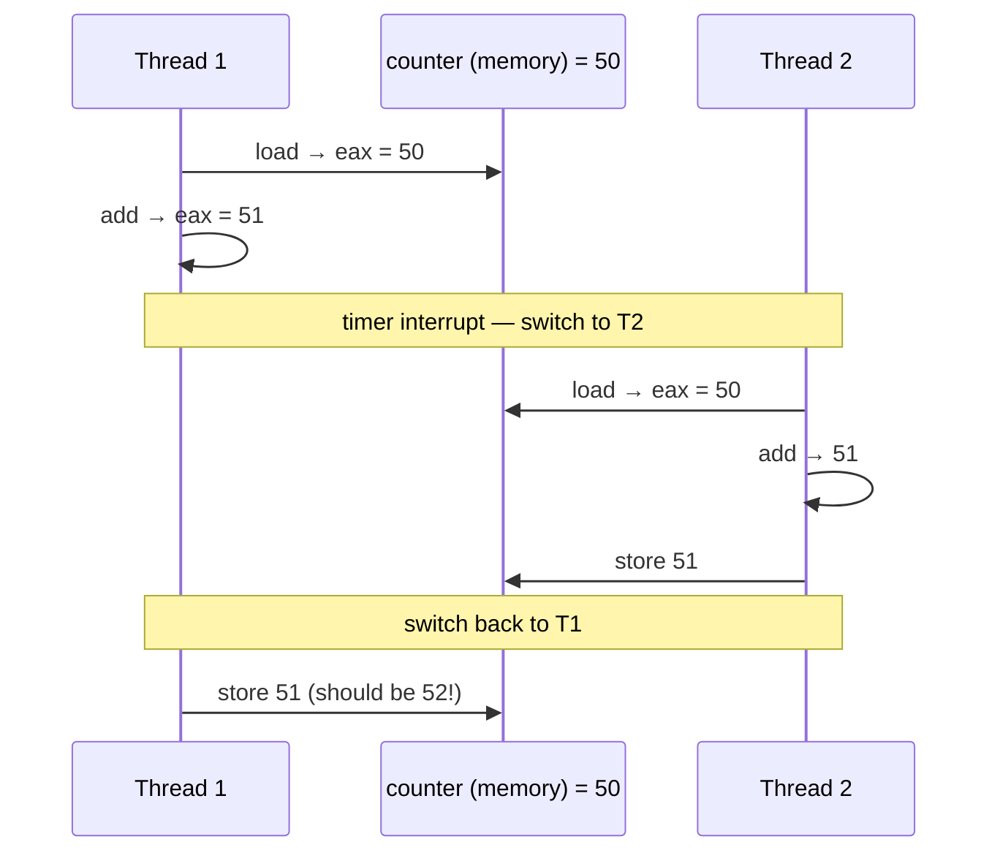

# L13 · Threads & race conditions

> **Book:** Ch 26 (pp. 273–287) 🔴 · Ch 27 (pp. 289–299) 🟡 · **Time:** 40 min · **Simulator:** `threads-intro/x86.py`

!!! example "In plain words"
    A **process** is a house. **Threads** are people living in it: they share the rooms (memory), but each has their own to-do list and notebook (registers and stack).

    Sharing is convenient but risky. Two people update the same shopping list at once: both read "milk ×1", both add one, both write "milk ×2". The answer should be ×3. That's a **race condition**.

    The part of the code where shared stuff is touched is the **critical section**. We need a way to let only one person in at a time.

## TL;DR (the 3 things to remember)

- A **thread** is like a process that **shares the address space** with its siblings: same code, heap and globals, but its own **registers, PC and stack**. Switching threads keeps the page table.
- When threads update shared data, the outcome depends on timing — a **race condition**. The code that touches shared data is a **critical section**; it needs **mutual exclusion**.
- The fix is **atomicity** (built from hardware primitives into **locks**) plus a way to **wait** for another thread (**condition variables**).

## The big question

> How do we build correct concurrent programs when threads share memory and the scheduler can interrupt at any instruction?

## The story chain

<small>Key: **bold** = the problem or the final design · *italics* = an attempted fix · ❌ = what goes wrong with it · → = "which leads to"</small>

**Want parallelism, or overlap I/O within one program** → *threads sharing one address space* → *two threads do `counter++`* → ❌ the result is wrong and different each run (a race; the program is **indeterminate**) → *wish: execute the three instructions atomically* → *no single "super-instruction" for every case* → **build synchronization primitives (locks) from a few hardware instructions** → ❌ threads also need to **wait** for each other (e.g. for I/O to finish) → condition variables ([L16](l16-condvars.md)).

## Core ideas

### Why threads?

1. **Parallelism:** a computer with 8 cores can run 8 threads truly at the same time, so splitting a big job (e.g. processing a huge image) across threads finishes it faster.
2. **Not freezing while waiting:** while one thread waits for the disk or network, the other threads keep working. A web browser can download a file in one thread while you keep scrolling in another.

Why threads and not several processes? Threads share memory automatically, so they can work on the same data without copying it around.

### Thread vs process

| | Process | Thread |
|---|---|---|
| Address space | Own | Shared with sibling threads |
| Saved registers kept in | Process control block (PCB) | Thread control block (**TCB**) |
| Switching between them | Must switch page tables (more expensive) | Same address space, so the page table stays (cheaper) |
| Stack | One | One **per thread** |

### The race, at instruction level

`counter = counter + 1` looks like a single step, but the CPU does it as three machine instructions:

```
mov 0x8049a1c, %eax    ; load
add $0x1, %eax         ; add
mov %eax, 0x8049a1c    ; store
```

In plain words: (1) copy the counter's value from memory (address 0x8049a1c) into the CPU register `eax`; (2) add 1 to the register; (3) copy the register back to memory. Each thread has its **own** copy of the registers, but they share the counter in memory. Now watch what happens if the OS switches threads at the wrong moment:



Both threads added 1, but the counter only went up by 1: one update was **lost**. Whether this happens depends on exactly when the timer interrupt hits, so the program may work 99 times and fail on the 100th.

### Vocabulary (exam favourites)

| Term | Meaning |
|---|---|
| **Critical section** | Code that accesses a shared resource |
| **Race condition** | Result depends on the timing of execution |
| **Indeterminate** | Output varies run to run |
| **Mutual exclusion** | Only one thread in the critical section at a time |
| **Atomic** | All or nothing; can't be interrupted halfway |

### Thread API (Ch 27, POSIX)

In C, threads come from the **pthread** library (POSIX threads). You only need to recognise four kinds of call:

```c
pthread_create(&t, NULL, worker, arg);   // start a new thread running worker(arg)
pthread_join(t, &ret);                   // wait until thread t finishes
pthread_mutex_lock(&m); ... pthread_mutex_unlock(&m);   // a lock (next lesson)
pthread_cond_wait(&c, &m); pthread_cond_signal(&c);     // waiting (L16)
```

Java equivalents: `new Thread(...).start()`, `t.join()`, `synchronized` / `ReentrantLock`, and `wait()` / `notify()`.

- **Never return a pointer to a local variable** from a thread function. Local variables live on the thread's stack, which disappears when the thread ends.
- Initialise locks (`PTHREAD_MUTEX_INITIALIZER` or `pthread_mutex_init`) and check return codes.
- Compile with `-pthread`.

## Common mistakes

- Threads share the heap and globals but **not** stacks or registers.
- A single line of C can be several instructions — never assume `x++` is atomic.
- Races may not show up in testing; they depend on timing.
- `pthread_join` waits for a thread; it is not a lock.

## Recall

**Blurt test** — close this page, then on paper, from memory: thread vs process table; the 3-instruction race diagram; the five vocabulary terms.

<details markdown="1"><summary>What do threads in a process share, and what is private to each?</summary>

Shared: code, heap, globals, open files (the address space). Private: registers, program counter, stack.

</details>

<details markdown="1"><summary>Why might counter++ give the wrong result with two threads?</summary>

It's load, add, store; an interrupt between them lets the other thread read the old value, and one update is lost.

</details>

<details markdown="1"><summary>Define critical section, race condition and mutual exclusion.</summary>

Critical section: code touching shared data. Race condition: result depends on timing. Mutual exclusion: only one thread in the critical section at a time.

</details>

<details markdown="1"><summary>Two reasons to use threads?</summary>

Parallelism on multiple CPUs, and avoiding blocking the program on slow I/O.

</details>

<details markdown="1"><summary>Why is returning a pointer to a local variable from a thread a bug?</summary>

The local lives on the thread's stack, which is freed when the thread exits.

</details>

**Explain it out loud (60 seconds, as if to a friend):** "Show me, instruction by instruction, how two threads incrementing a counter lose an update."

**Simulator drill** (book's free Python homework tools — see [the recall system](../start/recall-system.md#four-more-tricks-that-pay-off)): `python3 x86.py -p looping-race-nolock.s -t 2 -a bx=3 -i 2 -M 2000 -R ax,bx -c` — find the interrupt interval that breaks the counter.

## Connects to

- Locks → [L14](l14-locks.md)
- Waiting → [L16 Condition variables](l16-condvars.md)
- Context switch mechanics → [L03](../virtualization/l03-lde.md)

## Read in the book

- 🔴 Ch 26 entirely, especially 26.3 (the instruction-level race) and the key-terms box.
- 🟡 Ch 27: skim the API and the "guidelines" at the end.
