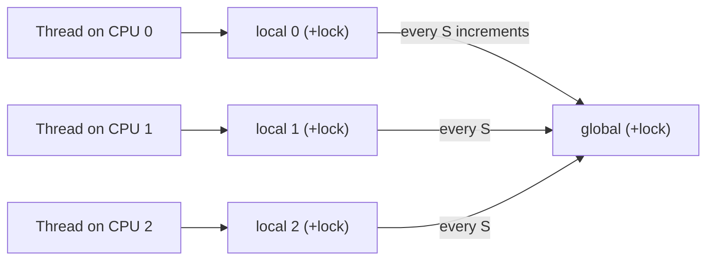

# L15 · Lock-based concurrent data structures

> **Book:** Ch 29 (pp. 325–337) · **Tier:** 🟡 Skim · **Time:** 25 min

## TL;DR

- Start simple: **one big lock** around the whole structure. It's correct; then measure whether it's actually too slow.
- To scale, use **finer-grained** locks: per-bucket locks for a hash table, separate head/tail locks for a queue, or **approximate (sloppy) counters**.
- More concurrency isn't automatically faster — lock overhead and control-flow bugs grow too. **Avoid premature optimisation.**

## The crux

> Given a data structure, how do we add locks so it's correct *and* performs well with many threads?

## The story chain

**Shared counter** → *one lock around increment* → ❌ with 4 threads it's dramatically slower than 1 (no scaling) → *sloppy counter: per-CPU local counters, flushed to a global counter every S updates* → trade-off: larger S = faster but less accurate global value. **Linked list** → *one lock* → *hand-over-hand locking (lock per node)* → ❌ lock/unlock per node is slow in practice. **Queue** → *two locks (head, tail) with a dummy node* → enqueues and dequeues run in parallel. **Hash table** → *a lock per bucket* → scales very well.

## Core ideas

### Approximate (sloppy) counter

- Each CPU increments its own local counter (little contention).
- When a local counter reaches threshold **S**, add it to the global and reset.
- Global can lag by up to (number of CPUs × S). S = 1024 gives near-perfect scaling.

### Design rules

- **Watch control flow**: every early `return` must release the lock. Restructure code so there's a single unlock path.
- **Shrink the critical section**: do `malloc` *outside* the lock where you can.
- **Concurrent queue** (Michael & Scott): head lock and tail lock, plus a dummy node so they never touch the same node.
- **Hash table** built from many simple lists, each with its own lock, scales nearly perfectly.

| Structure | Locking scheme | Scales? |
|---|---|---|
| Counter | Single lock | ✘ |
| Counter | Sloppy (per-CPU + global) | ✔ (approximate) |
| Linked list | Single lock | ✘ |
| Linked list | Hand-over-hand | Rarely better in practice |
| Queue | Head + tail locks | ✔ for producer/consumer |
| Hash table | Lock per bucket | ✔✔ |

## Traps

- More locks ≠ faster. Measure.
- A bug path that returns without unlocking = the next thread waits forever.
- Sloppy counters trade **accuracy** for **speed**.

## Recall

**Blurt test:** the sloppy counter picture and the meaning of S; the table above.

How does a sloppy (approximate) counter work?

Per-CPU local counters with their own locks; when one reaches threshold S it's added to the global counter. Low contention, but the global value lags.

What's the effect of increasing S in a sloppy counter?

Better scalability, less accurate global count.

Why does the Michael & Scott queue use a dummy node?

To keep the head and tail operations on separate nodes so the head lock and tail lock can be held concurrently.

Why does a hash table with per-bucket locks scale well?

Operations on different buckets don't contend for the same lock.

What's hand-over-hand locking and why is it often slow?

A lock per node; you grab the next node's lock before releasing the current one. The per-node lock overhead usually outweighs the extra concurrency.

**Explain it (60 s):** "You have a global counter that's a bottleneck on a 64-core machine. What do you do and what do you give up?"

## Connects to

- Locks themselves → [L14](l14-locks.md)
- Bounded buffer queue with waiting → [L16](l16-condvars.md)

## Read in the book

- 🟡 29.1 (counters — look at the performance graphs in Figures 29.3 and 29.6), 29.3, 29.4. Skim 29.2.
