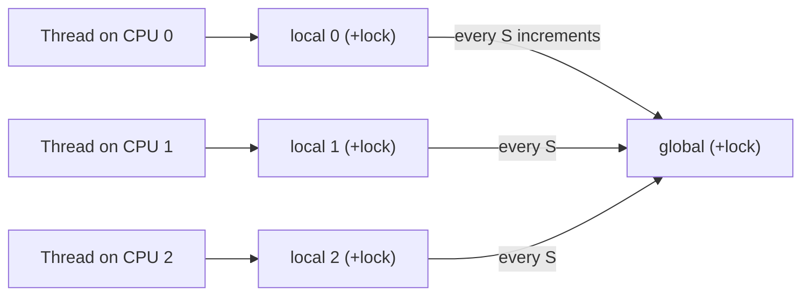

# L15 · Lock-based concurrent data structures

> **Book:** Ch 29 (pp. 325–337) · **Priority:** 🟡 good to know · **Time:** 25 min

!!! example "In plain words"
    You have a shared data structure (counter, list, queue, hash table) and many threads. The simplest safe plan is **one big lock** around the whole thing, like one key for an entire library. It's correct, but only one person can use the library at a time.

    Faster plans use **more, smaller locks**: one key per shelf (a lock per hash bucket), or each person keeps a private tally and adds it to the shared total now and then (a *sloppy counter*). More locks means more speed, but also more chances to make mistakes.

## TL;DR (the 3 things to remember)

- Start simple: **one big lock** around the whole structure. It's correct; then measure whether it's actually too slow.
- To scale, use **finer-grained** locks: per-bucket locks for a hash table, separate head/tail locks for a queue, or **approximate (sloppy) counters**.
- More concurrency isn't automatically faster — lock overhead and control-flow bugs grow too. **Avoid premature optimisation.**

## The big question

> Given a data structure, how do we add locks so it's correct *and* performs well with many threads?

## The story chain

<small>Key: **bold** = the problem or the final design · *italics* = an attempted fix · ❌ = what goes wrong with it · → = "which leads to"</small>

**Shared counter** → *one lock around increment* → ❌ with 4 threads it's dramatically slower than 1 (no scaling) → *sloppy counter: per-CPU local counters, flushed to a global counter every S updates* → trade-off: larger S = faster but less accurate global value. **Linked list** → *one lock* → *hand-over-hand locking (lock per node)* → ❌ lock/unlock per node is slow in practice. **Queue** → *two locks (head, tail) with a dummy node* → enqueues and dequeues run in parallel. **Hash table** → *a lock per bucket* → scales very well.

## Core ideas

First, what "scales" means: if 4 threads on 4 CPUs share the work, it should take about as long as 1 thread doing a quarter of it. With one big lock, the threads mostly queue for the lock, and 4 threads can end up *slower* than 1.

### Approximate (sloppy) counter

- Each CPU keeps its **own local count**, so threads on different CPUs rarely wait for each other.
- When a local count reaches a threshold **S** (say 1024), the thread adds it to the shared global count (briefly taking the global lock) and resets the local count to 0.
- The trade-off: the global total can be behind by up to (number of CPUs × S). That's fine for things like statistics, where "about right" is good enough. With S = 1024, four threads are nearly 4× faster than one.

### Design rules

- **Every exit must unlock.** If a function takes a lock and has an early `return` (e.g. on an error), it must release the lock first. Otherwise every other thread waits forever. Simplest fix: write the code so there's one unlock at one exit point.
- **Hold the lock as briefly as possible.** Do slow work, like allocating memory, *before* taking the lock.
- **Queue with two locks** (Michael & Scott's design): one lock for the front (where items are removed) and one for the back (where they're added), so adding and removing can happen at the same time. An empty placeholder ("dummy") node keeps the two ends from ever touching the same node.
- **Hash table with one lock per bucket:** a hash table is really many small lists (*buckets*). Give each its own lock, and threads working on different buckets never wait for each other, so it scales almost perfectly.

| Structure | Locking scheme | Scales? |
|---|---|---|
| Counter | Single lock | ✘ |
| Counter | Sloppy (per-CPU + global) | ✔ (approximate) |
| Linked list | Single lock | ✘ |
| Linked list | Hand-over-hand (one lock per node; grab the next node's lock before letting go of the current one) | Rarely better in practice: all that locking costs more than it saves |
| Queue | Head + tail locks | ✔ for producer/consumer |
| Hash table | Lock per bucket | ✔✔ |

## Common mistakes

- More locks ≠ faster. Measure.
- A bug path that returns without unlocking = the next thread waits forever.
- Sloppy counters trade **accuracy** for **speed**.

## Recall

**Blurt test** — close this page, then on paper, from memory: the sloppy counter picture and the meaning of S; the table above.

How does a sloppy (approximate) counter work?

Per-CPU local counters with their own locks; when one reaches threshold S it's added to the global counter. Low contention, but the global value lags.

What's the effect of increasing S in a sloppy counter?

Better scalability, less accurate global count.

Why does the Michael & Scott queue use a dummy node?

To keep the head and tail operations on separate nodes so the head lock and tail lock can be held concurrently.

Why does a hash table with per-bucket locks scale well?

Operations on different buckets don't contend for the same lock.

What's hand-over-hand locking and why is it often slow?

A lock per node; you grab the next node's lock before releasing the current one. The per-node lock overhead usually outweighs the extra concurrency.

**Explain it out loud (60 seconds, as if to a friend):** "You have a global counter that's a bottleneck on a 64-core machine. What do you do and what do you give up?"

## Connects to

- Locks themselves → [L14](l14-locks.md)
- Bounded buffer queue with waiting → [L16](l16-condvars.md)

## Read in the book

- 🟡 29.1 (counters — look at the performance graphs in Figures 29.3 and 29.6), 29.3, 29.4. Skim 29.2.
