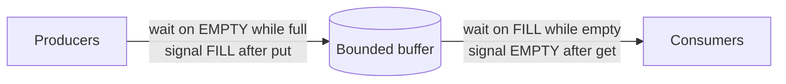

# L16 · Condition variables

> **Book:** Ch 30 (pp. 339–353) · **Tier:** 🔴 Must · **Time:** 50 min · **Code:** `threads-cv/`

## TL;DR

- A **condition variable** (CV) is a queue where threads **wait** until some condition becomes true; another thread **signals** when it changes the state.
- `wait(cv, mutex)` **atomically releases the lock and sleeps**, and re-acquires the lock before returning.
- Two rules for correct code: **always hold the lock** when calling wait/signal, and **always re-check the condition in a `while` loop** (Mesa semantics). For producer/consumer, use **two CVs** (empty, fill).

## The crux

> How should a thread wait for a condition to become true, without wasting CPU spinning?

## The story chain

**Parent waits for child thread** → *spin on a shared `done` flag* → ❌ wastes CPU, and may be incorrect → *condition variable: wait / signal* → ❌ without a state variable, if the child signals before the parent waits, the parent sleeps forever → *use a state variable (`done`)* → ❌ without the lock, a race between check and wait → *hold the lock* → **producer/consumer**: *one CV + `if`* → ❌ another consumer sneaks in and empties the buffer before the woken thread runs → *`while` instead of `if`* → ❌ with one CV, a consumer may wake another consumer and everyone sleeps → **two CVs: `empty` and `fill`**.

## Core ideas

### The canonical join

```c
int done = 0;
pthread_mutex_t m = PTHREAD_MUTEX_INITIALIZER;
pthread_cond_t  c = PTHREAD_COND_INITIALIZER;

void thr_exit() {                 // child
    pthread_mutex_lock(&m);
    done = 1;
    pthread_cond_signal(&c);
    pthread_mutex_unlock(&m);
}
void thr_join() {                 // parent
    pthread_mutex_lock(&m);
    while (done == 0)
        pthread_cond_wait(&c, &m);   // releases m while sleeping
    pthread_mutex_unlock(&m);
}
```

Three ingredients: **state variable** (`done`), **lock**, **CV**. Drop any one and it breaks.

### Producer/consumer (bounded buffer) — the correct version

```c
cond_t empty, fill;  mutex_t mutex;

void *producer(void *arg) {
    for (int i = 0; i < loops; i++) {
        lock(&mutex);
        while (count == MAX) wait(&empty, &mutex);
        put(i);
        signal(&fill);
        unlock(&mutex);
    }
}
void *consumer(void *arg) {
    for (int i = 0; i < loops; i++) {
        lock(&mutex);
        while (count == 0) wait(&fill, &mutex);
        int tmp = get();
        signal(&empty);
        unlock(&mutex);
    }
}
```



### Why `while`, not `if` — Mesa semantics

A signal is only a **hint** that the state changed. Between the signal and the woken thread actually running, another thread may change the state again. (Hoare semantics would run the woken thread immediately, but almost no real system does this.) Also guards against **spurious wakeups**.

### Why two CVs

With one CV, a consumer that empties the buffer may signal and wake **another consumer** instead of the producer. Now all three sleep. Producers should only wake consumers and vice versa.

### Covering conditions

When a signaller can't tell *which* waiter should wake (e.g. a memory allocator: one free of 50 bytes, waiters want 100 and 10 bytes), use **`broadcast`** to wake all; each re-checks. Correct but can be costly.

## Traps

- Calling wait without holding the lock — race between checking and sleeping.
- `if` instead of `while` — works in tests, fails under load.
- Forgetting the state variable — a signal with no waiter is **lost** (CVs have no memory, unlike semaphores).
- One CV shared by producers and consumers — possible all-asleep.

## Recall

**Blurt test:** write `thr_join`/`thr_exit` and the producer/consumer from memory; list the three bugs it fixes.

<details markdown="1"><summary>What does pthread_cond_wait(c, m) do?</summary>

Atomically releases mutex m and puts the thread to sleep on c; when woken, re-acquires m before returning.

</details>

<details markdown="1"><summary>Why must you re-check the condition in a while loop?</summary>

Mesa semantics: the signal is only a hint and the state may change before the woken thread runs; spurious wakeups can also happen.

</details>

<details markdown="1"><summary>Why do we need a state variable along with a CV?</summary>

CVs have no memory. If signal happens before wait, it's lost; the state variable records that the condition already holds.

</details>

<details markdown="1"><summary>Why does producer/consumer need two condition variables?</summary>

So a consumer only wakes producers and a producer only wakes consumers; with one CV a consumer can wake another consumer and everyone sleeps.

</details>

<details markdown="1"><summary>What is a covering condition?</summary>

Using broadcast to wake all waiters when you can't tell which one should proceed; each re-checks its condition.

</details>

<details markdown="1"><summary>Mesa vs Hoare semantics?</summary>

Mesa: signal is a hint; the woken thread runs later and must re-check. Hoare: the woken thread runs immediately with the guarantee. Real systems use Mesa.

</details>

**Explain it (60 s):** "Walk me through why the single-CV producer/consumer with `while` can still hang with two consumers."

**Code drill:** in `threads-cv/`, build and run `main-one-cv-while` with `-p 1 -c 2` and the `-C` sleep strings from the README until you reproduce the hang, then compare with `main-two-cvs-while`.

## Connects to

- Locks → [L14](l14-locks.md)
- Semaphores can do the same job → [L17](l17-semaphores.md)
- Event loops avoid this whole problem → [L18](l18-deadlock.md)

## Read in the book

- 🔴 30.1–30.2 — follow every broken version and its trace table (Figures 30.7 and 30.9).
- 🟡 30.3 covering conditions.
