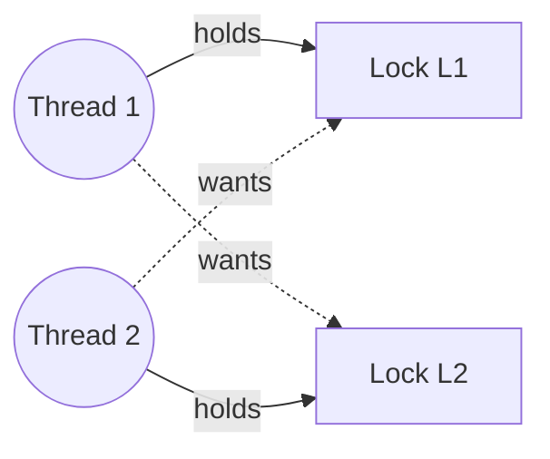

# L18 · Concurrency bugs, deadlock & event-based concurrency

> **Book:** Ch 32 (pp. 373–387) 🔴 · Ch 33 (pp. 389–400) 🟡 · **Time:** 50 min · **Code:** `threads-bugs/`

## TL;DR

- Most real concurrency bugs are **not** deadlocks: they're **atomicity violations** (a check-then-use isn't protected) and **order violations** (A assumed to happen before B). Fix with locks and CVs.
- **Deadlock needs all four:** mutual exclusion, hold-and-wait, no preemption, circular wait. Break any one. In practice: **lock ordering** (break circular wait).
- **Event-based** servers use one thread and an event loop with `select()`/`poll()` — no locks, but blocking calls ruin it, so they need **asynchronous I/O** and manual state management.

## The crux

> How do we handle common concurrency bugs, and in particular, how do we prevent, avoid or recover from deadlock?

## The story chain

**Study of real bugs (MySQL, Apache, Mozilla, OpenOffice)** → ~**97% of non-deadlock bugs** are atomicity or order violations → *locks and CVs fix them*. **Deadlock** → *why it happens*: big systems have complex dependencies, and encapsulation hides locking (`v1.AddAll(v2)` vs `v2.AddAll(v1)`) → *four conditions* → **prevention** (break a condition) / **avoidance** (smart scheduling, Banker's) / **detect and recover**. **Event loops** as an alternative to threads → ❌ blocking syscalls stall everything → *async I/O (AIO)* → ❌ state must be saved by hand (**continuations**) → ❌ doesn't use multiple CPUs easily; page faults still block.

## Core ideas

### Non-deadlock bugs

| Type | Example | Fix |
|---|---|---|
| **Atomicity violation** | `if (thd->proc_info) fputs(thd->proc_info, …);` — another thread sets it to NULL in between | Wrap check + use in one lock |
| **Order violation** | Thread 2 uses `mThread->State` before Thread 1 has initialised `mThread` | CV / semaphore to enforce order |

### The four deadlock conditions



| Condition | Meaning | How to break it (prevention) |
|---|---|---|
| **Mutual exclusion** | Threads need exclusive control of resources | **Lock-free** structures with CAS (hard to get right) |
| **Hold-and-wait** | Hold one lock while waiting for another | Grab all locks at once (under a global "prevention" lock) — hurts concurrency |
| **No preemption** | Locks can't be taken away | `pthread_mutex_trylock()`; on failure release everything and retry — risk **livelock** (add random back-off) |
| **Circular wait** | A cycle of threads, each waiting for the next | **Lock ordering**: total order (always L1 before L2), or partial order. Trick: order by lock **address** |

### Avoidance, detection

- **Avoidance via scheduling:** if you know which locks each thread needs, never run two conflicting threads at the same time (Dijkstra's **Banker's algorithm** generalises this). Only practical in limited settings.
- **Detect and recover:** let deadlocks happen rarely; a detector builds a **resource graph**, finds cycles, and restarts something. Common in databases.

### Event-based concurrency (Ch 33)

```c
while (1) {
    events = getEvents();        // select() / poll() / epoll
    for (e in events)
        processEvent(e);         // handler runs to completion
}
```

- **Pros:** one thread → no locks, no races (on a single CPU); explicit control of scheduling.
- **Cons:** a handler must **never block** (a blocking `read()` stalls the server) → use **async I/O** (`aio_read`, then poll or get a signal); state must be packed into a **continuation** for later; multiple CPUs bring locks back; page faults block implicitly; APIs change over time.
- This is the model behind Node.js and nginx.

## Traps

- Deadlock requires **all four** conditions; the usual fix is ordering, not removing mutual exclusion.
- `trylock`-and-retry can **livelock**: everyone keeps backing off and retrying.
- Encapsulation hides lock order — library calls can deadlock with no obvious lock in your code.
- Event loops are lock-free only on **one** CPU.

## Recall

**Blurt test:** two non-deadlock bug types with an example; four conditions and one fix each; event loop pros/cons.

<details markdown="1"><summary>What are the two main kinds of non-deadlock concurrency bugs?</summary>

Atomicity violations (a sequence assumed atomic isn't) and order violations (an assumed ordering isn't enforced).

</details>

<details markdown="1"><summary>List the four conditions for deadlock.</summary>

Mutual exclusion, hold-and-wait, no preemption, circular wait.

</details>

<details markdown="1"><summary>What is the most practical way to prevent deadlock?</summary>

Break circular wait by acquiring locks in a fixed global order (e.g. by address).

</details>

<details markdown="1"><summary>What's livelock and how do you reduce it?</summary>

Threads keep failing trylock, releasing and retrying without progress. Add a random delay before retrying.

</details>

<details markdown="1"><summary>Prevention vs avoidance vs detection?</summary>

Prevention: design so a deadlock condition can't hold. Avoidance: schedule so deadlock can't happen given known lock needs. Detection: let it happen, find cycles, recover.

</details>

<details markdown="1"><summary>Why must event handlers never block?</summary>

There's one thread; a blocking call stops the whole server from handling any other event.

</details>

<details markdown="1"><summary>What's a continuation in event-based programming?</summary>

Saved state needed to finish handling an event later, e.g. after async I/O completes.

</details>

**Explain it (60 s):** "Give me the four deadlock conditions and tell me which one you'd break in a real codebase, and how."

**Code drill:** in `threads-bugs/`, run `vector-deadlock` until it hangs, then read `vector-global-order.c` and `vector-avoid-hold-and-wait.c` to see two fixes.

## Connects to

- Lock ordering in [L15](l15-concurrent-ds.md) data structures
- Dining philosophers → [L17](l17-semaphores.md)
- `select()`-style I/O → [L19 I/O devices](../persistence/l19-io.md)

## Read in the book

- 🔴 32.2–32.3 — the four conditions with all prevention techniques.
- 🟡 Ch 33: 33.1–33.6.
