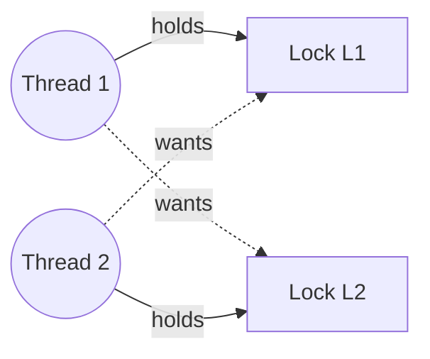

# L18 · Concurrency bugs, deadlock & event-based concurrency

> **Book:** Ch 32 (pp. 373–387) 🔴 · Ch 33 (pp. 389–400) 🟡 · **Time:** 50 min · **Code:** `threads-bugs/`

!!! example "In plain words"
    **Deadlock** is four cars arriving at a four-way junction at once, each waiting for the car on its right to go first. Nobody moves, ever.

    It only happens if **all four** of these are true at once:

    1. Only one can hold a thing (mutual exclusion).
    2. You hold one thing while waiting for another (hold-and-wait).
    3. Nobody can take a thing away from you (no preemption).
    4. There's a cycle of waiting (circular wait).

    Break any one and deadlock is impossible. The everyday fix is a **rule for the order** in which locks are taken ("always lock A before B"). That breaks the cycle.

    Most real bugs, though, aren't deadlocks. They're simpler mistakes: forgetting to lock, or assuming one thing happens before another.

## TL;DR (the 3 things to remember)

- Most real concurrency bugs are **not** deadlocks: they're **atomicity violations** (a check-then-use isn't protected) and **order violations** (A assumed to happen before B). Fix with locks and CVs.
- **Deadlock needs all four:** mutual exclusion, hold-and-wait, no preemption, circular wait. Break any one. In practice: **lock ordering** (break circular wait).
- **Event-based** servers use one thread and an event loop with `select()`/`poll()` — no locks, but blocking calls ruin it, so they need **asynchronous I/O** and manual state management.

## The big question

> How do we handle common concurrency bugs, and in particular, how do we prevent, avoid or recover from deadlock?

## The story chain

<small>Key: **bold** = the problem or the final design · *italics* = an attempted fix · ❌ = what goes wrong with it · → = "which leads to"</small>

**Study of real bugs (MySQL, Apache, Mozilla, OpenOffice)** → ~**97% of non-deadlock bugs** are atomicity or order violations → *locks and CVs fix them*. **Deadlock** → *why it happens*: big systems have complex dependencies, and encapsulation hides locking (`v1.AddAll(v2)` vs `v2.AddAll(v1)`) → *four conditions* → **prevention** (break a condition) / **avoidance** (smart scheduling, Banker's) / **detect and recover**. **Event loops** as an alternative to threads → ❌ blocking syscalls stall everything → *async I/O (AIO)* → ❌ state must be saved by hand (**continuations**) → ❌ doesn't use multiple CPUs easily; page faults still block.

## Core ideas

### Non-deadlock bugs

| Type | Example | Fix |
|---|---|---|
| **Atomicity violation** — two steps that must happen together get split | Thread 1 checks "is the pointer non-empty?" and then uses it. In between, thread 2 sets the pointer to NULL, and thread 1 crashes. (Real bug from MySQL) | Do the check and the use under one lock |
| **Order violation** — code assumes A happens before B, but nothing guarantees it | Thread 2 uses an object that thread 1 is *supposed* to have created first, but thread 2 got there sooner. (Real bug from Mozilla) | Make thread 2 wait for a signal from thread 1 (CV or semaphore) |

### The four deadlock conditions

The smallest possible deadlock: thread 1 holds lock L1 and wants L2; thread 2 holds L2 and wants L1. Each waits for the other forever.



| Condition | Meaning | How to break it (prevention) |
|---|---|---|
| **Mutual exclusion** | A resource can only be held by one thread at a time | Avoid locks altogether with **lock-free** data structures built on atomic instructions like CAS. Powerful but very hard to get right |
| **Hold-and-wait** | A thread holds one lock while waiting for another | Take **all** the locks you need at once, up front. Safe, but threads hold locks longer than needed, so less runs in parallel |
| **No preemption** | Nobody can take a lock away from its holder | Use `trylock` ("take it if free, otherwise tell me"). If you can't get the second lock, **release the first** and start again. Risk: two threads keep backing off and retrying in step forever (**livelock**); a random pause before retrying fixes that |
| **Circular wait** | Threads wait in a circle: A for B, B for C, C for A | **Lock ordering:** everyone takes locks in the same agreed order (e.g. always L1 before L2), so a circle can't form. Handy trick: order locks by their memory address. **This is the fix used most in practice** |

### Avoidance, detection

Prevention (above) designs deadlock out. Two other strategies:

- **Avoidance:** if you know in advance which locks each thread will need, the scheduler can simply never run two threads together that could deadlock. Dijkstra's **Banker's algorithm** is the classic version. It only works when needs are known up front, which is rare.
- **Detect and recover:** allow deadlocks, but check now and then. Draw who-waits-for-whom as a graph; a cycle means deadlock, so cancel or restart one of the threads. Databases do this: one transaction is cancelled and retried.

### Event-based concurrency (Ch 33)

A completely different way to handle many things at once: **don't use threads at all**. Use one thread running an **event loop**:

```c
while (1) {
    events = getEvents();        // select() / poll() / epoll
    for (e in events)
        processEvent(e);         // handler runs to completion
}
```

The loop asks the OS "which connections have something ready?" (`select`, `poll` or `epoll`), then handles each ready one in turn. Each handler runs from start to finish without interruption.

- **Pros:** only one thread, so no locks and no race conditions (on one CPU), and you decide exactly what runs when.
- **Cons:**
    - A handler must **never wait**. If one handler blocks on a slow disk read, the whole server freezes. So you need **asynchronous I/O**: start the read, return to the loop, and get notified when it's done.
    - Because a handler can't wait, any state needed later (e.g. "which client was this read for?") must be saved by hand and picked up when the notification arrives (a **continuation**).
    - Using several CPUs means several loops, and the locks come back.
- This is how **Node.js** and **nginx** work, and it's why "don't block the event loop" is the first rule of Node.js.

## Common mistakes

- Deadlock requires **all four** conditions; the usual fix is ordering, not removing mutual exclusion.
- `trylock`-and-retry can **livelock**: everyone keeps backing off and retrying.
- Encapsulation hides lock order — library calls can deadlock with no obvious lock in your code.
- Event loops are lock-free only on **one** CPU.

## Recall

**Blurt test** — close this page, then on paper, from memory: two non-deadlock bug types with an example; four conditions and one fix each; event loop pros/cons.

<details markdown="1"><summary>What are the two main kinds of non-deadlock concurrency bugs?</summary>

Atomicity violations (a sequence assumed atomic isn't) and order violations (an assumed ordering isn't enforced).

</details>

<details markdown="1"><summary>List the four conditions for deadlock.</summary>

Mutual exclusion, hold-and-wait, no preemption, circular wait.

</details>

<details markdown="1"><summary>What is the most practical way to prevent deadlock?</summary>

Break circular wait by acquiring locks in a fixed global order (e.g. by address).

</details>

<details markdown="1"><summary>What's livelock and how do you reduce it?</summary>

Threads keep failing trylock, releasing and retrying without progress. Add a random delay before retrying.

</details>

<details markdown="1"><summary>Prevention vs avoidance vs detection?</summary>

Prevention: design so a deadlock condition can't hold. Avoidance: schedule so deadlock can't happen given known lock needs. Detection: let it happen, find cycles, recover.

</details>

<details markdown="1"><summary>Why must event handlers never block?</summary>

There's one thread; a blocking call stops the whole server from handling any other event.

</details>

<details markdown="1"><summary>What's a continuation in event-based programming?</summary>

Saved state needed to finish handling an event later, e.g. after async I/O completes.

</details>

**Explain it out loud (60 seconds, as if to a friend):** "Give me the four deadlock conditions and tell me which one you'd break in a real codebase, and how."

**Code drill:** in `threads-bugs/`, run `vector-deadlock` until it hangs, then read `vector-global-order.c` and `vector-avoid-hold-and-wait.c` to see two fixes.

## Connects to

- Lock ordering in [L15](l15-concurrent-ds.md) data structures
- Dining philosophers → [L17](l17-semaphores.md)
- `select()`-style I/O → [L19 I/O devices](../persistence/l19-io.md)

## Read in the book

- 🔴 32.2–32.3 — the four conditions with all prevention techniques.
- 🟡 Ch 33: 33.1–33.6.
