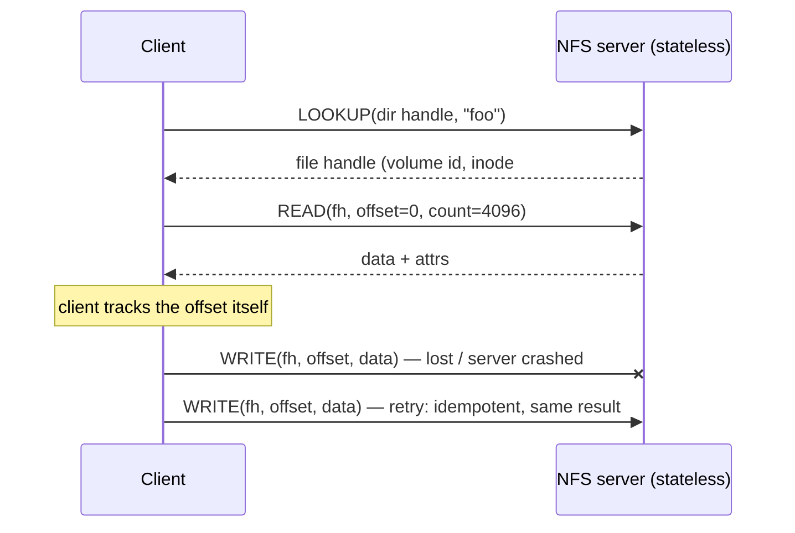

# L27 · Distributed systems, NFS & AFS

> **Book:** Ch 47 (pp. 559–574) · Ch 48 (pp. 575–590) · Ch 49 (pp. 591–604) · **Tier:** 🟡 Skim · **Time:** 50 min · **Simulator:** `dist-afs/afs.py`

## TL;DR

- Networks **lose packets**. Build reliability with **acknowledgements + timeouts + retries**, and **sequence numbers** to drop duplicates. **RPC** makes a remote call look like a local one (stubs, marshalling).
- **NFSv2** is **stateless**: every request carries everything needed (a **file handle** + offset), and operations are **idempotent**, so a client can simply **retry** after a server crash. Caching brings the **cache-consistency** problem → flush on close, check attributes (with a short attribute cache).
- **AFS** caches **whole files** on the client's local disk and uses **callbacks**: the server promises to tell clients when a file changes → far fewer server messages, scales better. Semantics: **last closer wins**.

## The crux

> How do we build systems that work when components fail — and in particular, a distributed file system that survives server crashes and scales to many clients?

## The story chain

**Packets get lost** → *ack + timeout + retry* → ❌ duplicates if the ack was lost → *sequence numbers* → *wrap it in RPC*. **Share files over a network** → *NFS: stateless protocol, file handles, idempotent ops* → server crash = client just retries → *client caching for speed* → ❌ **update visibility** (when do others see my write?) → *flush on close* → ❌ **stale cache** (do I have the old version?) → *GETATTR before using cache* → ❌ server flooded with GETATTRs → *attribute cache (~3 s)* → odd semantics. **AFS:** ❌ AFSv1 server overloaded by path traversal and TestAuth checks → *AFSv2: callbacks + file identifiers (FIDs), whole-file caching* → consistent, scalable; crash recovery needs care.

## Core ideas

### Communication basics (Ch 47)

- **Unreliable layer** (UDP): fast, may drop. **Reliable layer** (TCP-like): ack, timeout/retry, sequence numbers. **Checksums** for corruption.
- **End-to-end argument:** reliability must ultimately be checked at the top (the application) — lower layers can only help.
- Distributed shared memory: elegant, but failures and performance make it impractical.
- **RPC:** client **stub** marshals arguments → message → server stub unmarshals → calls the function → returns. Issues: naming, transport (often over UDP with its own acks), large arguments, byte order, async calls.

### NFSv2

- **File handle** = volume ID + inode number + **generation number** (detects reused inodes).
- **Idempotent:** READ, WRITE (at an explicit offset), GETATTR — doing it twice = doing it once. (MKDIR isn't: the second call fails with "already exists".)
- **Server must commit writes to stable storage before replying** — otherwise a crash could silently lose data the client thinks is safe. That's why NFS servers want fast write paths (battery-backed memory).

### Cache consistency

| Problem | NFS answer | AFS answer |
|---|---|---|
| **Update visibility** — when do others see my writes? | Flush dirty data on `close()` | Whole file sent to server on `close()` |
| **Stale cache** — is my copy out of date? | GETATTR check (cached for ~3 s) | **Callback**: server tells you when it changes |
| Server load | High (many GETATTRs) | Low (callbacks) |
| Concurrent writers | Mixed blocks possible | **Last closer wins** (whole file) |

### AFS

- **v1:** whole-file caching on local disk, but the server did path walking and clients sent **TestAuth** on every open → server CPU-bound, ~20 clients per server.
- **v2:** **callbacks** (server keeps state about who caches what); **FIDs** instead of paths (client walks the path, caching directories); **whole-file** caching; one server handles ~50 clients.
- **Crash recovery:** a rebooting client must treat cached files as suspect (re-validate). A rebooting server lost its callback state → tell all clients (or they poll with heartbeats).
- Extras: global namespace, ACLs, quotas, Kerberos security.

## Traps

- "Stateless" means the server keeps **no per-client state** about open files — not that it has no data.
- NFS write semantics: data is visible to others only after the writer **closes** (and the reader's attr cache expires).
- AFS on-close semantics: other processes on the **same** machine see writes immediately; other machines see them on close.
- Idempotency is what makes "just retry" safe.

## Recall

**Blurt test:** the NFS chain (stateless → idempotent → retry → caching → visibility & staleness → attr cache); the NFS vs AFS table.

How do you build reliable communication over an unreliable network?

Acknowledgements, timeouts with retries, and sequence numbers to detect duplicates (plus checksums for corruption).

What does an RPC stub do?

Marshals arguments into a message, sends it, waits for the reply and unmarshals the result, so a remote call looks like a local one.

Why is NFSv2 stateless, and what does that buy?

Every request carries all needed information, so after a server crash clients simply retry — no state to rebuild.

What's in an NFS file handle?

Volume ID, inode number, generation number.

What does idempotent mean, and why does NFS need it?

Performing an operation more than once has the same effect as once; it makes retrying after timeouts safe.

What are the two cache-consistency problems?

Update visibility (when do others see my writes) and stale cache (is my cached copy out of date).

What is an AFS callback?

A promise from the server to notify a client when a file it caches is modified, so the client needn't ask the server on each open.

Why must an NFS server commit writes to disk before replying?

If it replied first and crashed, the client would think the data was safe when it was lost.

**Explain it (60 s):** "Compare how NFS and AFS keep client caches consistent, and why AFS scales better."

**Simulator drill:** `python3 afs.py -C 2 -n 1 -s 12 -c` — predict which values each client reads and when callbacks fire.

## Connects to

- Write-ahead logging and idempotent replay → [L25 Journaling](../persistence/l25-journaling.md)
- File API semantics (open/close/fsync) → [L22](../persistence/l22-files-api.md)
- Caching trade-offs → [L10](../virtualization/l10-tlb.md), [L12](../virtualization/l12-swapping.md)

## Read in the book

- 🟡 Ch 47: 47.1–47.5 (unreliable/reliable communication, RPC).
- 🟡 Ch 48: 48.4–48.10 (stateless protocol, idempotency, caching, write buffering).
- 🟡 Ch 49: 49.1–49.5 (AFSv1 problems, AFSv2 callbacks, consistency).
