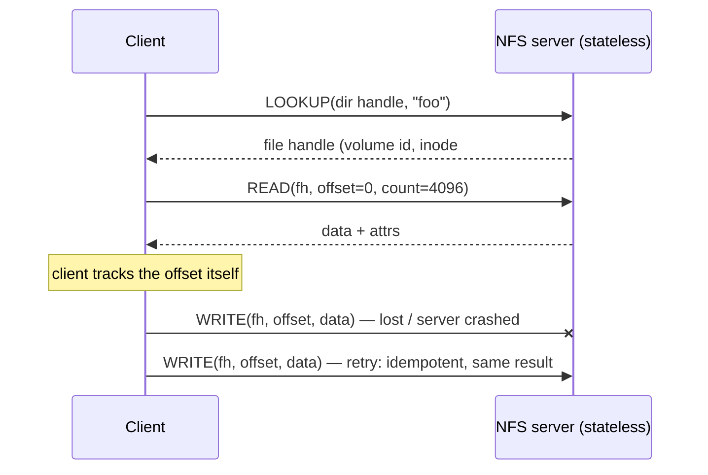

# L27 · Distributed systems, NFS & AFS

> **Book:** Ch 47 (pp. 559–574) · Ch 48 (pp. 575–590) · Ch 49 (pp. 591–604) · **Priority:** 🟡 good to know · **Time:** 50 min · **Simulator:** `dist-afs/afs.py`

!!! example "In plain words"
    A **distributed file system** lets many computers use files stored on a server, over a network that can lose messages or crash.

    - **The basic tools:** if there's no reply, send again (*retry*); number your messages so duplicates are spotted.
    - **NFS:** the server remembers *nothing* about clients (**stateless**). Every request says exactly what it wants ("write these bytes at position 4096 of file #123"), so asking twice is harmless (**idempotent**). If the server crashes and reboots, clients just retry.
    - **AFS:** clients copy the **whole file** to their own disk. The server promises to tell them if someone else changes it (a **callback**), so clients rarely need to ask the server anything.

## TL;DR (the 3 things to remember)

- Networks **lose packets**. Build reliability with **acknowledgements + timeouts + retries**, and **sequence numbers** to drop duplicates. **RPC** makes a remote call look like a local one (stubs, marshalling).
- **NFSv2** is **stateless**: every request carries everything needed (a **file handle** + offset), and operations are **idempotent**, so a client can simply **retry** after a server crash. Caching brings the **cache-consistency** problem → flush on close, check attributes (with a short attribute cache).
- **AFS** caches **whole files** on the client's local disk and uses **callbacks**: the server promises to tell clients when a file changes → far fewer server messages, scales better. Semantics: **last closer wins**.

## The big question

> How do we build systems that work when components fail — and in particular, a distributed file system that survives server crashes and scales to many clients?

## The story chain

<small>Key: **bold** = the problem or the final design · *italics* = an attempted fix · ❌ = what goes wrong with it · → = "which leads to"</small>

**Packets get lost** → *ack + timeout + retry* → ❌ duplicates if the ack was lost → *sequence numbers* → *wrap it in RPC*. **Share files over a network** → *NFS: stateless protocol, file handles, idempotent ops* → server crash = client just retries → *client caching for speed* → ❌ **update visibility** (when do others see my write?) → *flush on close* → ❌ **stale cache** (do I have the old version?) → *GETATTR before using cache* → ❌ server flooded with GETATTRs → *attribute cache (~3 s)* → odd semantics. **AFS:** ❌ AFSv1 server overloaded by path traversal and TestAuth checks → *AFSv2: callbacks + file identifiers (FIDs), whole-file caching* → consistent, scalable; crash recovery needs care.

## Core ideas

### Communication basics (Ch 47)

- **Networks lose messages.** The basic network service (UDP) just sends a message and hopes. To make delivery reliable (as TCP does):
    - the receiver sends back an **acknowledgement** ("got it");
    - if the sender hears nothing within a set time (a **timeout**), it sends again (**retry**);
    - if the message arrived but the ack was lost, the retry creates a duplicate, so each message carries a **sequence number** and the receiver ignores numbers it has already seen;
    - a **checksum** detects messages damaged in transit.
- **End-to-end argument:** only the application at each end can be sure the whole job worked (e.g. the file really arrived intact on disk). Lower layers can make failures rarer, but the final check belongs at the top.
- **RPC (remote procedure call)** makes calling a function on another machine look like a normal function call. Generated helper code (a **stub**) packs the arguments into a message (**marshalling**), sends it, and waits; on the server, another stub unpacks them, calls the real function and sends back the result. Hard parts: finding the server, handling lost messages, big arguments, and machines that store numbers in different byte orders.

### NFSv2

How to read the diagram: the client first looks up "foo" and gets a **file handle**, a permanent ID for the file. Every later request carries that handle *and* the exact position, so the server needs no memory of earlier requests. When a write is lost, the client simply sends the identical request again.

- **What's in a file handle:** which disk (volume ID) + which file (inode number) + a **generation number**. The generation number changes whenever an inode number is reused for a new file, so a stale handle can't accidentally reach the wrong file.
- **Idempotent** means "doing it twice has the same effect as doing it once". "Write these bytes at position 4096" is idempotent: repeat it and the result is identical. So are READ and GETATTR. Compare "append these bytes", which would add them twice. (MKDIR isn't idempotent either: the second attempt fails with "already exists".) Idempotency is what makes "just retry" safe.
- **The server must save writes to disk *before* saying "done".** Otherwise it could crash after replying, and the client would believe lost data was safe. This makes NFS writes slow, so NFS servers often use battery-backed memory to speed them up.

### Cache consistency

Clients keep copies of files in their own memory (a cache) to avoid asking the server every time. But copies cause two problems:

- **Update visibility:** I changed my copy. When do *other* clients see the change?
- **Stale cache:** my copy might be out of date because someone else changed the file. How do I find out?

| Problem | NFS answer | AFS answer |
|---|---|---|
| **Update visibility** — when do others see my writes? | Flush dirty data on `close()` | Whole file sent to server on `close()` |
| **Stale cache** — is my copy out of date? | Before using the cache, ask the server for the file's details (GETATTR) to see if it changed. To avoid asking constantly, trust the answer for about 3 seconds | **Callback:** the server promises to tell you when someone changes the file. Until then, your copy is good |
| Load on the server | High: lots of "has it changed?" questions | Low: the server only speaks up when something changes |
| Two clients write the same file | Their blocks can end up mixed together | The whole file from whoever **closes last** wins |

### AFS

- **AFS version 1:** clients copied whole files to their local disk, which was good. But on **every** open they asked the server "has this changed?", and the server had to look up the full path name each time. The server spent all its CPU time answering and could only support about 20 clients.
- **AFS version 2** fixed this:
    - **Callbacks:** the server remembers who has a copy of what and notifies them when it changes, so clients stop asking.
    - **File IDs (FIDs):** clients look up path names themselves (caching the directories they pass through) and send the server a compact file ID instead of a long path.
    - Result: about 50 clients per server.
- **Crashes are harder** because the server now *remembers* things (it is *stateful*). A client that reboots may have missed callbacks, so it must re-check its cached files. A server that reboots has forgotten who has copies, so it must tell all clients to re-check (or clients regularly ask "are you still there?").
- AFS also offered one shared folder tree for everyone, access control lists, quotas and secure login (Kerberos).

## Common mistakes

- "Stateless" means the server keeps **no per-client state** about open files — not that it has no data.
- NFS write semantics: data is visible to others only after the writer **closes** (and the reader's attr cache expires).
- AFS on-close semantics: other processes on the **same** machine see writes immediately; other machines see them on close.
- Idempotency is what makes "just retry" safe.

## Recall

**Blurt test** — close this page, then on paper, from memory: the NFS chain (stateless → idempotent → retry → caching → visibility & staleness → attr cache); the NFS vs AFS table.

How do you build reliable communication over an unreliable network?

Acknowledgements, timeouts with retries, and sequence numbers to detect duplicates (plus checksums for corruption).

What does an RPC stub do?

Marshals arguments into a message, sends it, waits for the reply and unmarshals the result, so a remote call looks like a local one.

Why is NFSv2 stateless, and what does that buy?

Every request carries all needed information, so after a server crash clients simply retry — no state to rebuild.

What's in an NFS file handle?

Volume ID, inode number, generation number.

What does idempotent mean, and why does NFS need it?

Performing an operation more than once has the same effect as once; it makes retrying after timeouts safe.

What are the two cache-consistency problems?

Update visibility (when do others see my writes) and stale cache (is my cached copy out of date).

What is an AFS callback?

A promise from the server to notify a client when a file it caches is modified, so the client needn't ask the server on each open.

Why must an NFS server commit writes to disk before replying?

If it replied first and crashed, the client would think the data was safe when it was lost.

**Explain it out loud (60 seconds, as if to a friend):** "Compare how NFS and AFS keep client caches consistent, and why AFS scales better."

**Simulator drill** (book's free Python homework tools — see [the recall system](../start/recall-system.md#four-more-tricks-that-pay-off)): `python3 afs.py -C 2 -n 1 -s 12 -c` — predict which values each client reads and when callbacks fire.

## Connects to

- Write-ahead logging and idempotent replay → [L25 Journaling](../persistence/l25-journaling.md)
- File API semantics (open/close/fsync) → [L22](../persistence/l22-files-api.md)
- Caching trade-offs → [L10](../virtualization/l10-tlb.md), [L12](../virtualization/l12-swapping.md)

## Read in the book

- 🟡 Ch 47: 47.1–47.5 (unreliable/reliable communication, RPC).
- 🟡 Ch 48: 48.4–48.10 (stateless protocol, idempotency, caching, write buffering).
- 🟡 Ch 49: 49.1–49.5 (AFSv1 problems, AFSv2 callbacks, consistency).
