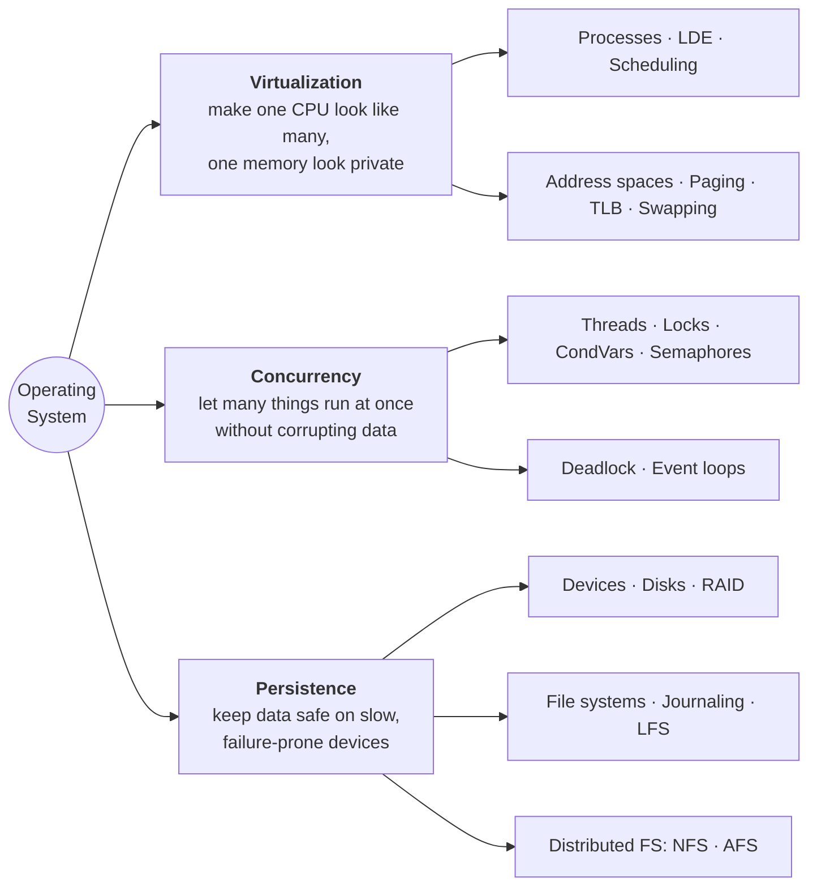

# OS Step by Step

**Learn 80% of *Operating Systems: Three Easy Pieces* (OSTEP) with about 20% of the effort.**

OSTEP is 50 chapters and ~650 pages. Most of what you'll use in an exam, an interview, or real systems work comes from about a third of it. This site gives you that third as **27 short lessons**, each built around the same shape, plus a recall system so it actually sticks.

!!! note "These are study notes, not the book"
    Everything here is written in our own words as a companion to OSTEP by Remzi H. Arpaci-Dusseau and Andrea C. Arpaci-Dusseau. The book is free to read at [ostep.org](https://pages.cs.wisc.edu/~remzi/OSTEP/) — read the chapters each lesson points you to. Page numbers refer to the printed page numbers of the 0.9x edition (the free PDF); newer editions shift slightly.

## The whole book in one picture

## How every lesson is built

| Section | What it gives you | Time |
|---|---|---|
| **TL;DR** | The 3 lines you must not forget | 1 min |
| **The crux** | The one question the chapter answers | 30 s |
| **The story chain** | Problem → naive fix → what breaks → better fix. OSTEP teaches this way; it's also the best memory hook | 3 min |
| **Core ideas + diagram** | The mechanism, in plain words | 10 min |
| **Worked example / numbers** | The calculation an exam will ask | 5 min |
| **Traps** | Where people lose marks | 2 min |
| **Recall** | Blurt test, flashcards, explain-it prompt | 10 min |
| **Read in the book** | Exactly which sections to read, skim or skip | — |

## Where to start

1. Read **[The 80/20 map](start/80-20-map.md)** — what to study deeply and what to skip.
2. Read **[The recall system](start/recall-system.md)** once. It's 5 minutes and doubles what you keep.
3. Follow the **[3-week plan](start/study-plan.md)**, one lesson a day.
4. Before an exam or interview, use the **[cheat sheet](review/cheat-sheet.md)** and **[mixed drills](review/drills.md)**.
