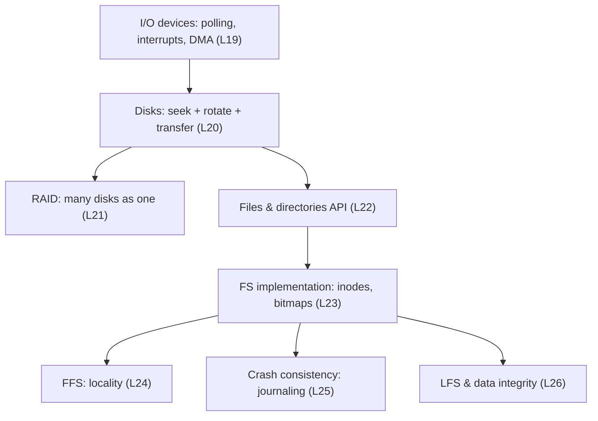

# Part III · Persistence

**The question:** how do we keep data safe and fast on slow devices that can fail or lose power at any moment?

Everything in this part follows from one number: **random disk I/O is ~100–300× slower than sequential.** FFS keeps related data close, LFS makes every write sequential, journaling turns scattered updates into one sequential log write.

**Lessons:** L19–L26. **Time:** ~7 hours.
