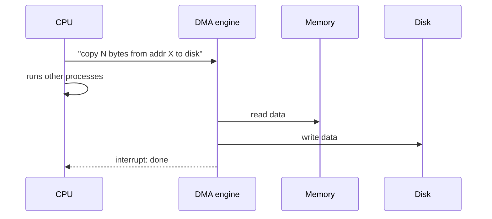

# L19 · I/O devices

> **Book:** Ch 36 (pp. 405–418) · **Tier:** 🔴 Must · **Time:** 30 min

## TL;DR

- A device exposes a simple **interface** (status, command, data registers) and hides its **internals** (its own CPU, memory, firmware).
- The OS talks to it by **polling** (spin on status) or **interrupts** (sleep until the device signals). Interrupts win for slow devices; polling wins for fast ones; **hybrid** does both. Use **DMA** so the CPU doesn't copy data byte by byte.
- Access via special **I/O instructions** or **memory-mapped I/O**. Hide device differences behind **device drivers** — which are ~70% of Linux kernel code and the main source of crashes.

## The crux

> How should I/O be integrated into systems, and how do we make it efficient and device-neutral?

## The story chain

**OS must drive a device** → *the canonical protocol: poll status, write data, write command, poll until done* → ❌ polling wastes CPU → *interrupts: issue the request, sleep, device raises an interrupt* → ❌ for fast devices, interrupt overhead beats polling; floods can cause **livelock** → *hybrid (poll briefly, then interrupt) and interrupt coalescing* → ❌ CPU still copies all data (**PIO**) → *DMA engine copies, interrupts when done* → ❌ every device is different → *abstraction layers: device drivers + a generic block layer*.

## Core ideas

### The canonical protocol

```
while (STATUS == BUSY) ;           // 1. wait until device is free (poll)
write data to DATA register        // 2. (PIO: CPU moves the data)
write command to COMMAND register  // 3. device starts
while (STATUS == BUSY) ;           // 4. wait until done (poll)
```

### Polling vs interrupts

| | Polling | Interrupts |
|---|---|---|
| CPU while waiting | Spins (wasted) | Runs other processes (overlap) |
| Best for | **Fast** devices (done on the first poll) | **Slow** devices |
| Risk | Wasted cycles | Context-switch overhead; **livelock** under floods (e.g. network packets) |
| Middle ground | **Hybrid**: poll a little, then sleep. **Coalescing**: device batches several interrupts |

### DMA



### Talking to devices

- **Explicit I/O instructions** (x86 `in`/`out`) — privileged.
- **Memory-mapped I/O** — device registers appear as memory addresses; ordinary loads/stores reach them.

### The file system stack

Application → POSIX API → **file system** → **generic block layer** → **device driver** → device. Downside: special device features get hidden behind the generic interface.

### A real example: IDE disk

Registers for control, command block (sector count, LBA, drive), status, and error. Driver: wait until ready → write parameters → write command (READ/WRITE) → transfer data → handle interrupt → check errors.

## Traps

- Interrupts aren't always better. For fast devices polling has less overhead.
- DMA removes CPU **data copying**, not CPU involvement entirely (it still sets it up and handles completion).
- Memory-mapped I/O is not "the device's memory is RAM" — it's addresses routed to device registers.

## Recall

**Blurt test:** the 4-step protocol; polling vs interrupts table; DMA sequence; the two ways to address a device.

<details markdown="1"><summary>What are the three registers of the canonical device interface?</summary>

Status, command, data.

</details>

<details markdown="1"><summary>When is polling better than interrupts?</summary>

When the device is fast, so the first poll usually finds it done; interrupt handling and context switching would cost more.

</details>

<details markdown="1"><summary>What is interrupt livelock?</summary>

A flood of interrupts (e.g. network packets) keeps the CPU busy handling interrupts so no real work gets done.

</details>

<details markdown="1"><summary>What does DMA do?</summary>

A DMA engine transfers data between memory and a device without the CPU copying it, then raises an interrupt when finished.

</details>

<details markdown="1"><summary>Two ways the OS can access device registers?</summary>

Privileged I/O instructions (in/out) or memory-mapped I/O.

</details>

<details markdown="1"><summary>Why are device drivers a reliability problem?</summary>

They make up most of the kernel's code (~70% of Linux), are often written by less experienced developers, and run in kernel mode.

</details>

**Explain it (60 s):** "Should a 10 Gbit network card use polling or interrupts? Defend your answer."

## Connects to

- Blocked state while waiting for I/O → [L02](../virtualization/l02-process.md)
- Interrupt-driven I/O enables overlap in scheduling → [L04](../virtualization/l04-scheduling.md)
- The disk behind the driver → [L20](l20-disks.md)

## Read in the book

- 🔴 36.1–36.6 (structure, interface, interrupts, DMA, access methods, drivers).
- 🟡 36.7 IDE example.
