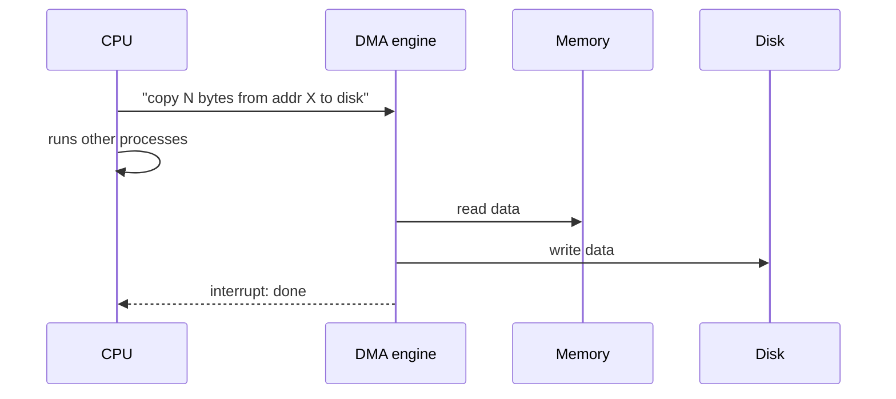

# L19 · I/O devices

> **Book:** Ch 36 (pp. 405–418) · **Priority:** 🔴 must-know · **Time:** 30 min

!!! example "In plain words"
    The CPU needs to talk to devices (disk, keyboard, network card). Each device has a few **registers**, like a mailbox with three slots: *status* ("am I busy?"), *command* ("do this") and *data*.

    How does the CPU know a device has finished?

    - **Polling:** keep asking "done yet? done yet?" Fine if the answer comes almost immediately.
    - **Interrupts:** go do other work, and the device rings a bell (interrupt) when it's finished. Better for slow devices.
    - **DMA:** hire a helper to carry the data between memory and the device, so the CPU doesn't have to copy it byte by byte.

## TL;DR (the 3 things to remember)

- A device exposes a simple **interface** (status, command, data registers) and hides its **internals** (its own CPU, memory, firmware).
- The OS talks to it by **polling** (spin on status) or **interrupts** (sleep until the device signals). Interrupts win for slow devices; polling wins for fast ones; **hybrid** does both. Use **DMA** so the CPU doesn't copy data byte by byte.
- Access via special **I/O instructions** or **memory-mapped I/O**. Hide device differences behind **device drivers** — which are ~70% of Linux kernel code and the main source of crashes.

## The big question

> How should I/O be integrated into systems, and how do we make it efficient and device-neutral?

## The story chain

<small>Key: **bold** = the problem or the final design · *italics* = an attempted fix · ❌ = what goes wrong with it · → = "which leads to"</small>

**OS must drive a device** → *the canonical protocol: poll status, write data, write command, poll until done* → ❌ polling wastes CPU → *interrupts: issue the request, sleep, device raises an interrupt* → ❌ for fast devices, interrupt overhead beats polling; floods can cause **livelock** → *hybrid (poll briefly, then interrupt) and interrupt coalescing* → ❌ CPU still copies all data (**PIO**) → *DMA engine copies, interrupts when done* → ❌ every device is different → *abstraction layers: device drivers + a generic block layer*.

## Core ideas

### The canonical protocol

A simple device shows the OS three **registers** (slots the OS can read and write): **status** (busy or ready?), **command** (what to do), and **data** (what to send or receive). Talking to it always follows the same four steps:

```
while (STATUS == BUSY) ;           // 1. wait until device is free (poll)
write data to DATA register        // 2. CPU copies the data in itself (called PIO, programmed I/O)
write command to COMMAND register  // 3. device starts
while (STATUS == BUSY) ;           // 4. wait until done (poll)
```

Steps 1 and 4 are **polling**: asking "are you done?" over and over. The CPU does nothing useful while it asks.

### Polling vs interrupts

With **interrupts**, the OS sends the command, puts the waiting process to sleep, runs other processes, and the device raises an interrupt when it's finished. The OS then wakes the process.

| | Polling | Interrupts |
|---|---|---|
| CPU while waiting | Keeps asking (wasted) | Runs other processes meanwhile |
| Best for | **Fast** devices — the answer is ready on the first ask | **Slow** devices (e.g. hard disks) |
| Risk | Wasted CPU time | Each interrupt costs a context switch. A flood of them (e.g. millions of network packets) can keep the CPU so busy handling interrupts that no real work gets done (**livelock**) |
| Middle ground | **Hybrid**: poll for a moment, then switch to interrupts. **Coalescing**: the device waits a little and sends one interrupt for several finished requests |

### DMA



### Talking to devices

How does the CPU actually reach a device's registers? Two designs:

- **Special I/O instructions** (e.g. `in` and `out` on x86). Only the OS may use them.
- **Memory-mapped I/O:** the device's registers are given ordinary-looking memory addresses. Writing to "address X" actually goes to the device instead of RAM.

### The file system stack

There are thousands of different devices, and the OS can't be rewritten for each one. So it uses **layers**: your program calls `read()` → the **file system** works out which disk blocks are needed → a **generic block layer** sends "read block N" in a standard form → a **device driver**, written for that specific hardware, turns it into the device's own commands. Only the driver knows the device's details.

The downside: if a device has a special feature, the generic layers may have no way to use it. Fun fact from the book: device drivers make up about 70% of Linux's code, and cause most kernel crashes.

### A real example: IDE disk

An old IDE hard disk has registers for control, a command block (how many sectors, which sector number — the **LBA**, logical block address — and which drive), status and errors. Its driver follows the canonical protocol: wait until ready → write the parameters → write the command (READ or WRITE) → move the data → handle the "done" interrupt → check for errors.

## Common mistakes

- Interrupts aren't always better. For fast devices polling has less overhead.
- DMA removes CPU **data copying**, not CPU involvement entirely (it still sets it up and handles completion).
- Memory-mapped I/O is not "the device's memory is RAM" — it's addresses routed to device registers.

## Recall

**Blurt test** — close this page, then on paper, from memory: the 4-step protocol; polling vs interrupts table; DMA sequence; the two ways to address a device.

<details markdown="1"><summary>What are the three registers of the canonical device interface?</summary>

Status, command, data.

</details>

<details markdown="1"><summary>When is polling better than interrupts?</summary>

When the device is fast, so the first poll usually finds it done; interrupt handling and context switching would cost more.

</details>

<details markdown="1"><summary>What is interrupt livelock?</summary>

A flood of interrupts (e.g. network packets) keeps the CPU busy handling interrupts so no real work gets done.

</details>

<details markdown="1"><summary>What does DMA do?</summary>

A DMA engine transfers data between memory and a device without the CPU copying it, then raises an interrupt when finished.

</details>

<details markdown="1"><summary>Two ways the OS can access device registers?</summary>

Privileged I/O instructions (in/out) or memory-mapped I/O.

</details>

<details markdown="1"><summary>Why are device drivers a reliability problem?</summary>

They make up most of the kernel's code (~70% of Linux), are often written by less experienced developers, and run in kernel mode.

</details>

**Explain it out loud (60 seconds, as if to a friend):** "Should a 10 Gbit network card use polling or interrupts? Defend your answer."

## Connects to

- Blocked state while waiting for I/O → [L02](../virtualization/l02-process.md)
- Interrupt-driven I/O enables overlap in scheduling → [L04](../virtualization/l04-scheduling.md)
- The disk behind the driver → [L20](l20-disks.md)

## Read in the book

- 🔴 36.1–36.6 (structure, interface, interrupts, DMA, access methods, drivers).
- 🟡 36.7 IDE example.
