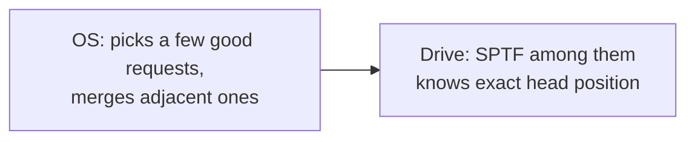

# L20 · Hard disks (and SSDs in brief)

> **Book:** Ch 37 (pp. 419–436) 🔴 · Appendix: Flash-based SSDs 🟡 · **Time:** 50 min · **Simulators:** `file-disks/disk.py`, `file-ssd/ssd.py`

!!! example "In plain words"
    A hard disk is like a **record player**: spinning platters, and an arm that moves a head over the right ring (track). Reading one random block means:

    1. **Seek:** move the arm to the right ring, a few milliseconds.
    2. **Rotate:** wait for the right spot to spin under the head, a few milliseconds.
    3. **Transfer:** read it, almost instant.

    Because of the first two, **reading scattered pieces is 100–300× slower than reading one long continuous run**. That single fact shapes every file system design in Part III.

    SSDs have no moving parts, but they have their own quirks: they must erase in big chunks, and they wear out.

## TL;DR (the 3 things to remember)

- A disk is an array of 512-byte **sectors**. Only a single-sector write is **atomic** (torn writes are possible for bigger ones).
- **TI/O = Tseek + Trotation + Ttransfer.** Random I/O is dominated by seek and rotation, so **sequential is 100–300× faster than random**.
- The OS/disk **schedules** requests: **SSTF** (nearest track first) → starvation → **elevator/SCAN, C-SCAN** → modern **SPTF** (account for rotation too, done inside the drive). SSDs have no moving parts, but erase-before-write and wear-out force an **FTL** with log-structured writes.

## The big question

> How do modern hard drives store data, what's the interface, and how should we schedule requests to them?

## The story chain

<small>Key: **bold** = the problem or the final design · *italics* = an attempted fix · ❌ = what goes wrong with it · → = "which leads to"</small>

**Spinning platters, one arm** → *cost of an I/O = seek + rotate + transfer* → ❌ random small I/Os are terribly slow → **always transfer sequentially if you can** → *schedule queued requests: SJF for disks = SSTF* → ❌ starvation of far tracks; and "nearest track" ignores rotation → *elevator (SCAN / C-SCAN)* → ❌ still ignores rotation → **SPTF**: shortest positioning time first, done inside the drive which knows its geometry. *Also merge adjacent requests; maybe wait briefly for a better request (anticipatory scheduling).*

## Core ideas

### Geometry & vocabulary

To the OS, a disk is simply a numbered list of 512-byte **sectors** (0, 1, 2, …), and it can read or write any of them. Inside, it's mechanical:

- **Platters:** spinning metal discs, coated on both sides (**surfaces**). They turn at a fixed speed, measured in **RPM** (rotations per minute), typically 7,200–15,000.
- **Tracks:** data sits in rings around each surface, like the grooves of a record.
- **Head and arm:** one read/write head per surface, on an arm that swings in and out to reach different tracks.
- Every access pays three costs:
    1. **Seek:** swing the arm to the right track (it speeds up, coasts, slows down, then settles precisely).
    2. **Rotational delay:** wait for the right sector to spin round under the head.
    3. **Transfer:** actually read or write the data as it passes under the head.
- Small details: **track skew** offsets where each track starts, so a long read crossing to the next track doesn't just miss the next sector while the arm moves. Outer tracks are longer, so they hold more sectors.
- **Disk cache (track buffer):** a few MB of memory inside the drive. In **write-back** mode the drive says "done" as soon as data reaches this cache, which is fast but lost if the power fails. In **write-through** mode it says "done" only once the data is on the platter.

### The math

- **Time for one I/O:** TI/O = Tseek + Trotation + Ttransfer
- **Rate** (how many MB per second you actually get): RI/O = size of the request ÷ TI/O
- **Average seek** is about **⅓** of the time to swing all the way across the disk.
- **Average rotational delay** is **half** a rotation (sometimes the sector is just arriving, sometimes it just left). At 15,000 RPM: a minute is 60,000 ms, so one rotation takes 60,000 ÷ 15,000 = **4 ms**, and the average wait is **2 ms**.

### The classic comparison (memorise the shape)

| | Cheetah 15K.5 (performance) | Barracuda (capacity) |
|---|---|---|
| RPM / avg seek | 15,000 / 4 ms | 7,200 / 9 ms |
| Max transfer | 125 MB/s | 105 MB/s |
| Random 4 KB TI/O | ≈ 4 + 2 + 0.03 = **~6 ms** | **~13.2 ms** |
| **Random rate** | **0.66 MB/s** | **0.31 MB/s** |
| **Sequential rate** | **125 MB/s** | **105 MB/s** |

How to read this table: for **random** small reads, almost all the time goes on seek + rotation (~6 ms), and only 0.03 ms on actually reading 4 KB. So you get a miserable 0.66 MB/s. For one big **sequential** read, you pay seek and rotation once and then stream at full speed: 125 MB/s.

→ Sequential is **~200× faster** (Cheetah) and **over 300× faster** (Barracuda) than random. This is the most important number in Part III.

### Disk scheduling

When many requests are waiting, the order you serve them in makes a huge difference (the same idea as CPU scheduling in [L04](../virtualization/l04-scheduling.md)).

| Algorithm | Picks next | Problem |
|---|---|---|
| **SSTF** (shortest seek time first) | The request on the **nearest track** | Requests far away can wait forever (**starvation**). Also, the OS doesn't really know the disk's layout, so it approximates "nearest" by "closest block number" |
| **SCAN** (the **elevator**) | Sweep across the disk in one direction serving requests on the way, then sweep back — like a lift | Tracks in the middle get visited twice as often as the edges |
| **C-SCAN** (circular SCAN) | Sweep in one direction only, then jump back to the start | Fairer to inner and outer tracks |
| **SPTF** (shortest positioning time first) | The request with the least **seek + rotation** in total | Needs exact knowledge of where the head is, so it's done **inside the drive**, not by the OS |

### SSDs in one paragraph (appendix)

An SSD stores data in **flash memory** chips, with no moving parts, so there's no seek or rotation, and random reads are fast. But flash has two awkward rules:

1. You can write a small **page** (a few KB) only if it's blank, and you can only blank things in big **blocks** (hundreds of KB) at a time. You can't simply overwrite a page in place.
2. Each block **wears out** after a few thousand erases.

So every SSD contains a small translation layer (the **FTL**, flash translation layer). When you "overwrite" block 7, the FTL actually writes the new data to a fresh blank page and updates its map: "block 7 now lives here". Old copies are cleaned up later in the background (**garbage collection**), and erases are spread evenly so no block wears out early (**wear levelling**). The costs: the extra copying during cleanup (**write amplification**) and the memory needed for the map. You'll see the same "never overwrite, write somewhere fresh" idea in LFS ([L26](l26-lfs-integrity.md)).

## Common mistakes

- Average rotational delay is **half** a rotation, not a full one.
- Transfer time for small random I/O is negligible — the cost is positioning.
- SSTF is SJF for disks: same starvation issue.
- Only single-sector writes are atomic → **torn writes** matter for crash consistency ([L25](l25-journaling.md)).

## Worked example (do it)

7,200 RPM disk, 9 ms average seek, 100 MB/s transfer. Random 4 KB read:

- Rotation: 60,000/7,200 ≈ 8.3 ms per rotation → **4.17 ms** average.
- Transfer: 4 KB / 100 MB/s ≈ **0.04 ms**.
- TI/O ≈ 9 + 4.17 + 0.04 ≈ **13.2 ms** → R ≈ 4 KB / 13.2 ms ≈ **0.3 MB/s**.

## Recall

**Blurt test** — close this page, then on paper, from memory: the three-term formula; compute the 7,200 RPM example; the scheduling table; SSD in three facts.

What's the disk I/O time formula?

T_I/O = T_seek + T_rotation + T_transfer.

Average rotational delay at 15,000 RPM?

One rotation = 4 ms, so average = 2 ms (half a rotation).

Roughly how much faster is sequential than random I/O on a hard disk?

About 200–300×, e.g. 125 MB/s vs 0.66 MB/s.

What's the problem with SSTF?

Starvation of requests on far tracks; it also ignores rotational delay.

What does SPTF do differently, and where is it implemented?

Picks the request with the least seek + rotation time; implemented inside the drive, which knows the head position and geometry.

What write is guaranteed atomic on a disk?

A single 512-byte sector write.

Why do SSDs need a flash translation layer?

Flash must erase whole blocks before reprogramming pages and blocks wear out, so the FTL remaps writes log-style to fresh pages, garbage-collects and wear-levels.

**Explain it out loud (60 seconds, as if to a friend):** "Why do database and file system designers care so much about sequential I/O?"

**Simulator drill** (book's free Python homework tools — see [the recall system](../start/recall-system.md#four-more-tricks-that-pay-off)): `python3 disk.py -a 0,6,30,7 -c` then `-p SSTF` and `-p SATF`; try `-G` for graphics (needs Python with tkinter).

## Connects to

- RAID builds on disks → [L21](l21-raid.md)
- FFS and LFS are designed around these numbers → [L24](l24-ffs.md), [L26](l26-lfs-integrity.md)
- Disk time in AMAT → [L12 Swapping](../virtualization/l12-swapping.md)

## Read in the book

- 🔴 37.1–37.4 (interface, geometry, I/O time with the Cheetah/Barracuda example).
- 🔴 37.5 (scheduling) — SSTF, elevator, SPTF.
- 🟡 SSD appendix: raw flash operations, FTL, garbage collection, wear levelling.
