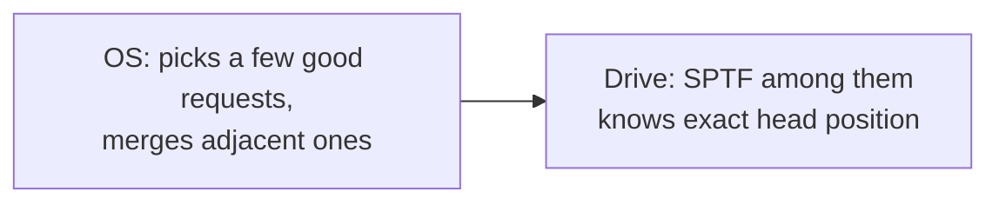

# L20 · Hard disks (and SSDs in brief)

> **Book:** Ch 37 (pp. 419–436) 🔴 · Appendix: Flash-based SSDs 🟡 · **Time:** 50 min · **Simulators:** `file-disks/disk.py`, `file-ssd/ssd.py`

## TL;DR

- A disk is an array of 512-byte **sectors**. Only a single-sector write is **atomic** (torn writes are possible for bigger ones).
- **TI/O = Tseek + Trotation + Ttransfer.** Random I/O is dominated by seek and rotation, so **sequential is 100–300× faster than random**.
- The OS/disk **schedules** requests: **SSTF** (nearest track first) → starvation → **elevator/SCAN, C-SCAN** → modern **SPTF** (account for rotation too, done inside the drive). SSDs have no moving parts, but erase-before-write and wear-out force an **FTL** with log-structured writes.

## The crux

> How do modern hard drives store data, what's the interface, and how should we schedule requests to them?

## The story chain

**Spinning platters, one arm** → *cost of an I/O = seek + rotate + transfer* → ❌ random small I/Os are terribly slow → **always transfer sequentially if you can** → *schedule queued requests: SJF for disks = SSTF* → ❌ starvation of far tracks; and "nearest track" ignores rotation → *elevator (SCAN / C-SCAN)* → ❌ still ignores rotation → **SPTF**: shortest positioning time first, done inside the drive which knows its geometry. *Also merge adjacent requests; maybe wait briefly for a better request (anticipatory scheduling).*

## Core ideas

### Geometry & vocabulary

- **Platter** (two **surfaces**), spinning on a **spindle** at a fixed **RPM** (7,200–15,000).
- Data in concentric **tracks**; a **disk head** per surface on a **disk arm**.
- **Seek**: move the arm to the right track (accelerate → coast → decelerate → **settle**). **Rotational delay**: wait for the sector to come under the head. **Transfer**: read/write.
- **Track skew** so sequential reads across track boundaries don't miss the next sector. **Multi-zoned**: outer tracks hold more sectors.
- **Track buffer (cache)**: 8–16 MB. **Write-back** caching (ack when in cache — fast, risky) vs **write-through** (ack when on disk).

### The math

- **TI/O = Tseek + Trotation + Ttransfer**, **RI/O = Size / TI/O**
- Average seek ≈ **1/3** of full seek.
- Average rotation = **half** a rotation. At 15,000 RPM: 60,000 ms / 15,000 = 4 ms per rotation → **2 ms** average.

### The classic comparison (memorise the shape)

| | Cheetah 15K.5 (performance) | Barracuda (capacity) |
|---|---|---|
| RPM / avg seek | 15,000 / 4 ms | 7,200 / 9 ms |
| Max transfer | 125 MB/s | 105 MB/s |
| Random 4 KB TI/O | ≈ 4 + 2 + 0.03 = **~6 ms** | **~13.2 ms** |
| **Random rate** | **0.66 MB/s** | **0.31 MB/s** |
| **Sequential rate** | **125 MB/s** | **105 MB/s** |

→ ~200× (Cheetah) and >300× (Barracuda) between sequential and random.

### Disk scheduling

| Algorithm | Picks | Problem |
|---|---|---|
| **SSTF** | Nearest track | Starvation; OS doesn't know geometry (use nearest block, NBF) |
| **SCAN (elevator)** | Sweep in one direction, then back | Middle tracks favoured |
| **C-SCAN** | Sweep one way only, then jump back | Fairer |
| **SPTF** | Shortest seek **+ rotation** | Needs geometry → implemented in the drive |

### SSDs in one paragraph (appendix)

Flash is read/programmed in **pages** (KBs) but erased only in **blocks** (hundreds of KB). Blocks **wear out** after thousands of erase cycles. A **flash translation layer (FTL)** maps logical → physical pages and writes **log-structured** (always to a fresh page), then **garbage-collects** old pages; **wear levelling** spreads erases. Random and sequential perform much closer than on disks, and there's no seek. Write amplification and mapping-table size are the costs.

## Traps

- Average rotational delay is **half** a rotation, not a full one.
- Transfer time for small random I/O is negligible — the cost is positioning.
- SSTF is SJF for disks: same starvation issue.
- Only single-sector writes are atomic → **torn writes** matter for crash consistency ([L25](l25-journaling.md)).

## Worked example (do it)

7,200 RPM disk, 9 ms average seek, 100 MB/s transfer. Random 4 KB read:

- Rotation: 60,000/7,200 ≈ 8.3 ms per rotation → **4.17 ms** average.
- Transfer: 4 KB / 100 MB/s ≈ **0.04 ms**.
- TI/O ≈ 9 + 4.17 + 0.04 ≈ **13.2 ms** → R ≈ 4 KB / 13.2 ms ≈ **0.3 MB/s**.

## Recall

**Blurt test:** the three-term formula; compute the 7,200 RPM example; the scheduling table; SSD in three facts.

What's the disk I/O time formula?

T_I/O = T_seek + T_rotation + T_transfer.

Average rotational delay at 15,000 RPM?

One rotation = 4 ms, so average = 2 ms (half a rotation).

Roughly how much faster is sequential than random I/O on a hard disk?

About 200–300×, e.g. 125 MB/s vs 0.66 MB/s.

What's the problem with SSTF?

Starvation of requests on far tracks; it also ignores rotational delay.

What does SPTF do differently, and where is it implemented?

Picks the request with the least seek + rotation time; implemented inside the drive, which knows the head position and geometry.

What write is guaranteed atomic on a disk?

A single 512-byte sector write.

Why do SSDs need a flash translation layer?

Flash must erase whole blocks before reprogramming pages and blocks wear out, so the FTL remaps writes log-style to fresh pages, garbage-collects and wear-levels.

**Explain it (60 s):** "Why do database and file system designers care so much about sequential I/O?"

**Simulator drill:** `python3 disk.py -a 0,6,30,7 -c` then `-p SSTF` and `-p SATF`; try `-G` for graphics (needs Python with tkinter).

## Connects to

- RAID builds on disks → [L21](l21-raid.md)
- FFS and LFS are designed around these numbers → [L24](l24-ffs.md), [L26](l26-lfs-integrity.md)
- Disk time in AMAT → [L12 Swapping](../virtualization/l12-swapping.md)

## Read in the book

- 🔴 37.1–37.4 (interface, geometry, I/O time with the Cheetah/Barracuda example).
- 🔴 37.5 (scheduling) — SSTF, elevator, SPTF.
- 🟡 SSD appendix: raw flash operations, FTL, garbage collection, wear levelling.
