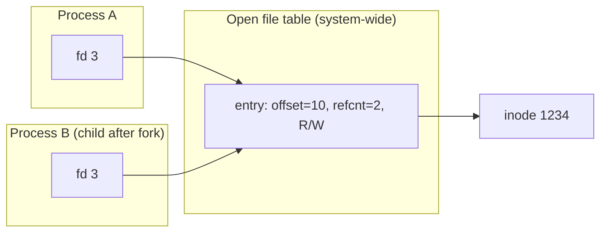

# L22 · Files & directories (the API)

> **Book:** Ch 39 (pp. 457–476) · **Priority:** 🔴 must-know · **Time:** 40 min

!!! example "In plain words"
    Under the hood, a **file** is a numbered box of bytes. The number is the **inode number**. A **directory** is a list matching friendly names to those numbers, like a phone's contacts mapping "Mum" to a number.

    - `open` gives you a **file descriptor**, a ticket for "this open file". Keep it for reading and writing.
    - `write` usually only reaches memory at first. `fsync` means "really put it on the disk now".
    - A name is just a **link** to the box, and a box can have several names. Deleting a name (`unlink`) removes the box only when no names, and no open tickets, are left.

## TL;DR (the 3 things to remember)

- A **file** is a linear array of bytes with a low-level name, the **inode number**. A **directory** is a file that maps human names → inode numbers.
- `open()` returns a **file descriptor** (a per-process handle); each open has its own **offset** in the system-wide **open file table**. `write()` usually goes to memory first — **`fsync()`** forces it to disk.
- A name is just a **link** to an inode. `link()` adds a hard link (refcount++), `unlink()` removes one; the file is deleted when the count hits 0. **Symbolic links** are files holding a path — they can dangle.

## The big question

> How should the OS manage a persistent device? What should the API look like, and what are its important aspects?

## The story chain

<small>Key: **bold** = the problem or the final design · *italics* = an attempted fix · ❌ = what goes wrong with it · → = "which leads to"</small>

**Need named, persistent data** → *files (bytes + inode number) and directories (name → inode)* → *open → fd → read/write with a current offset* → *`lseek` to move the offset* → ❌ `write` returns before the data is on disk → *`fsync()`* (and fsync the directory for a new file) → ❌ how to update a file atomically? → *write a temp file, fsync, `rename()` over the old one* (rename is atomic) → *names are links; deleting = `unlink`* → ❌ hard links can't cross file systems or point to directories → *symbolic links*.

## Core ideas

### File descriptors and offsets

When a program opens a file, three layers are involved. The program gets a small number (the **file descriptor**, e.g. 3). That number points to an entry in the OS's **open file table**, which remembers *how far through the file you are* (the **offset**). That entry points to the file's **inode**, which holds its size and where its data is on disk.



- Each `open()` creates a **new** entry with its own offset, even for the same file. Open a file twice and you can read the start and the end independently.
- After `fork()` (or `dup()`), the parent's and child's descriptors point to the **same** entry, so they **share one offset**. If the child reads 10 bytes, the parent's next read starts 10 bytes further on. (The entry keeps a count of how many descriptors use it, so it's freed only when the last one closes.)
- The offset moves forward as you read or write, or you can set it directly with `lseek()`. Despite the name, `lseek` only changes a number in memory; the disk arm doesn't move.

### Key calls

| Call | Does |
|---|---|
| `open(path, flags, mode)` | Opens (or creates) a file and returns a file descriptor. Flags say how: `O_CREAT` = create if missing, `O_WRONLY` = write only, `O_TRUNC` = empty it first |
| `read(fd, buf, n)` / `write(fd, buf, n)` | Read or write up to n bytes at the current offset, then move the offset forward |
| `lseek(fd, off, whence)` | Jump to a position in the file |
| `fsync(fd)` | "Put everything I've written on the disk **now**, and only return when it's there" |
| `rename(old, new)` | Rename a file. It happens all at once (**atomically**), even across a crash: you see either the old name or the new one, never a broken half |
| `stat(path)` / `fstat(fd)` | Get a file's details: size, owner, permissions, times, number of links |
| `mkdir`, `opendir`, `readdir`, `rmdir` | Make, list and remove directories (`rmdir` only works on an empty one) |
| `link(old, new)` / `unlink(path)` | Add or remove a **name** for a file |
| `symlink` (shell: `ln -s`) | Create a symbolic link (shortcut) |
| `mount` | Attach another file system (e.g. a USB stick) at a folder in the tree |

### Hard vs symbolic links

| | Hard link | Symbolic link |
|---|---|---|
| What it is | A second name for the **very same file** (same inode) | A small separate file that just contains a **path**, like a Windows shortcut |
| Delete the original name | The file survives, since it still has another name | The link now points at nothing (**dangling** link) |
| Can point to another disk/partition | ✘ | ✔ |
| Can point to a directory | ✘ (could create loops in the tree) | ✔ |

### Permissions

In `ls -l`, you see strings like `-rwxr-x---`. After the first character (the file type), it's three groups of three: what the **owner**, the **group** and **everyone else** may do. `r` = read, `w` = write, `x` = execute (run it, or, for a directory, enter it). So `rwxr-x---` means: owner can do everything, group can read and run, others can do nothing. More detailed per-user rules are called **ACLs** (access control lists).

**A classic security bug (TOCTTOU, "time of check to time of use"):** a program checks a file is safe (`stat`) and then opens it. In the gap between the two, an attacker swaps the file for something else.

### Atomic file update recipe

```c
fd = open("foo.txt.tmp", O_WRONLY|O_CREAT|O_TRUNC, 0644);
write(fd, buf, size);
fsync(fd);
close(fd);
rename("foo.txt.tmp", "foo.txt");    // atomic swap
```

Why this works: you never touch the real `foo.txt` until the very end. You write the new version to a temporary file, make sure it's really on disk (`fsync`), then `rename` swaps it into place in one step. If the power fails at any point, `foo.txt` is either the complete old version or the complete new one, never half-written. Text editors save files this way.

## Common mistakes

- `write()` returning doesn't mean the data is on disk.
- `lseek()` doesn't cause disk I/O.
- `rm` calls `unlink()` — it only removes a name; the inode goes when refcount (and open fds) reach 0.
- Two opens of one file = two offsets; fork/dup = one shared offset.

## Recall

**Blurt test** — close this page, then on paper, from memory: the fd → open file table → inode picture; hard vs soft link table; the atomic-update recipe.

<details markdown="1"><summary>What is an inode number?</summary>

The file's low-level name; the file system uses it to find the inode (metadata and block pointers).

</details>

<details markdown="1"><summary>What does a directory contain?</summary>

A list of (name, inode number) pairs, including "." and "..".

</details>

<details markdown="1"><summary>When do two file descriptors share an offset?</summary>

When they refer to the same open-file-table entry: after fork() or dup(). Separate open() calls get separate offsets.

</details>

<details markdown="1"><summary>Why call fsync()?</summary>

write() buffers data in memory; fsync forces it (and metadata) to persistent storage.

</details>

<details markdown="1"><summary>How do you update a file atomically?</summary>

Write a temporary file, fsync it, then rename() it over the original; rename is atomic.

</details>

<details markdown="1"><summary>Hard link vs symbolic link?</summary>

Hard link: another name for the same inode (refcount). Symlink: a file containing a path; can cross file systems and point to directories, but can dangle.

</details>

<details markdown="1"><summary>Why is the call to remove a file named unlink()?</summary>

It removes one name (link) to the inode; the file is freed only when the link count drops to zero.

</details>

**Explain it out loud (60 seconds, as if to a friend):** "What happens, step by step, when you run `rm file` while another process still has the file open?"

**Hands-on:** `strace cat foo.txt` and `ln foo bar; ls -i foo bar; stat foo` — see the calls and the shared inode.

## Connects to

- What's on disk behind these calls → [L23 VSFS](l23-vsfs.md)
- Making the updates crash-safe → [L25](l25-journaling.md)
- fds after fork → [L02](../virtualization/l02-process.md)

## Read in the book

- 🔴 39.1–39.17 are short sections — read 39.3–39.7 (open/read/write/lseek/fsync), 39.9 (rename), 39.14–39.15 (hard links, symbolic links).
- 🟡 Directory calls, permissions, mount.
