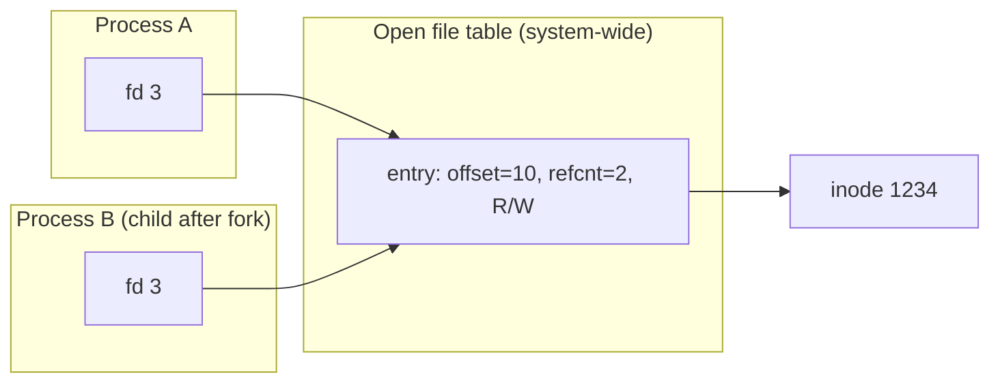

# L22 · Files & directories (the API)

> **Book:** Ch 39 (pp. 457–476) · **Tier:** 🔴 Must · **Time:** 40 min

## TL;DR

- A **file** is a linear array of bytes with a low-level name, the **inode number**. A **directory** is a file that maps human names → inode numbers.
- `open()` returns a **file descriptor** (a per-process handle); each open has its own **offset** in the system-wide **open file table**. `write()` usually goes to memory first — **`fsync()`** forces it to disk.
- A name is just a **link** to an inode. `link()` adds a hard link (refcount++), `unlink()` removes one; the file is deleted when the count hits 0. **Symbolic links** are files holding a path — they can dangle.

## The crux

> How should the OS manage a persistent device? What should the API look like, and what are its important aspects?

## The story chain

**Need named, persistent data** → *files (bytes + inode number) and directories (name → inode)* → *open → fd → read/write with a current offset* → *`lseek` to move the offset* → ❌ `write` returns before the data is on disk → *`fsync()`* (and fsync the directory for a new file) → ❌ how to update a file atomically? → *write a temp file, fsync, `rename()` over the old one* (rename is atomic) → *names are links; deleting = `unlink`* → ❌ hard links can't cross file systems or point to directories → *symbolic links*.

## Core ideas

### File descriptors and offsets



- Each `open()` creates a **new** open-file-table entry with its own offset, even for the same file.
- `fork()` and `dup()` make two fds **share** one entry → they share the offset (refcount on the entry).
- Offset changes by reads/writes or explicitly with `lseek()` (which does **not** move the disk head).

### Key calls

| Call | Does |
|---|---|
| `open(path, flags, mode)` | Returns fd (`O_CREAT`, `O_WRONLY`, `O_TRUNC`…) |
| `read / write(fd, buf, n)` | Move bytes; advance offset |
| `lseek(fd, off, whence)` | Set offset |
| `fsync(fd)` | Force dirty data to disk |
| `rename(old, new)` | **Atomic** replace |
| `stat / fstat` | Metadata from the inode (size, owner, perms, times, link count) |
| `mkdir / opendir / readdir / rmdir` | Directories (`rmdir` only if empty) |
| `link(old, new)` / `unlink(path)` | Add / remove a name for an inode |
| `symlink` (`ln -s`) | Create a soft link |
| `mount` | Graft a file system onto the directory tree |

### Hard vs symbolic links

| | Hard link | Symbolic link |
|---|---|---|
| What it is | Another directory entry → **same inode** | A small file whose content is a **path** |
| Delete original | Data survives (refcount > 0) | Link **dangles** |
| Across file systems | ✘ | ✔ |
| To directories | ✘ (cycles) | ✔ |

### Permissions

`-rwxr-x---` = owner / group / others. Directories: `x` lets you `cd` into it. Advanced: **ACLs**. **TOCTTOU** bug: check-then-use race between `stat()` and `open()`.

### Atomic file update recipe

```c
fd = open("foo.txt.tmp", O_WRONLY|O_CREAT|O_TRUNC, 0644);
write(fd, buf, size);
fsync(fd);
close(fd);
rename("foo.txt.tmp", "foo.txt");    // atomic swap
```

## Traps

- `write()` returning doesn't mean the data is on disk.
- `lseek()` doesn't cause disk I/O.
- `rm` calls `unlink()` — it only removes a name; the inode goes when refcount (and open fds) reach 0.
- Two opens of one file = two offsets; fork/dup = one shared offset.

## Recall

**Blurt test:** the fd → open file table → inode picture; hard vs soft link table; the atomic-update recipe.

<details markdown="1"><summary>What is an inode number?</summary>

The file's low-level name; the file system uses it to find the inode (metadata and block pointers).

</details>

<details markdown="1"><summary>What does a directory contain?</summary>

A list of (name, inode number) pairs, including "." and "..".

</details>

<details markdown="1"><summary>When do two file descriptors share an offset?</summary>

When they refer to the same open-file-table entry: after fork() or dup(). Separate open() calls get separate offsets.

</details>

<details markdown="1"><summary>Why call fsync()?</summary>

write() buffers data in memory; fsync forces it (and metadata) to persistent storage.

</details>

<details markdown="1"><summary>How do you update a file atomically?</summary>

Write a temporary file, fsync it, then rename() it over the original; rename is atomic.

</details>

<details markdown="1"><summary>Hard link vs symbolic link?</summary>

Hard link: another name for the same inode (refcount). Symlink: a file containing a path; can cross file systems and point to directories, but can dangle.

</details>

<details markdown="1"><summary>Why is the call to remove a file named unlink()?</summary>

It removes one name (link) to the inode; the file is freed only when the link count drops to zero.

</details>

**Explain it (60 s):** "What happens, step by step, when you run `rm file` while another process still has the file open?"

**Hands-on:** `strace cat foo.txt` and `ln foo bar; ls -i foo bar; stat foo` — see the calls and the shared inode.

## Connects to

- What's on disk behind these calls → [L23 VSFS](l23-vsfs.md)
- Making the updates crash-safe → [L25](l25-journaling.md)
- fds after fork → [L02](../virtualization/l02-process.md)

## Read in the book

- 🔴 39.1–39.17 are short sections — read 39.3–39.7 (open/read/write/lseek/fsync), 39.9 (rename), 39.14–39.15 (hard links, symbolic links).
- 🟡 Directory calls, permissions, mount.
