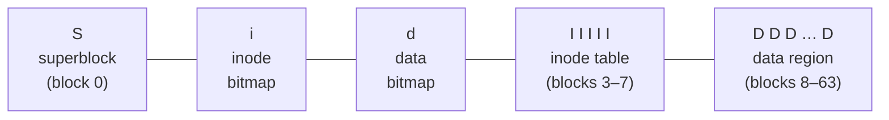

# L23 · File system implementation (VSFS)

> **Book:** Ch 40 (pp. 477–493) · **Tier:** 🔴 Must · **Time:** 55 min · **Simulator:** `file-implementation/vsfs.py`

## TL;DR

- A simple file system divides the disk into **blocks** (4 KB): **superblock** · **inode bitmap** · **data bitmap** · **inode table** · **data region**.
- An **inode** holds metadata and pointers to data: **direct pointers**, then **indirect** (and double/triple indirect) blocks — a tree tuned for "most files are small".
- Opening `/foo/bar` reads the root inode, root data, foo's inode, foo's data, bar's inode — one hop per path component. **Caching** (page cache) hides reads; **write buffering** batches writes.

## The crux

> How can we build a simple file system? What structures are needed on disk, and what do they track?

## The story chain

**Need to store files on a block device** → *data region + inode table* → *track what's free: bitmaps* → *superblock describes the layout* → *inode needs to point to blocks* → *a few direct pointers* → ❌ big files → *indirect blocks (then double/triple)* → *directories are files of (name, inum)* → ❌ every open/read/write costs several I/Os → *cache blocks in memory (unified page cache)* + *delay and batch writes (5–30 s)* → ❌ batching risks data loss on crash → fsync, and crash consistency ([L25](l25-journaling.md)).

## Core ideas

### On-disk layout (64 blocks example)



- 4 KB blocks, 256-byte inodes → 16 inodes per block → 5 blocks = **80 inodes** max.
- Superblock: number of inodes and data blocks, where the inode table starts, a **magic number**.

### Finding inode number i

```
block  = (i * sizeof(inode)) / blockSize
sector = ((block * blockSize) + inodeStartAddr) / sectorSize
```
Example: inode 32, table starts at 12 KB → offset 32 × 256 = 8 KB → byte address **20 KB** → sector 40.

### The multi-level index

- 12 **direct** pointers × 4 KB = 48 KB.
- One **single indirect** block: 4 KB / 4 B = **1024 pointers** → +4 MB.
- **Double indirect**: 1024 × 1024 blocks → +4 GB. **Triple**: +4 TB.
- Works because **most files are small** (~2 KB typical) while most bytes are in a few large files.
- Alternatives: **extents** (pointer + length, used by ext4/XFS); **linked list / FAT** (poor random access).

### Directories

A directory's data blocks hold entries: `inum | reclen | strlen | name`. Deleting leaves a gap (inum 0); `reclen` lets new entries reuse it. Big directories can use B-trees (XFS).

### Access paths — count the I/Os

**Read `/foo/bar` (open + read 3 blocks):**

| Step | I/Os |
|---|---|
| open: root inode → root data → foo inode → foo data → bar inode | 5 reads |
| each read(): read bar inode → read data block → write bar inode (update atime) | 3 per block |

**Create and write a file** is worse: read+write the inode bitmap, write the new inode, write the directory data, read+write the directory inode, and for each new block: read/write data bitmap, write data, write inode — ~**5 I/Os per allocated block**, ~10 for create.

### Caching & buffering

- **Unified page cache** (shared between VM pages and file blocks) holds hot inodes, directories and data → most reads hit memory.
- **Write buffering**: delay writes 5–30 s to **batch** (one bitmap write for many allocations), **schedule** them well, and **avoid** some entirely (file created then deleted). Cost: data loss on crash → `fsync()`, direct I/O, or raw disk for databases.

## Traps

- Path lookup walks from the root (inode number usually **2**) for every component — long paths cost I/Os.
- Reads update the **access time** in the inode → reads cause writes (unless `noatime`).
- Bitmaps are per-block, so allocating one block = read + write a bitmap block.
- Inode size is fixed; number of inodes is fixed at mkfs time in VSFS — you can run out of inodes with free space left.

## Recall

**Blurt test:** draw the layout; compute max file size with 12 direct + 1 indirect; list the 5 reads to open `/foo/bar`.

<details markdown="1"><summary>Name the five regions of VSFS's on-disk layout.</summary>

Superblock, inode bitmap, data bitmap, inode table, data region.

</details>

<details markdown="1"><summary>What's in an inode?</summary>

Metadata (type, size, owner, permissions, times, link count, block count) and pointers to data blocks.

</details>

<details markdown="1"><summary>Max file size with 12 direct pointers, one indirect block, 4 KB blocks, 4-byte pointers?</summary>

(12 + 1024) × 4 KB = 4144 KB ≈ 4 MB.

</details>

<details markdown="1"><summary>Why does a multi-level (imbalanced) tree make sense for inodes?</summary>

Most files are small and fit in direct pointers; the rare large files use indirect blocks.

</details>

<details markdown="1"><summary>How many reads to open /foo/bar (no cache)?</summary>

Five: root inode, root data, foo inode, foo data, bar inode.

</details>

<details markdown="1"><summary>Why does reading a file cause a write?</summary>

The inode's last-access time must be updated.

</details>

<details markdown="1"><summary>Three benefits of write buffering?</summary>

Batching updates into fewer I/Os, better scheduling of writes, and avoiding writes entirely for short-lived files.

</details>

<details markdown="1"><summary>Extents vs pointers?</summary>

An extent is a start pointer plus a length, describing a contiguous run with little metadata; pointers name each block but are more flexible.

</details>

**Explain it (60 s):** "Walk me through every disk access when you create a new file `/foo/bar` and write one block to it."

**Simulator drill:** `python3 vsfs.py -n 6 -s 17` — infer each operation from the state changes, then `-c`. Try `-r` to go the other way.

## Connects to

- The API on top → [L22](l22-files-api.md)
- Faster layout → [L24 FFS](l24-ffs.md)
- Crash safety → [L25](l25-journaling.md)
- Indirection trees again → multi-level page tables [L11](../virtualization/l11-smaller-tables.md)

## Read in the book

- 🔴 40.1–40.6 — follow the two access-path timelines (Figures 40.3 and 40.4) step by step.
- 🔴 40.7 caching and buffering.
