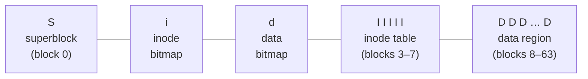

# L23 · File system implementation (VSFS)

> **Book:** Ch 40 (pp. 477–493) · **Priority:** 🔴 must-know · **Time:** 55 min · **Simulator:** `file-implementation/vsfs.py`

!!! example "In plain words"
    The disk is a giant shelf of numbered **blocks** (4 KB each). A simple file system splits it into zones:

    - **Superblock:** the label on the shelf. How big it is and where everything starts.
    - **Bitmaps:** two checklists of which inodes and which data blocks are free.
    - **Inode table:** one card per file, with its size, owner, times and *which blocks hold its data*.
    - **Data blocks:** the actual contents.

    Opening `/home/notes.txt` means: read the root folder's card → find "home" → read home's card → find "notes.txt" → read its card → now you know where the data is. That's several disk reads, which is why the OS caches heavily in memory.

## TL;DR (the 3 things to remember)

- A simple file system divides the disk into **blocks** (4 KB): **superblock** · **inode bitmap** · **data bitmap** · **inode table** · **data region**.
- An **inode** holds metadata and pointers to data: **direct pointers**, then **indirect** (and double/triple indirect) blocks — a tree tuned for "most files are small".
- Opening `/foo/bar` reads the root inode, root data, foo's inode, foo's data, bar's inode — one hop per path component. **Caching** (page cache) hides reads; **write buffering** batches writes.

## The big question

> How can we build a simple file system? What structures are needed on disk, and what do they track?

## The story chain

<small>Key: **bold** = the problem or the final design · *italics* = an attempted fix · ❌ = what goes wrong with it · → = "which leads to"</small>

**Need to store files on a block device** → *data region + inode table* → *track what's free: bitmaps* → *superblock describes the layout* → *inode needs to point to blocks* → *a few direct pointers* → ❌ big files → *indirect blocks (then double/triple)* → *directories are files of (name, inum)* → ❌ every open/read/write costs several I/Os → *cache blocks in memory (unified page cache)* + *delay and batch writes (5–30 s)* → ❌ batching risks data loss on crash → fsync, and crash consistency ([L25](l25-journaling.md)).

## Core ideas

### On-disk layout (64 blocks example)



- 4 KB blocks, 256-byte inodes → 16 inodes per block → 5 blocks = **80 inodes** max.
- Superblock: number of inodes and data blocks, where the inode table starts, a **magic number**.

### Finding inode number i

```
block  = (i * sizeof(inode)) / blockSize
sector = ((block * blockSize) + inodeStartAddr) / sectorSize
```
Because every inode is the same size and they sit in one table, finding inode *i* is simple arithmetic: (start of table) + *i* × (size of one inode).

*Example:* inodes are 256 bytes each and the inode table starts 12 KB into the disk. Inode 32 is 32 × 256 = 8 KB into the table, so it's at 12 + 8 = **20 KB** from the start of the disk. Disks work in 512-byte sectors, so that's sector 20 × 1024 ÷ 512 = **40**.

### The multi-level index

How does an inode record which blocks hold the file's data? With **pointers** (block numbers):

- **Direct pointers:** the inode itself holds, say, 12 block numbers. 12 × 4 KB = enough for files up to **48 KB**.
- **Single indirect pointer:** for bigger files, one more pointer leads to a whole block that is *full of pointers*. A 4 KB block holds 4096 ÷ 4 = **1024** pointers, which adds 1024 × 4 KB = **4 MB**.
- **Double indirect:** a block of pointers to blocks of pointers: 1024 × 1024 more blocks, about **4 GB**. **Triple indirect:** about **4 TB**.

It's lopsided on purpose: **most files are small** (a typical file is about 2 KB), so they use only the fast direct pointers, while the rare huge files pay for the extra hops.

Other designs: **extents** store "start at block X, run for N blocks" — compact for files stored contiguously (used by ext4 and XFS). The old **FAT** file system (USB sticks) links each block to the next like a chain, which makes jumping into the middle of a file slow.

### Directories

A directory is just a special file whose contents are a list of entries. Each entry holds: the inode number, the entry's length, the name's length, and the name. For example `(5, 12, 3, "foo")`. Every directory also has `.` (itself) and `..` (its parent). Deleting a file just marks its entry empty (inode number 0) so it can be reused. Very large directories may use a search tree instead of a list (XFS uses B-trees).

### Access paths — count the I/Os

Assume nothing is cached in memory yet. **Opening `/foo/bar` and reading 3 blocks from it:**

| Step | I/Os |
|---|---|
| `open`: read the root directory's inode (to find its data) → read the root directory's data (find "foo" → its inode number) → read foo's inode → read foo's data (find "bar") → read bar's inode | 5 reads |
| Each `read()`: read bar's inode (where is the block?) → read the data block → write bar's inode back (to update its "last accessed" time) | 3 per block |

**Creating and writing a file** costs even more. To create it: find a free inode (read and write the inode bitmap), initialise the new inode, add the name to the directory's data, and update the directory's inode. That's about **10 disk operations**. Then for *each* new block written: find a free block (read and write the data bitmap), write the data, and update the file's inode. That's about **5 operations per block**. This is why caching matters so much.

### Caching & buffering

- **Reading:** the OS keeps recently used blocks (inodes, directories, file data) in spare RAM, called the **page cache**. Open the same file again and most or all of those reads come from memory, with no disk access at all.
- **Writing:** the OS doesn't write immediately. It waits 5–30 seconds (**write buffering**) because this lets it:
    - **batch** — update the bitmap once for many new blocks instead of once each;
    - **schedule** — send the writes in a good order for the disk;
    - **skip** some entirely — a temporary file created and deleted within those seconds never reaches the disk.
- The cost: if the power fails, the last few seconds of writes are lost. Programs that can't accept that (databases) call `fsync()` to force their data out.

## Common mistakes

- Path lookup walks from the root (inode number usually **2**) for every component — long paths cost I/Os.
- Reads update the **access time** in the inode → reads cause writes (unless `noatime`).
- Bitmaps are per-block, so allocating one block = read + write a bitmap block.
- Inode size is fixed; number of inodes is fixed at mkfs time in VSFS — you can run out of inodes with free space left.

## Recall

**Blurt test** — close this page, then on paper, from memory: draw the layout; compute max file size with 12 direct + 1 indirect; list the 5 reads to open `/foo/bar`.

<details markdown="1"><summary>Name the five regions of VSFS's on-disk layout.</summary>

Superblock, inode bitmap, data bitmap, inode table, data region.

</details>

<details markdown="1"><summary>What's in an inode?</summary>

Metadata (type, size, owner, permissions, times, link count, block count) and pointers to data blocks.

</details>

<details markdown="1"><summary>Max file size with 12 direct pointers, one indirect block, 4 KB blocks, 4-byte pointers?</summary>

(12 + 1024) × 4 KB = 4144 KB ≈ 4 MB.

</details>

<details markdown="1"><summary>Why does a multi-level (imbalanced) tree make sense for inodes?</summary>

Most files are small and fit in direct pointers; the rare large files use indirect blocks.

</details>

<details markdown="1"><summary>How many reads to open /foo/bar (no cache)?</summary>

Five: root inode, root data, foo inode, foo data, bar inode.

</details>

<details markdown="1"><summary>Why does reading a file cause a write?</summary>

The inode's last-access time must be updated.

</details>

<details markdown="1"><summary>Three benefits of write buffering?</summary>

Batching updates into fewer I/Os, better scheduling of writes, and avoiding writes entirely for short-lived files.

</details>

<details markdown="1"><summary>Extents vs pointers?</summary>

An extent is a start pointer plus a length, describing a contiguous run with little metadata; pointers name each block but are more flexible.

</details>

**Explain it out loud (60 seconds, as if to a friend):** "Walk me through every disk access when you create a new file `/foo/bar` and write one block to it."

**Simulator drill** (book's free Python homework tools — see [the recall system](../start/recall-system.md#four-more-tricks-that-pay-off)): `python3 vsfs.py -n 6 -s 17` — infer each operation from the state changes, then `-c`. Try `-r` to go the other way.

## Connects to

- The API on top → [L22](l22-files-api.md)
- Faster layout → [L24 FFS](l24-ffs.md)
- Crash safety → [L25](l25-journaling.md)
- Indirection trees again → multi-level page tables [L11](../virtualization/l11-smaller-tables.md)

## Read in the book

- 🔴 40.1–40.6 — follow the two access-path timelines (Figures 40.3 and 40.4) step by step.
- 🔴 40.7 caching and buffering.
