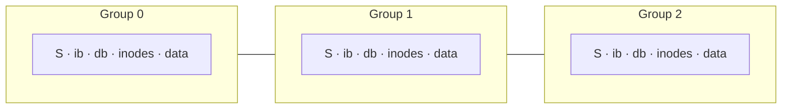

# L24 · FFS: locality and the Fast File System

> **Book:** Ch 41 (pp. 495–506) · **Tier:** 🟡 Skim · **Time:** 25 min · **Simulator:** `file-ffs/ffs.py`

## TL;DR

- The old UNIX file system treated the disk like RAM: inodes far from data, free blocks scattered → **~2% of disk bandwidth**.
- **FFS** made the file system **disk-aware**: split the disk into **cylinder groups** (block groups), each with its own superblock copy, bitmaps, inodes and data.
- Placement policy: **keep related things together** — a file's inode and data in the same group, files in the same directory together; **spread directories** across groups. Exception: chunk **large files** across groups.

## The crux

> How can we organise file system data structures to improve performance — what allocation policies do we need?

## The story chain

**Old UNIX FS: simple, slow** → inodes at the front, data at the back = long seeks; free list gets scrambled = **fragmentation**; 512-byte blocks = small transfers → *bigger blocks* → ❌ internal fragmentation for small files → *4 KB blocks + 512 B sub-blocks* → *cylinder groups with local bitmaps/inodes* → *place related things together* → ❌ one big file fills a whole group, hurting locality for everything else → *large-file exception: spread chunks across groups, chunk size large enough to amortise seeks*. Also: long file names, symlinks, atomic rename.

## Core ideas

### Placement heuristics

| What | Where |
|---|---|
| New **directory** | A group with few directories and many free inodes (spread out) |
| New **file** | Same group as its **parent directory**; data blocks in the same group as its **inode** |
| **Large file** | First 12 blocks (direct) in the inode's group; then each chunk (e.g. one indirect block's worth) in a different group |

Why it works: measurements show **name-space locality** — files in the same directory are often accessed together.

### Amortisation for large files

To get 50% of peak bandwidth, transfer as long as you spend positioning. With 10 ms positioning and 40 MB/s, a chunk must be ~409.6 KB; for 90% ~3.69 MB; for 99% ~40.6 MB.

### Other FFS innovations

- **Sub-blocks** (512 B) for small files, later grown into full 4 KB blocks (libc buffering avoids most of this cost).
- **Parameterisation**: skip every other block so the head doesn't miss the next block during processing (obsolete now — disks have track buffers).
- Long file names, **symbolic links**, atomic **rename** — usability counts.

## Traps

- FFS doesn't change the API; it changes **placement**.
- Spreading directories ≠ spreading files: files stay near their directory.
- Large files are deliberately split — the one exception to "keep together".

## Recall

**Blurt test:** why old UNIX FS was slow (3 reasons); the placement table; the large-file exception.

Why was the original UNIX file system so slow?

It ignored disk geometry: inodes far from data (long seeks), a fragmented free list, and tiny 512-byte blocks.

What is a cylinder (block) group?

A contiguous region of the disk with its own copy of the superblock, inode and data bitmaps, inodes and data blocks.

Where does FFS place a new file and a new directory?

File: same group as its parent directory, with its data near its inode. Directory: a group with few directories and many free inodes.

Why does FFS spread large files across groups?

So one big file doesn't fill a group and destroy locality for other related files; chunks are large enough to amortise the seeks.

What are sub-blocks for?

512-byte allocations for small files to avoid internal fragmentation with 4 KB blocks.

**Explain it (60 s):** "What does it mean for a file system to be 'disk-aware', and how did FFS do it?"

**Simulator drill:** `python3 ffs.py -f in.manyfiles -c` then `-L 4` to change the large-file exception; `-T` shows span statistics.

## Connects to

- Disk numbers → [L20](l20-disks.md)
- ext2/3/4 block groups are FFS's descendants → [L25](l25-journaling.md)
- LFS takes the opposite approach → [L26](l26-lfs-integrity.md)

## Read in the book

- 🟡 41.1–41.5 (problem, groups, policies, measurement). Skim the large-file exception math in 41.6.
