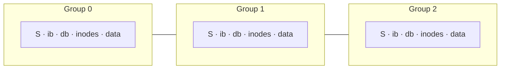

# L24 · FFS: locality and the Fast File System

> **Book:** Ch 41 (pp. 495–506) · **Priority:** 🟡 good to know · **Time:** 25 min · **Simulator:** `file-ffs/ffs.py`

!!! example "In plain words"
    The first UNIX file system scattered a file's card (inode) and its data all over the disk, so the disk arm kept travelling. It used only about 2% of the disk's speed.

    **FFS** made one simple change: **keep things that are used together close together**. The disk is split into neighbourhoods (cylinder groups). A file's card and data live in the same neighbourhood, and files in the same folder live near each other. Fewer long arm movements means much faster.

## TL;DR (the 3 things to remember)

- The old UNIX file system treated the disk like RAM: inodes far from data, free blocks scattered → **~2% of disk bandwidth**.
- **FFS** made the file system **disk-aware**: split the disk into **cylinder groups** (block groups), each with its own superblock copy, bitmaps, inodes and data.
- Placement policy: **keep related things together** — a file's inode and data in the same group, files in the same directory together; **spread directories** across groups. Exception: chunk **large files** across groups.

## The big question

> How can we organise file system data structures to improve performance — what allocation policies do we need?

## The story chain

<small>Key: **bold** = the problem or the final design · *italics* = an attempted fix · ❌ = what goes wrong with it · → = "which leads to"</small>

**Old UNIX FS: simple, slow** → inodes at the front, data at the back = long seeks; free list gets scrambled = **fragmentation**; 512-byte blocks = small transfers → *bigger blocks* → ❌ internal fragmentation for small files → *4 KB blocks + 512 B sub-blocks* → *cylinder groups with local bitmaps/inodes* → *place related things together* → ❌ one big file fills a whole group, hurting locality for everything else → *large-file exception: spread chunks across groups, chunk size large enough to amortise seeks*. Also: long file names, symlinks, atomic rename.

## Core ideas

### Placement heuristics

| What | Where |
|---|---|
FFS decides *where* to put new things using a few rules of thumb (**heuristics**):

| What | Where |
|---|---|
| New **directory** | A group with few directories and plenty of free space, so different directories spread out over the disk |
| New **file** | In the **same group as its folder**, with its data blocks in the same group as its inode |
| **Large file** | The first 48 KB in the file's own group, then the rest in big chunks spread across *other* groups, so one huge file doesn't fill up a group that its neighbours need |

Why it works: files in the same folder tend to be used together (compiling a project reads all its source files), so keeping them physically close means short arm movements.

### Amortisation for large files

Spreading a big file around costs a seek each time you jump to the next chunk. How big must chunks be for that not to matter? To spend **half** the time transferring data (50% of the disk's top speed), each transfer must take as long as the seek. With 10 ms of positioning and a 40 MB/s disk, that's 40 MB/s × 10 ms ≈ **409.6 KB** per chunk. For 90% of top speed you need ~3.69 MB chunks; for 99%, ~40.6 MB.

### Other FFS innovations

- **Sub-blocks:** FFS used bigger 4 KB blocks for speed, but a 1 KB file would waste 3 KB. So small files get 512-byte **sub-blocks**, which are moved into a full block once the file grows.
- **Skipping blocks:** on old, slow systems, by the time the OS asked for the next block, the disk had already spun past it. FFS laid files out on every *other* block to give the OS time. Modern disks read whole tracks into their own cache, so this trick is obsolete.
- **Usability features** that we now take for granted first appeared here: long file names, symbolic links and atomic rename.

## Common mistakes

- FFS doesn't change the API; it changes **placement**.
- Spreading directories ≠ spreading files: files stay near their directory.
- Large files are deliberately split — the one exception to "keep together".

## Recall

**Blurt test** — close this page, then on paper, from memory: why old UNIX FS was slow (3 reasons); the placement table; the large-file exception.

Why was the original UNIX file system so slow?

It ignored disk geometry: inodes far from data (long seeks), a fragmented free list, and tiny 512-byte blocks.

What is a cylinder (block) group?

A contiguous region of the disk with its own copy of the superblock, inode and data bitmaps, inodes and data blocks.

Where does FFS place a new file and a new directory?

File: same group as its parent directory, with its data near its inode. Directory: a group with few directories and many free inodes.

Why does FFS spread large files across groups?

So one big file doesn't fill a group and destroy locality for other related files; chunks are large enough to amortise the seeks.

What are sub-blocks for?

512-byte allocations for small files to avoid internal fragmentation with 4 KB blocks.

**Explain it out loud (60 seconds, as if to a friend):** "What does it mean for a file system to be 'disk-aware', and how did FFS do it?"

**Simulator drill** (book's free Python homework tools — see [the recall system](../start/recall-system.md#four-more-tricks-that-pay-off)): `python3 ffs.py -f in.manyfiles -c` then `-L 4` to change the large-file exception; `-T` shows span statistics.

## Connects to

- Disk numbers → [L20](l20-disks.md)
- ext2/3/4 block groups are FFS's descendants → [L25](l25-journaling.md)
- LFS takes the opposite approach → [L26](l26-lfs-integrity.md)

## Read in the book

- 🟡 41.1–41.5 (problem, groups, policies, measurement). Skim the large-file exception math in 41.6.
