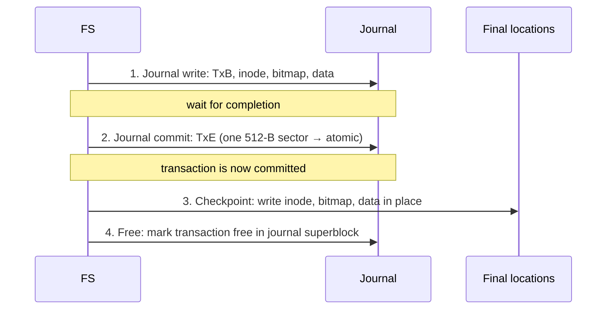

# L25 · Crash consistency: fsck & journaling

> **Book:** Ch 42 (pp. 507–526) · **Priority:** 🔴 must-know · **Time:** 55 min · **Simulator:** `file-journaling/fsck.py`

!!! example "In plain words"
    Saving a file involves several separate disk writes: the data, the file's card (inode) and the free-space checklist (bitmap). If the power dies **between** them, the disk is left in a muddle, e.g. a card pointing at garbage.

    - **fsck:** after a crash, inspect the whole disk and fix it. That's like re-checking every shelf in a library, and takes hours on big disks.
    - **Journaling:** before changing anything, first write a note in a **journal** ("I'm about to do X, Y, Z"), then a "done writing the note" mark, *then* do the real writes. After a crash, just replay the finished notes. It works like a shopping list you tick off: even if you're interrupted, you know exactly what's left.

## TL;DR (the 3 things to remember)

- Appending one block needs **three writes**: inode, data bitmap, data block. A crash between them leaves the disk **inconsistent** (leaks, garbage, or pointers to freed blocks).
- **fsck** scans the whole disk after a crash and repairs metadata — correct-ish but **far too slow** for big disks.
- **Journaling (write-ahead logging):** first write what you're about to do to a **log**, then **commit**, then write it in place (**checkpoint**). On recovery, **replay** committed transactions. **Metadata (ordered) journaling** — write data first, journal only metadata — is the common default (ext3/ext4).

## The big question

> How do we update persistent data structures despite the possibility of a crash or power loss at any moment?

## The story chain

<small>Key: **bold** = the problem or the final design · *italics* = an attempted fix · ❌ = what goes wrong with it · → = "which leads to"</small>

**Three writes, crash in between** → *fsck: check everything on reboot* → ❌ time grows with disk size (hours) and it can't know if data is right, only if it's consistent → *journaling: write intent to a log first* → *write TxB + metadata + data + TxE together* → ❌ the disk may reorder writes; TxE could land before the data → garbage replayed → *write TxB + contents, wait, then write TxE (512 B → atomic)* → ❌ data written twice = half bandwidth → *metadata journaling: data in place first, then journal metadata* → ❌ block reuse bug (deleted directory block reused for a file, replay overwrites it) → *revoke records* → **ordered metadata journaling**. Alternatives: soft updates, copy-on-write (ZFS, btrfs, LFS), backpointer-based consistency, optimistic crash consistency.

## Core ideas

### What can go wrong (adding one block to a file)

Adding one block of data to a file needs **three** separate disk writes:

1. the **data block** itself;
2. the file's **inode** (to record the new block and the bigger size);
3. the **data bitmap** (to mark the block as used).

The disk does them one at a time. Here's what the disk looks like if the power dies after only some of them:

| What made it to disk | Result |
|---|---|
| Only the data | The file system is fine; the new data is simply lost |
| Only the inode | The inode points to a block holding old **garbage**, and the bitmap says that block is free, so it could be given to another file |
| Only the bitmap | A block is marked used but nothing uses it: wasted space (a **space leak**) |
| Inode + bitmap | The structures agree, but the file now contains **garbage** where the new data should be |
| Inode + data | The file looks right, but the bitmap says the block is free, so it may be handed out again and overwritten |
| Bitmap + data | The block is used but no file points to it: a space leak |

### fsck checks

**fsck** (file system check) runs after a crash and checks everything for consistency: Does the superblock look sane? Do the bitmaps match what the inodes actually use? Does each file's link count match the number of directory entries pointing to it (this means walking the *entire* directory tree)? Do two files claim the same block? Does every directory have proper `.` and `..` entries? Files that no directory points to are put in a folder called `lost+found`.

It works, but it reads the **whole disk**, which takes hours on a big one. And it can only make things *consistent*: it can't know whether the data is the *right* data.

### Data journaling — the protocol

The idea (called **write-ahead logging**): before changing anything in place, first write a description of **all** the changes to a reserved area of the disk, the **journal**. A group of changes that belong together is a **transaction**. It's marked with a begin block (**TxB**) and an end block (**TxE**, the "commit").



**Why the waits matter:** the disk may reorder writes for speed. If TxE were sent together with the rest, it could reach the disk *before* the data it vouches for. A crash at that moment would leave a "complete-looking" transaction full of garbage. So: write everything else, **wait** until it's on disk, *then* write TxE. TxE fits in one 512-byte sector, and single-sector writes are all-or-nothing, so the commit either happened or it didn't.

**Recovery after a crash:** read the journal. Every transaction that has its TxE is complete, so **replay** it (write its blocks to their real places again). Transactions without a TxE never committed, so ignore them; the real data was never touched. Replaying a transaction twice does no harm, since it writes the same blocks with the same contents.

**Batching:** the OS doesn't journal every tiny change separately. It gathers many updates into one big transaction in memory and writes it every few seconds.

**The journal has a fixed size:** once a transaction has been checkpointed, its space can be reused. The journal is used round and round like a ring (**circular buffer**), and a small header (the journal superblock) records which transactions are still pending.

### Metadata (ordered) journaling

Data journaling writes every data block **twice** (once in the journal, once in place), which halves write speed. Most systems instead journal only the **metadata** (inodes, bitmaps: the file system's own bookkeeping) and write the user's data straight to its final place, but *first*:

```
1. Data write:      write data to final location         (wait)*
2. Journal write:   TxB + metadata (inode, bitmap)       (wait)
3. Journal commit:  TxE                                  (wait)
4. Checkpoint:      write metadata in place
5. Free
```
*Steps 1 and 2 can be sent together, but **both must finish before step 3**.

Why write the data first? If the inode (which *points to* the data block) committed first and the crash came before the data was written, the file would point at garbage. The general rule: **write the thing being pointed to before the thing that points to it.**

- **Writeback mode** (no ordering at all) is faster but allows exactly that garbage-pointing case.
- **Revoke records:** a subtle case where a block is freed and reused for something else. A revoke entry in the journal tells recovery "don't replay the old version of this block".
- **Speed trick (ext4):** store a **checksum** of the transaction in TxE, so everything can be written in one go without waiting. If the checksum doesn't match at recovery, the transaction is treated as incomplete.

### Comparison

| Approach | Recovery time | Normal-path cost | Notes |
|---|---|---|---|
| fsck | Grows with disk size — hours | None | Only fixes the structures, not the data |
| Data journaling | Grows only with journal size — seconds | All data written **twice** | Strongest guarantee |
| Ordered metadata journaling | Seconds | Only metadata written twice | The default in Linux ext3/ext4 |
| Copy-on-write (ZFS, btrfs, LFS) | Fast | Never overwrites anything in place, so there's nothing half-changed to fix | See [L26](l26-lfs-integrity.md) |
| Soft updates | Fast | Orders every write very carefully so the disk is always consistent | Very complex to implement |

## Common mistakes

- Journaling guarantees **consistency**, not that your last writes survive. Use `fsync`.
- TxE must be written **after** the rest of the transaction completes (or use checksums).
- In ordered mode, data goes **before** the journal commit — not after.
- fsck is "consistent" not "correct": it can't tell whether the data in a block is the right data.

## Recall

**Blurt test** — close this page, then on paper, from memory: the six crash scenarios (at least four); the data-journaling 4 steps; metadata-journaling 5 steps with the ordering rule.

<details markdown="1"><summary>Which three blocks must be written to append one data block?</summary>

The inode, the data bitmap, and the data block.

</details>

<details markdown="1"><summary>What's the main drawback of fsck?</summary>

It scans the entire disk, so recovery takes time proportional to disk size — far too slow for large disks.

</details>

<details markdown="1"><summary>List the steps of data journaling.</summary>

Journal write (TxB + contents), journal commit (TxE), checkpoint (write in place), free the journal space.

</details>

<details markdown="1"><summary>Why must TxE be written separately, after the rest?</summary>

The disk can reorder writes; if TxE lands first and the crash hits, recovery could replay garbage. TxE fits in one sector, so its write is atomic.

</details>

<details markdown="1"><summary>What does recovery do with the journal?</summary>

Replays (redoes) every committed transaction — those with a TxE — and ignores incomplete ones.

</details>

<details markdown="1"><summary>In ordered metadata journaling, when is user data written?</summary>

To its final location before the journal commit, so metadata never points to garbage.

</details>

<details markdown="1"><summary>What rule underlies crash-consistent write ordering?</summary>

Write the pointed-to object before the object that points to it.

</details>

<details markdown="1"><summary>Why do metadata journaling instead of data journaling?</summary>

Data journaling writes all data twice, halving write bandwidth; metadata is small.

</details>

**Explain it out loud (60 seconds, as if to a friend):** "Your laptop loses power while saving a file. Explain how ext4 makes sure the file system isn't corrupted when it boots."

**Simulator drill** (book's free Python homework tools — see [the recall system](../start/recall-system.md#four-more-tricks-that-pay-off)): `python3 fsck.py -D` to see a clean FS, then `-S 1` … `-S 19` with `-c` to spot the corruption.

## Connects to

- The three structures → [L23 VSFS](l23-vsfs.md)
- Atomic sector writes → [L20](l20-disks.md)
- Never overwrite in place → [L26 LFS](l26-lfs-integrity.md)
- Write-ahead logs in databases and Kafka — same idea.

## Read in the book

- 🔴 42.1 (the crash scenarios), 42.3 (journaling — data, recovery, batching, metadata journaling, block reuse).
- 🟡 42.2 fsck, 42.4 other approaches.
