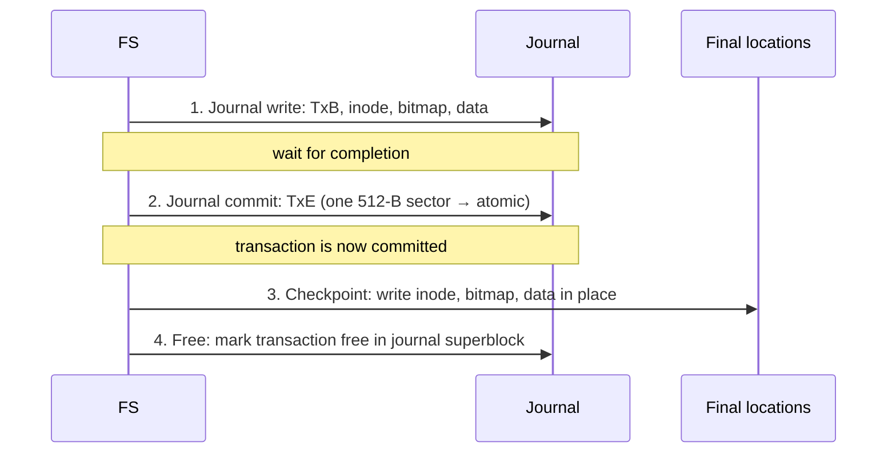

# L25 · Crash consistency: fsck & journaling

> **Book:** Ch 42 (pp. 507–526) · **Tier:** 🔴 Must · **Time:** 55 min · **Simulator:** `file-journaling/fsck.py`

## TL;DR

- Appending one block needs **three writes**: inode, data bitmap, data block. A crash between them leaves the disk **inconsistent** (leaks, garbage, or pointers to freed blocks).
- **fsck** scans the whole disk after a crash and repairs metadata — correct-ish but **far too slow** for big disks.
- **Journaling (write-ahead logging):** first write what you're about to do to a **log**, then **commit**, then write it in place (**checkpoint**). On recovery, **replay** committed transactions. **Metadata (ordered) journaling** — write data first, journal only metadata — is the common default (ext3/ext4).

## The crux

> How do we update persistent data structures despite the possibility of a crash or power loss at any moment?

## The story chain

**Three writes, crash in between** → *fsck: check everything on reboot* → ❌ time grows with disk size (hours) and it can't know if data is right, only if it's consistent → *journaling: write intent to a log first* → *write TxB + metadata + data + TxE together* → ❌ the disk may reorder writes; TxE could land before the data → garbage replayed → *write TxB + contents, wait, then write TxE (512 B → atomic)* → ❌ data written twice = half bandwidth → *metadata journaling: data in place first, then journal metadata* → ❌ block reuse bug (deleted directory block reused for a file, replay overwrites it) → *revoke records* → **ordered metadata journaling**. Alternatives: soft updates, copy-on-write (ZFS, btrfs, LFS), backpointer-based consistency, optimistic crash consistency.

## Core ideas

### What can go wrong (one block append)

| Written | Result |
|---|---|
| Only data | Fine for FS — data just lost |
| Only inode | Points to garbage; also inconsistent with bitmap |
| Only bitmap | **Space leak** |
| Inode + bitmap | Metadata consistent, but block contains **garbage** |
| Inode + data | Inconsistent: bitmap says block free |
| Bitmap + data | Inconsistent: no inode points to block (leak) |

### fsck checks

Superblock sanity · free bitmaps vs inodes · inode state · **link counts** (scan the whole tree) · duplicates · bad block pointers · directory structure (`.` and `..`). Unreferenced inodes → `lost+found`.

### Data journaling — the protocol



**Recovery:** scan the log; **replay** every transaction that has a TxE (**redo logging**); discard incomplete ones. Replaying twice is harmless.

**Batching:** many updates are merged into one global transaction in memory and written every few seconds.

**Finite log:** treat it as a **circular buffer**; a journal superblock records the oldest and newest non-checkpointed transactions.

### Metadata (ordered) journaling

```
1. Data write:      write data to final location         (wait)*
2. Journal write:   TxB + metadata (inode, bitmap)       (wait)
3. Journal commit:  TxE                                  (wait)
4. Checkpoint:      write metadata in place
5. Free
```
*Steps 1 and 2 can be issued together, but **both must finish before step 3**. Rule: **write the pointed-to object before the object that points to it.**

- **Writeback mode** (unordered): data whenever → metadata may point to garbage.
- **Revoke records** stop replay of deleted metadata blocks being written over reused blocks.
- Optional optimisation: **checksum** the transaction so TxB, contents and TxE can be written at once (ext4).

### Comparison

| Approach | Recovery time | Normal-path cost | Notes |
|---|---|---|---|
| fsck | O(disk size) — very slow | None | Only fixes metadata |
| Data journaling | O(log size) | Data written **twice** | Strongest |
| Ordered metadata journaling | O(log size) | Metadata written twice | Default in ext3/4 |
| Copy-on-write (ZFS, btrfs, LFS) | Fast | Never overwrite in place | — |
| Soft updates | Fast | Careful write ordering | Very complex |

## Traps

- Journaling guarantees **consistency**, not that your last writes survive. Use `fsync`.
- TxE must be written **after** the rest of the transaction completes (or use checksums).
- In ordered mode, data goes **before** the journal commit — not after.
- fsck is "consistent" not "correct": it can't tell whether the data in a block is the right data.

## Recall

**Blurt test:** the six crash scenarios (at least four); the data-journaling 4 steps; metadata-journaling 5 steps with the ordering rule.

<details markdown="1"><summary>Which three blocks must be written to append one data block?</summary>

The inode, the data bitmap, and the data block.

</details>

<details markdown="1"><summary>What's the main drawback of fsck?</summary>

It scans the entire disk, so recovery takes time proportional to disk size — far too slow for large disks.

</details>

<details markdown="1"><summary>List the steps of data journaling.</summary>

Journal write (TxB + contents), journal commit (TxE), checkpoint (write in place), free the journal space.

</details>

<details markdown="1"><summary>Why must TxE be written separately, after the rest?</summary>

The disk can reorder writes; if TxE lands first and the crash hits, recovery could replay garbage. TxE fits in one sector, so its write is atomic.

</details>

<details markdown="1"><summary>What does recovery do with the journal?</summary>

Replays (redoes) every committed transaction — those with a TxE — and ignores incomplete ones.

</details>

<details markdown="1"><summary>In ordered metadata journaling, when is user data written?</summary>

To its final location before the journal commit, so metadata never points to garbage.

</details>

<details markdown="1"><summary>What rule underlies crash-consistent write ordering?</summary>

Write the pointed-to object before the object that points to it.

</details>

<details markdown="1"><summary>Why do metadata journaling instead of data journaling?</summary>

Data journaling writes all data twice, halving write bandwidth; metadata is small.

</details>

**Explain it (60 s):** "Your laptop loses power while saving a file. Explain how ext4 makes sure the file system isn't corrupted when it boots."

**Simulator drill:** `python3 fsck.py -D` to see a clean FS, then `-S 1` … `-S 19` with `-c` to spot the corruption.

## Connects to

- The three structures → [L23 VSFS](l23-vsfs.md)
- Atomic sector writes → [L20](l20-disks.md)
- Never overwrite in place → [L26 LFS](l26-lfs-integrity.md)
- Write-ahead logs in databases and Kafka — same idea.

## Read in the book

- 🔴 42.1 (the crash scenarios), 42.3 (journaling — data, recovery, batching, metadata journaling, block reuse).
- 🟡 42.2 fsck, 42.4 other approaches.
