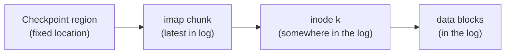

# L26 · Log-structured file systems & data integrity

> **Book:** Ch 43 (pp. 527–542) 🟡 · Ch 44 (pp. 543–554) 🟡 · **Time:** 40 min · **Simulators:** `file-lfs/lfs.py`, `file-integrity/checksum.py`

!!! example "In plain words"
    **LFS** treats the disk like a diary. You never go back and edit old pages; every change is written on the **next blank pages**, in one sweep. Writing is very fast because it's all sequential. The cost: you need an index of where the latest version of each thing is (the **inode map**), and someone must occasionally clear out pages full of outdated entries (the **cleaner**).

    **Data integrity:** disks sometimes fail quietly, returning wrong data with no error. A **checksum** is a fingerprint stored with the data. Recompute it when you read, and if the fingerprints don't match, the data is corrupt and you use a backup copy.

## TL;DR (the 3 things to remember)

- **LFS:** memory is big, so reads hit the cache — **optimise for writes**. Buffer all updates (data *and* inodes) into a big **segment** and write it **sequentially** to free space. **Never overwrite in place.**
- Inodes now move, so an **inode map (imap)** finds them; pieces of the imap are written with each segment and located through the fixed **checkpoint region**. Old versions become garbage → a **cleaner** compacts segments.
- **Data integrity:** disks also fail partially — **latent sector errors** (detectable) and **silent corruption** (not). Use **checksums** stored separately, plus block **address** and **write verification** to catch misdirected and lost writes; **scrub** periodically.

## The big question

> LFS: how can a file system turn all writes into sequential writes? · Integrity: how do we make sure the data we read back is the data we wrote?

## The story chain (LFS)

**Memory grows → most reads hit cache; disk transfer improves faster than seek** → *write everything sequentially* → ❌ one small write at a time still pays rotation → *buffer into large segments (MBs)* → ❌ inodes are no longer at fixed places → *imap: inum → inode address* → ❌ where is the imap? → *write imap chunks in the log too; fixed checkpoint region points to the latest chunks* → ❌ old copies pile up → *cleaner: read M segments, write live blocks into N < M new ones* → ❌ which blocks are live? → *segment summary block: (inum, offset) per block; check if the inode still points here* → ❌ crash while writing the CR → *two CRs, alternate, with timestamps*.

## Core ideas — LFS

### Writing in LFS

The LFS rule: **never overwrite anything.** Every change — new data, the updated inode, everything — is collected in memory and then written together as one big sequential chunk, a **segment** (several MB), onto free space. Large sequential writes are what disks do fastest ([L20](l20-disks.md)).

That creates a puzzle. A normal file system keeps inode 7 in a fixed spot, but in LFS a new copy of inode 7 is written somewhere new every time the file changes. So how do you find the *latest* inode 7? With an **inode map (imap)**: a table "inode 7 is currently at disk address X". Pieces of the imap are written into the log too, and one **fixed** place on the disk, the **checkpoint region**, says where the latest imap pieces are.

### Reading a file in LFS

Follow the arrows: fixed checkpoint region → latest imap → the file's latest inode → its data. In practice the imap is kept in memory, so reading costs about the same as in a normal file system.

### Write cost amortisation

How big should a segment be? Each segment write pays one seek + rotation first, so the segment must be big enough to make that cost small. To get a fraction F of the disk's top speed: **D = F/(1−F) × Rpeak × Tposition**.

*Example:* 10 ms positioning, 100 MB/s top speed, and we want 90%. F/(1−F) = 0.9/0.1 = 9, so D = 9 × 100 MB/s × 0.01 s = **9 MB** per segment.

### Garbage collection

Because nothing is overwritten, old versions pile up and the disk fills with outdated blocks (*garbage*). A background **cleaner** reads a few old segments, copies out only the blocks that are still current (**live**), packs them into a fresh segment, and frees the old ones.

- **How does it know a block is live?** Each segment starts with a **summary block** noting, for every block, "this was block #3 of inode 7". The cleaner looks up inode 7's current version: if it still points at this exact address, the block is live; otherwise it's an outdated copy.
- **Which segments to clean first?** Segments full of frequently changing (*hot*) data: wait, because more of their blocks will become garbage soon anyway. Segments of rarely changing (*cold*) data: clean sooner.
- **Why moving inodes doesn't ripple upward:** directories store a file's inode *number*, not its disk address. When an inode moves, only the imap changes; the directory doesn't need rewriting.

### Crash recovery

The checkpoint region is updated every ~30 seconds. LFS keeps **two** of them and alternates between them, with a timestamp at both the start and the end of each. If the power fails while one is being written, its two timestamps won't match, so LFS uses the other, older one. Then it reads forward through any segments written after that checkpoint (**roll forward**) to recover recent work.

LFS ideas live on in **copy-on-write** file systems (WAFL/NetApp, ZFS, btrfs) and in SSD FTLs.

## Core ideas — Data integrity (Ch 44)

### Failure modes

| Failure | Detected? | Example cause |
|---|---|---|
Disks don't only fail completely. They also fail **partially**: the disk mostly works, but some blocks go bad.

| Failure | Does the disk notice? | Example cause |
|---|---|---|
| **Latent sector error (LSE)** — a block can't be read | **Yes**: the disk's internal error-correcting code (ECC) fails, and the read returns an error | Scratched surface, cosmic rays |
| **Silent corruption** — a block reads back wrong | **No**: you get wrong data with no error | Buggy disk firmware, faulty cable |
| **Misdirected write** | No | The right data was written to the **wrong** block |
| **Lost write** | No | The disk said "done" but never actually wrote |

### Handling them

- **Unreadable blocks (LSEs):** the disk reports them, so just rebuild the block from a mirror or parity ([RAID](l21-raid.md)). The danger is a second bad block turning up *while* rebuilding a failed disk, which is why some systems keep extra parity (e.g. NetApp's RAID-DP).
- **Silent corruption → checksums.** A checksum is a small "fingerprint" computed from a block's contents (simple ones: XOR, Fletcher; stronger: CRC). Store it **separately** from the block. On every read, recompute the fingerprint; if it doesn't match the stored one, the block is corrupt, so use a redundant copy instead.
- **Misdirected writes:** store the block's **own address** next to its checksum. If you read block 50 and the record says "I am block 70", something was written to the wrong place.
- **Lost writes:** either read every block back right after writing it (**write verify** — reliable but slow), or keep a second copy of the checksum elsewhere, e.g. in the inode (ZFS does this). A lost write then leaves a mismatch.
- **Scrubbing:** checksums only help when you read the data. So the system periodically reads **every** block in the background to catch damage before you need the data.
- **Costs:** a little space (8 bytes per 4 KB block ≈ 0.2%) and a little CPU time to compute fingerprints.

## Common mistakes

- LFS writes **inodes** into the log too — not only data.
- The checkpoint region is the **only** fixed structure, and it's updated rarely (every ~30 s).
- A checksum can't fix data by itself — it only **detects**; recovery needs redundancy.
- Checksums alone can't catch misdirected or lost writes (the wrong block has a valid checksum for itself).

## Recall

**Blurt test** — close this page, then on paper, from memory: the LFS chain; CR → imap → inode → data; the cleaner's liveness test; the four failure types with their fix.

What's the core idea of LFS?

Buffer all updates (data and metadata) in memory and write them sequentially as large segments to free space; never overwrite in place.

Why does LFS need an inode map?

Inodes move every time they're written, so the imap records each inode's current location.

How does LFS find the imap?

Through the checkpoint region, a fixed location that points to the latest imap pieces; it's updated periodically.

How does the LFS cleaner decide if a block is live?

The segment summary block gives the block's inode number and offset; if that inode (via the imap) still points to this address, it's live.

What is a latent sector error vs silent corruption?

LSE: the disk detects the bad sector and returns an error. Silent corruption: the disk returns wrong data with no error.

How do you detect misdirected writes?

Store the disk and sector address alongside the checksum and verify it on read.

What is disk scrubbing?

Periodically reading all blocks and verifying checksums to find corruption early.

**Explain it out loud (60 seconds, as if to a friend):** "Why does LFS give great write performance, and what price does it pay?"

**Simulator drill** (book's free Python homework tools — see [the recall system](../start/recall-system.md#four-more-tricks-that-pay-off)): `python3 lfs.py -n 3 -c` and `python3 checksum.py -D 1,2,3,4 -c` (compute the additive, XOR and Fletcher checksums by hand first).

## Connects to

- Sequential vs random → [L20 Disks](l20-disks.md)
- Journaling as the alternative → [L25](l25-journaling.md)
- RAID provides the redundancy → [L21](l21-raid.md)
- SSD FTLs are log-structured → [L20](l20-disks.md)

## Read in the book

- 🟡 Ch 43: 43.1–43.6 (sequential writes, imap, CR), 43.9–43.11 (garbage collection).
- 🟡 Ch 44: 44.1–44.4, skim the rest.
