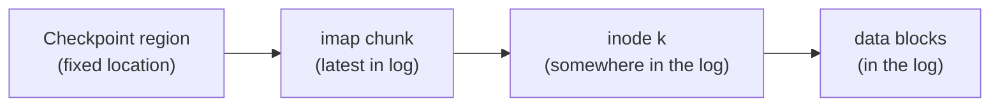

# L26 · Log-structured file systems & data integrity

> **Book:** Ch 43 (pp. 527–542) 🟡 · Ch 44 (pp. 543–554) 🟡 · **Time:** 40 min · **Simulators:** `file-lfs/lfs.py`, `file-integrity/checksum.py`

## TL;DR

- **LFS:** memory is big, so reads hit the cache — **optimise for writes**. Buffer all updates (data *and* inodes) into a big **segment** and write it **sequentially** to free space. **Never overwrite in place.**
- Inodes now move, so an **inode map (imap)** finds them; pieces of the imap are written with each segment and located through the fixed **checkpoint region**. Old versions become garbage → a **cleaner** compacts segments.
- **Data integrity:** disks also fail partially — **latent sector errors** (detectable) and **silent corruption** (not). Use **checksums** stored separately, plus block **address** and **write verification** to catch misdirected and lost writes; **scrub** periodically.

## The crux

> LFS: how can a file system turn all writes into sequential writes? · Integrity: how do we make sure the data we read back is the data we wrote?

## The story chain (LFS)

**Memory grows → most reads hit cache; disk transfer improves faster than seek** → *write everything sequentially* → ❌ one small write at a time still pays rotation → *buffer into large segments (MBs)* → ❌ inodes are no longer at fixed places → *imap: inum → inode address* → ❌ where is the imap? → *write imap chunks in the log too; fixed checkpoint region points to the latest chunks* → ❌ old copies pile up → *cleaner: read M segments, write live blocks into N < M new ones* → ❌ which blocks are live? → *segment summary block: (inum, offset) per block; check if the inode still points here* → ❌ crash while writing the CR → *two CRs, alternate, with timestamps*.

## Core ideas — LFS

### Reading a file in LFS

Once the imap is cached in memory, a read is the same cost as a normal FS: imap lookup → inode → block.

### Write cost amortisation

To reach fraction F of peak bandwidth Rpeak with positioning time Tposition, buffer **D = F/(1−F) × Rpeak × Tposition**. Example: 10 ms positioning, 100 MB/s, F = 90% → D = 9 × 100 MB/s × 0.01 s = **9 MB**.

### Garbage collection

- Works **segment by segment**. A **segment summary block** records each block's inode number and offset → liveness check: look up the inode via the imap; if it still points to this address, the block is live. (A version number can shortcut this.)
- **Which segments to clean?** Hot (often overwritten) segments: wait — more blocks will die. **Cold** segments: clean sooner.
- Directories: LFS avoids the **recursive update problem** — the directory stores (name, inum), not the inode's address, so moving an inode only changes the imap.

### Crash recovery

Alternate between **two checkpoint regions** with timestamps at both ends (detect torn CR writes). Then **roll forward** through segments written after the last checkpoint.

LFS ideas live on in **copy-on-write** file systems (WAFL/NetApp, ZFS, btrfs) and in SSD FTLs.

## Core ideas — Data integrity (Ch 44)

### Failure modes

| Failure | Detected? | Example cause |
|---|---|---|
| **Latent sector error (LSE)** | Yes — disk ECC fails, read returns error | Head crash, cosmic rays |
| **Block corruption** | **No** — returns wrong data silently | Firmware bugs, bad bus |
| **Misdirected write** | No | Data written to the wrong address |
| **Lost write** | No | Disk says "done" but never wrote |

**Fail-partial** model: the disk mostly works but some blocks fail.

### Handling them

- **LSEs:** use redundancy (RAID mirror/parity) to rebuild. Watch out: an LSE *during* RAID reconstruction → RAID-DP / extra parity.
- **Corruption → checksums:** XOR, Fletcher, CRC. Store the checksum **apart** from the data (or per-sector extra bytes, e.g. 520-byte sectors). On read, recompute and compare; on mismatch, use a redundant copy.
- **Misdirected writes:** include the **disk and block number** in the checksum record.
- **Lost writes:** **write verify** (read after write — slow) or keep a checksum in the inode/indirect block too (ZFS).
- **Scrubbing:** periodically read every block and check checksums, so bit rot is found before you need the data.
- **Overheads:** space (~0.2% for 8 B per 4 KB block) and time (CPU to compute; mitigate by combining with the copy).

## Traps

- LFS writes **inodes** into the log too — not only data.
- The checkpoint region is the **only** fixed structure, and it's updated rarely (every ~30 s).
- A checksum can't fix data by itself — it only **detects**; recovery needs redundancy.
- Checksums alone can't catch misdirected or lost writes (the wrong block has a valid checksum for itself).

## Recall

**Blurt test:** the LFS chain; CR → imap → inode → data; the cleaner's liveness test; the four failure types with their fix.

What's the core idea of LFS?

Buffer all updates (data and metadata) in memory and write them sequentially as large segments to free space; never overwrite in place.

Why does LFS need an inode map?

Inodes move every time they're written, so the imap records each inode's current location.

How does LFS find the imap?

Through the checkpoint region, a fixed location that points to the latest imap pieces; it's updated periodically.

How does the LFS cleaner decide if a block is live?

The segment summary block gives the block's inode number and offset; if that inode (via the imap) still points to this address, it's live.

What is a latent sector error vs silent corruption?

LSE: the disk detects the bad sector and returns an error. Silent corruption: the disk returns wrong data with no error.

How do you detect misdirected writes?

Store the disk and sector address alongside the checksum and verify it on read.

What is disk scrubbing?

Periodically reading all blocks and verifying checksums to find corruption early.

**Explain it (60 s):** "Why does LFS give great write performance, and what price does it pay?"

**Simulator drill:** `python3 lfs.py -n 3 -c` and `python3 checksum.py -D 1,2,3,4 -c` (compute the additive, XOR and Fletcher checksums by hand first).

## Connects to

- Sequential vs random → [L20 Disks](l20-disks.md)
- Journaling as the alternative → [L25](l25-journaling.md)
- RAID provides the redundancy → [L21](l21-raid.md)
- SSD FTLs are log-structured → [L20](l20-disks.md)

## Read in the book

- 🟡 Ch 43: 43.1–43.6 (sequential writes, imap, CR), 43.9–43.11 (garbage collection).
- 🟡 Ch 44: 44.1–44.4, skim the rest.
