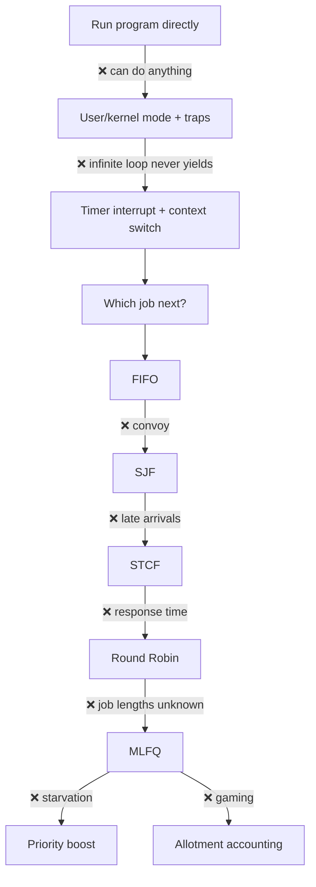
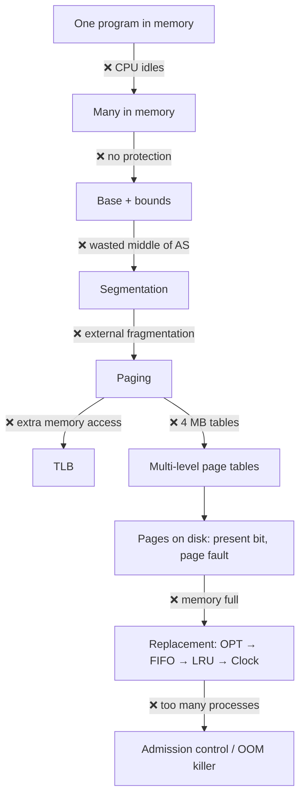
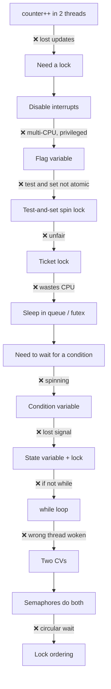
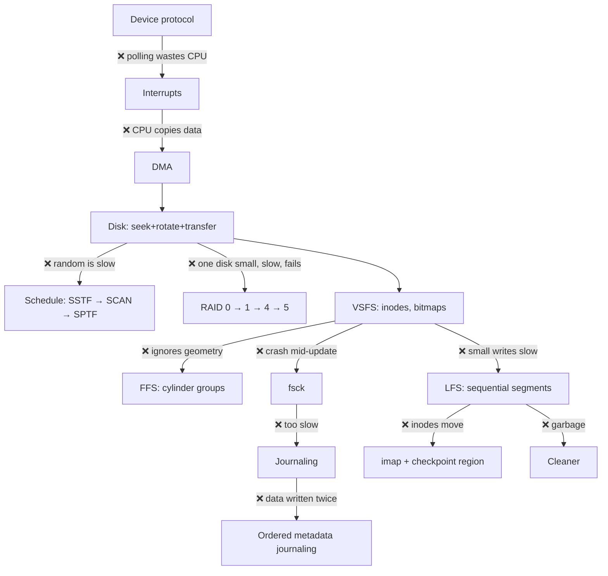
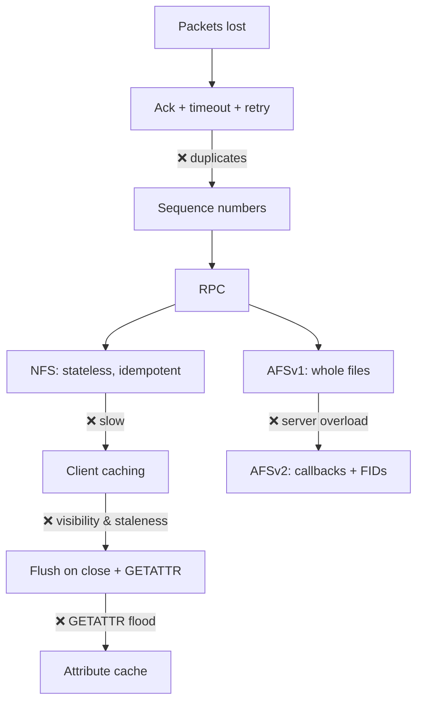

# The big chain map

Every lesson as a chain: **problem → fix → ❌ what breaks → better fix**. Practise by covering a diagram and rebuilding its chain out loud, top to bottom. If you can rebuild these five diagrams, you can rebuild the book.

## 1 · CPU virtualization

## 2 · Memory virtualization

## 3 · Concurrency

## 4 · Persistence

## 5 · Distribution

