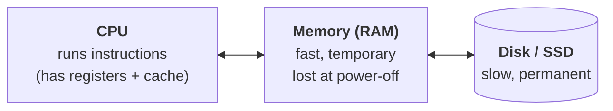

# Background you need (10 minutes)

OSTEP assumes you know a little about how a computer runs a program. If words like *register*, *stack* or *pointer* feel fuzzy, read this page first. Everything else in the course builds on these ideas.

!!! tip "Hover over underlined words"
    On this website, any word with a dotted underline has a definition. Hover over it with the mouse, or tap it on a phone. The full list is in the [Glossary](../review/glossary.md).

## 1 · The three parts of a computer



| Part | Think of it as | Speed (rough) |
|---|---|---|
| **CPU** | The worker who follows a recipe one step at a time | One simple step takes under 1 nanosecond |
| **Memory (RAM)** | The kitchen counter: everything currently in use sits here | ~100 nanoseconds to fetch something |
| **Disk / SSD** | The storeroom: big and permanent, but far away | Hard disk: ~10 milliseconds, 100,000× slower than RAM |

That huge speed gap explains a lot of the book. Disks are so slow that the OS works hard to avoid touching them, mostly by keeping copies of data in memory.

**Units:** 1 KB ≈ a thousand bytes, 1 MB ≈ a million, 1 GB ≈ a billion. In OS work these are powers of two: **1 KB = 1024 bytes** and **4 KB = 4096 bytes**. A millisecond (ms) is 1/1000 of a second. A microsecond (µs) is 1/1000 of a millisecond. A nanosecond (ns) is 1/1000 of a microsecond.

## 2 · How the CPU runs a program

A program is a list of **instructions**: tiny steps like "load a number from memory", "add two numbers" and "store the result in memory".

Inside the CPU are a handful of **registers**. Each is a tiny, very fast slot that holds one value. Three of them matter most in this course:

- **Program counter (PC)** — the address of the next instruction. The CPU fetches that instruction, does it, moves the PC on, and repeats forever.
- **Stack pointer** — where the top of the stack is right now (see below).
- **General registers** — scratch space for the values being worked on.

> **Why it matters:** if you save all the registers, you've saved "where the program is" in its work. Restore them later and the program carries on as if nothing happened. That's how the OS switches between programs ([L03](../virtualization/l03-lde.md)).

## 3 · Memory: addresses, code, stack and heap

Memory is one long row of numbered bytes. The number is the byte's **address**.

A running program's memory is split into regions:

| Region | What lives there | Example (C) |
|---|---|---|
| **Code** | The program's instructions | — |
| **Static data** | Global variables | `int count = 0;` outside any function |
| **Stack** | Local variables, function arguments and return addresses. Grows when a function is called and shrinks when it returns | `int x = 5;` inside a function |
| **Heap** | Memory the program asks for while running and gives back when done | `p = malloc(100);` … `free(p);` (Java: `new`) |

A **pointer** is just a variable that holds an address. `int *p` means "p holds the address of an int".

## 4 · Just enough C to read the code in this course

The book's examples are in C. You don't need to write C; you only need to read short snippets.

```c
#include <stdio.h>

int main(int argc, char *argv[]) {     // program starts here
    printf("I was started as %s\n", argv[0]);
    for (int i = 1; i < argc; i++)
        printf("argument %d: %s\n", i, argv[i]);
    return 0;                          // 0 = "finished OK"
}
```

- **`main`** is where every C program starts.
- **argc** (*argument count*) is how many words you typed to start the program.
- **argv** (*argument vector*) holds those words as text. `argv[0]` is the program's own name.
- Running `./show hello world` prints `I was started as ./show`, then `argument 1: hello` and `argument 2: world`. Here argc = 3.
- Java's `public static void main(String[] args)` is the same idea, except `args` doesn't include the program name.

Other things you'll see:

| C | Meaning |
|---|---|
| `x++` | add 1 to x |
| `int *p` | p is a pointer to an int |
| `*p = 5` | store 5 at the address in p |
| `&x` | the address of x |
| `p->field` | the field of the struct p points to |
| `while (cond) ;` | loop doing nothing until cond is false ("spinning") |
| `NULL` | "points nowhere" |

## 5 · The OS, the kernel and system calls

- The **kernel** is the core of the operating system. It runs in a special, all-powerful CPU mode called **kernel mode**.
- Your programs run in **user mode**, which isn't allowed to touch hardware directly.
- When a program needs something only the OS may do (read a file, start a process), it makes a **system call**. That is a special instruction that jumps safely into the kernel, which does the job and then returns.

Think of a bank: you (user mode) can't walk into the vault. You fill in a form at the counter (system call), and the teller (kernel) does it for you.

## 6 · Files you already know: stdin, stdout, stderr

Every program starts with three open "files":

- **stdin** (number 0) — input, usually the keyboard.
- **stdout** (number 1) — normal output, usually the screen.
- **stderr** (number 2) — error messages.

In a shell, `ls > out.txt` sends stdout to a file. `ls | wc -l` connects the stdout of `ls` to the stdin of `wc`.

## 7 · Caches, in one paragraph

A **cache** is a small, fast place that keeps copies of things you used recently, so the next use is quick. Your browser caches web pages; the CPU caches memory; the OS caches disk blocks in RAM. Caches work because programs tend to reuse the same data soon (**temporal locality**) and to use data next to what they just used (**spatial locality**). You'll meet this idea in almost every lesson.

## Ready?

If the ideas above make sense, start with **[L01 · Intro & the three pieces](../virtualization/l01-intro.md)**. Come back here whenever a lesson assumes something you're unsure of.
