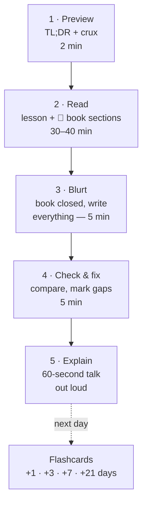

# The recall system

Reading feels like learning, but most of it is gone within a week. What makes things stick is **pulling them out of your head** (retrieval) at **growing intervals** (spacing). This page is the whole method. It takes 5 minutes to read and adds about 15 minutes to each lesson.

## The 5-step loop (per lesson)

### 1 · Preview (2 min)
Read only the **TL;DR** and **crux**. You now know the question before you read the answer, so your brain files new details under it.

### 2 · Read
Read the lesson, then the book sections marked 🔴 in "Read in the book". Don't highlight. Instead, after every section, look away and say one sentence about what it did.

### 3 · Blurt (the most important step)
Close everything. On a blank page, write down **everything you remember**: the story chain, the diagram, the rules, the numbers. Messy is fine. This feels hard — that difficulty is what builds memory.

### 4 · Check & fix
Open the lesson. With a different colour, add what you missed. **Those gaps are your flashcards.** Star anything you got wrong.

### 5 · Explain (Feynman test)
Each lesson ends with an "Explain it" prompt. Answer it out loud in 60 seconds, as if to a friend who knows programming but not OS. If you say "it just sort of…", that's a gap — go back to that part.

## The story chain — your main memory hook

OSTEP almost always teaches by trying something simple, showing how it breaks, and fixing it. Each lesson writes this down as a **chain**:

> **Problem** → *naive fix* → ❌ what breaks → *better fix* → ❌ what breaks → … → **final design**

Chains are far easier to remember than lists of facts, because each step *causes* the next. If you can rebuild the chain from memory, you can rebuild the details. In an exam, write the chain first, then fill in.

Example (scheduling): *Run jobs in order (FIFO)* → ❌ a long job blocks short ones (convoy) → *run shortest first (SJF)* → ❌ a long job already running still blocks late arrivals → *preempt (STCF)* → ❌ interactive users wait → *time slices (Round Robin)* → ❌ we don't know job lengths → **learn from history (MLFQ)**.

The **[big chain map](../review/chain-map.md)** has every chain on one page.

## Spaced review schedule

After the lesson day (Day 0), review at these gaps. Each review is **5 minutes**: flip the flashcards, redo the blurt for the chain only.

| Review | When | What |
|---|---|---|
| R1 | Day +1 | Flashcards + blurt the chain |
| R2 | Day +3 | Flashcards only, starred cards twice |
| R3 | Day +7 | One "Explain it" out loud + drills for that part |
| R4 | Day +21 | Mixed drills across all parts |

The easiest way to run this is **Anki**: import the deck from **[Flashcards](../review/flashcards.md)** and it schedules everything for you.

## Four more tricks that pay off

**Interleave.** After the first week, don't review one topic at a time. Mix questions from scheduling, paging and locks in one sitting. It feels worse and works better, because exams mix too. The **[mixed drills](../review/drills.md)** are built for this.

**Run the simulators.** OSTEP's homework comes with small Python simulators ([ostep-homework](https://github.com/remzi-arpacidusseau/ostep-homework)). Each one generates a problem with a random seed (`-s 1`, `-s 2`, …) and shows the answer with `-c`. Solve a few seeds in your head first, then check. This is retrieval practice with infinite questions. Every lesson lists the right simulator.

**File it under mechanism or policy.** When you meet a new idea, ask: is this *how* (mechanism) or *which* (policy)? Two mental drawers make recall faster.

**Draw, don't copy.** Redraw each lesson's diagram from memory once. If you can draw the page table walk or the journaling timeline, you understand it.

## Signs it's working

- You can write the chain for a lesson in under a minute, a week later.
- You can answer "why not just…?" questions (why not one big page table? why not spin forever?).
- Numbers come to you without looking: 4 KB pages, ~10 ms per random disk I/O, 4 MB of linear page table per process on 32-bit.
