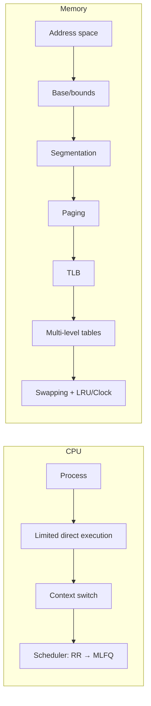

# Part I · Virtualization

**The question:** how does one CPU and one memory look like many private ones?

Two halves, each split into **mechanism** (how) and **policy** (which):

| | Mechanism | Policy |
|---|---|---|
| **CPU** | Processes, limited direct execution, context switch ([L02](l02-process.md), [L03](l03-lde.md)) | Scheduling: FIFO → SJF → STCF → RR → MLFQ, lottery ([L04](l04-scheduling.md), [L05](l05-mlfq.md)) |
| **Memory** | Address spaces, base/bounds, segmentation, paging, TLB, multi-level tables, page faults ([L06](l06-address-space.md)–[L11](l11-smaller-tables.md), [L12](l12-swapping.md)) | Free-space fits ([L08](l08-free-space.md)); page replacement: OPT, FIFO, LRU, Clock ([L12](l12-swapping.md)) |

**Lessons:** L01–L12. **Time:** ~8 hours for the whole part.
