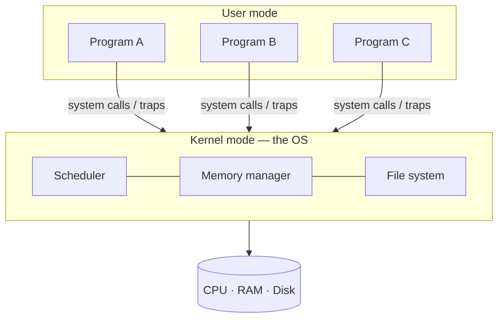

# L01 · Intro & the three pieces

> **Book:** Ch 2 (pp. 3–19) · **Priority:** 🟡 good to know · **Time:** 20 min

!!! example "In plain words"
    Picture a busy hotel. Guests (programs) each feel they have a private room, their own staff and their own safe. In reality there is **one building and one staff**, shared cleverly. The hotel manager (the OS) does three jobs:

    - **Virtualization:** makes shared things look private. One CPU feels like many; one memory feels like your own.
    - **Concurrency:** many guests act at once without trampling each other.
    - **Persistence:** valuables locked in the safe survive a power cut.

## TL;DR (the 3 things to remember)

- An OS is a layer of software that **virtualizes** hardware (CPU, memory, disk) so every program thinks it has the machine to itself.
- It also manages **concurrency** (many things happening at once) and **persistence** (data that survives power loss).
- Programs ask the OS for things through **system calls**; the OS is effectively a **resource manager** and a **standard library**.

## The big question

> How does the OS turn physical resources into general, powerful, easy-to-use virtual ones — efficiently and safely?

## The story chain

<small>Key: **bold** = the problem or the final design · *italics* = an attempted fix · ❌ = what goes wrong with it · → = "which leads to"</small>

**Programs want the whole machine** → *give each one the real hardware* → ❌ only one can run, any bug crashes everything → *a layer that hands out slices of the hardware and enforces rules* → **the operating system**: virtualization for sharing, protection for isolation, persistence for safety.

## Core ideas

**Virtualizing the CPU.** Run four programs on one CPU and all four seem to make progress. The OS switches between them fast enough that each looks like it owns a processor. (Mechanism: [L03](l03-lde.md). Policy: [L04](l04-scheduling.md).)

**Virtualizing memory.** Two copies of the same program can both print "my variable is at address 0x200000" (an address written in hexadecimal) and yet change different values, because each sees its own private copy. Each process has its own **private virtual address space**; the OS and hardware map it onto real memory. ([L06](l06-address-space.md) onward.)

**Concurrency.** Two threads each add 1 to a shared counter a million times. Expected result 2,000,000; actual result is often less, and different every run. Why: `counter++` looks like one step but the CPU does it in three — **load** the value from memory, **add** 1, **store** it back. If the OS switches threads in the middle, both threads may load the same old value, and one update is lost. ([L13](../concurrency/l13-threads.md).)

**Persistence.** Memory is lost at power off, so data goes to disk through the **file system**. Writing safely is hard: for speed the OS holds writes in memory for a while and sends them to disk in batches, and it must not leave the disk broken if the power dies halfway through. ([L22](../persistence/l22-files-api.md) onward.)

## The design goals (remember the five)

| Goal | Meaning |
|---|---|
| **Abstraction** | Easy-to-use interfaces (process, address space, file) |
| **Performance** | The OS itself should use little CPU time and memory (low *overhead*) |
| **Protection / isolation** | One program can't harm another or the OS |
| **Reliability** | The OS itself must not crash |
| **Energy, security, mobility** | Increasingly important extras |

## Common mistakes

- "OS = the kernel *and* the desktop apps" — no. In this book, OS means the **kernel**: the core part that shares out the hardware and protects programs from each other.
- A **system call** is not a normal function call: it switches the CPU into kernel mode via a trap, so the OS can do privileged things.

## Recall

**Blurt test** — close this page, then on paper, from memory (5 min): name the three pieces with one example each, and the five design goals.

What are the "three easy pieces"?

Virtualization, concurrency, persistence.

Why can two processes print the same address for a variable yet hold different values?

Each has its own virtual address space; the same virtual address maps to different physical memory.

Why does a shared counter incremented by two threads end up wrong?

`counter++` is load–add–store. If a context switch hits between them, one thread's update overwrites the other's. The three instructions are not atomic.

How does a system call differ from a procedure call?

It traps into the kernel and raises the hardware privilege level, so the OS can perform restricted operations; a procedure call stays in user mode.

**Explain it out loud (60 seconds, as if to a friend):** "Why do we need an operating system at all? What would break without one?"

## Connects to

All other lessons. Each part of this site expands one of the three pieces.

## Read in the book

- 🔴 2.1–2.4 — the four small example programs (cpu, mem, threads, io). Run them if you can.
- 🟡 2.5 Design goals.
- ⚪ 2.6 History — interesting but rarely examined.
