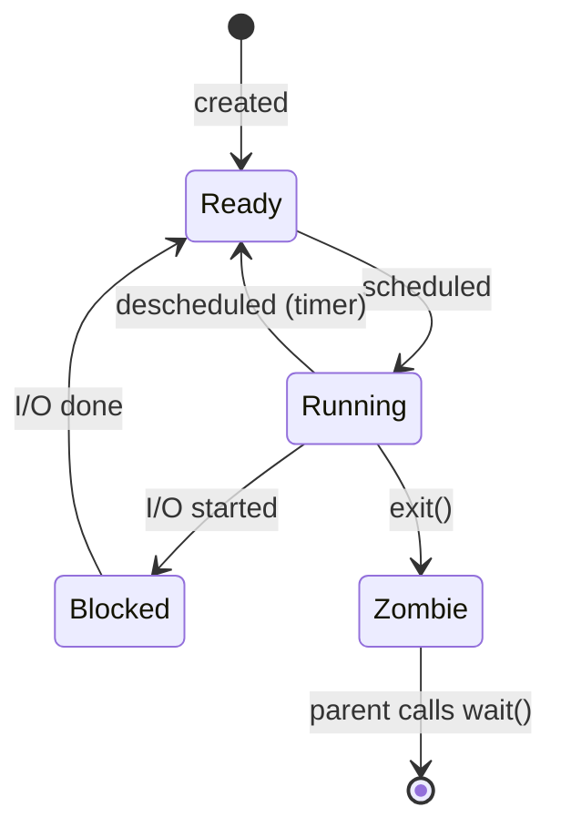

# L02 · Processes & fork / exec / wait

> **Book:** Ch 4–5 (pp. 25–48) · **Tier:** 🔴 Must · **Time:** 45 min · **Simulators:** `cpu-intro/process-run.py`, `cpu-api/fork.py`

## TL;DR

- A **process** is a running program: its memory (address space), its registers (incl. PC and stack pointer) and its open files.
- A process moves between three main states: **Running ⇄ Ready**, and **Running → Blocked → Ready** when it waits for I/O.
- UNIX creates processes with **`fork()`** (copy me), **`exec()`** (replace me with another program) and **`wait()`** (let my child finish). Splitting fork from exec is what makes shells powerful.

## The crux

> How do we create and control processes, and how does the OS give the illusion of many CPUs?

## The story chain

**Want many programs at once** → *one CPU, one program* → ❌ CPU idles while waiting for disk → *time-share: switch between processes* → need to **save/restore each process's state** → keep it in a **process control block (PCB)** in a **process list** → need an API to create them → **fork + exec + wait**.

## Core ideas

### What makes up a process (machine state)

- **Memory:** code, static data, heap, stack — the address space.
- **Registers:** program counter (PC), stack pointer, frame pointer, general registers.
- **I/O state:** list of open files (file descriptors 0, 1, 2 = stdin, stdout, stderr).

### How a program becomes a process

1. Load code and static data from disk into memory (modern OSes do this **lazily**, page by page).
2. Allocate the **stack** (with `argc`/`argv`) and a small **heap**.
3. Set up file descriptors 0, 1, 2.
4. Jump to `main()` — the OS hands the CPU to the process.

### Process states



A **zombie** has exited but its parent hasn't collected its exit status yet.

### The process API

| Call | What it does | Returns |
|---|---|---|
| `fork()` | Creates an almost exact copy of the caller. Both continue from the line after `fork()` | `0` in the child, child's PID in the parent, `-1` on error |
| `exec*()` | Replaces the current program's code and data with a new program. **Never returns on success** | only on error |
| `wait()` / `waitpid()` | Parent blocks until a child exits | child's PID |

```c
int rc = fork();
if (rc == 0) {                 // child
    char *args[] = {"wc", "notes.txt", NULL};
    execvp(args[0], args);     // becomes "wc"
} else {                       // parent
    wait(NULL);                // wait for child
}
```

### Why fork and exec are separate

The gap between `fork()` and `exec()` lets the shell **change the child's environment** before the new program starts. That's how redirection works:

`wc notes.txt > out.txt` → shell forks → child does `close(1); open("out.txt")` (the new file gets the lowest free fd, which is 1) → `exec("wc")`. `wc` writes to stdout as usual, but stdout is now the file. Pipes (`|`) use the same trick with `pipe()`.

### Other bits

- `kill()` sends **signals** (SIGINT on Ctrl-C, SIGTSTP on Ctrl-Z); a process can catch them with `signal()`.
- **Users** limit who can signal whom; the **superuser (root)** can do anything.

## Worked example

```c
printf("hello\n");
int rc = fork();
printf("rc=%d\n", rc);
```

Output: `hello` once, then two `rc=` lines — one `rc=0` (child), one `rc=<pid>` (parent). The **order of the two lines is not fixed**: the scheduler decides who runs first. Add `wait()` in the parent and the child's line always comes first.

## Traps

- After `fork()`, the child gets a **copy** of memory. Changing a variable in the child does not change the parent's.
- `exec()` does **not** create a new process. The PID stays the same.
- Output order after `fork()` is nondeterministic without `wait()`.
- Lazy loading means "load the program" doesn't read the whole file up front.

## Recall

**Blurt test:** draw the state diagram; write the fork–exec–wait snippet; explain `>` redirection in 3 steps.

<details markdown="1"><summary>What does fork() return in the parent and in the child?</summary>

Child's PID in the parent; 0 in the child; −1 on failure.

</details>

<details markdown="1"><summary>When does exec() return?</summary>

Only if it fails. On success the calling program is replaced and the old code is gone.

</details>

<details markdown="1"><summary>Why does UNIX split process creation into fork() and exec()?</summary>

So code can run in the child between the two, to set up redirection, pipes or other environment changes before the new program starts.

</details>

<details markdown="1"><summary>What are the three main process states and their transitions?</summary>

Running, Ready, Blocked. Running→Ready (descheduled), Ready→Running (scheduled), Running→Blocked (I/O starts), Blocked→Ready (I/O done).

</details>

<details markdown="1"><summary>What is a zombie process?</summary>

One that has exited but whose parent hasn't called wait() to collect its exit status.

</details>

<details markdown="1"><summary>What does the OS store in a process control block (PCB)?</summary>

Saved registers (context), state, PID, parent, memory info, open files, and similar per-process data.

</details>

**Explain it (60 s):** "Walk me through what the shell does when you type `ls -l > out.txt`."

**Simulator drill:** `python3 process-run.py -l 5:100,5:100 -c` then try `-l 4:0,1:100 -S SWITCH_ON_IO -I IO_RUN_IMMEDIATE` and predict CPU utilisation before running with `-c -p`.

## Connects to

- How the OS switches between processes → [L03 LDE](l03-lde.md)
- Which process to run next → [L04 Scheduling](l04-scheduling.md)
- What a process's memory looks like → [L06 Address spaces](l06-address-space.md)
- File descriptors → [L22 Files API](../persistence/l22-files-api.md)

## Read in the book

- 🔴 4.1–4.4 (process, API, creation, states) and 5.1–5.4 (fork, wait, exec, why).
- 🟡 4.5 data structures (look at the xv6 `struct proc`), 5.5.
- Do the Ch 5 coding homework if you have a Linux box — it's the fastest way to make fork stick.
