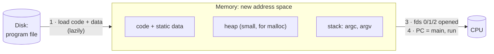
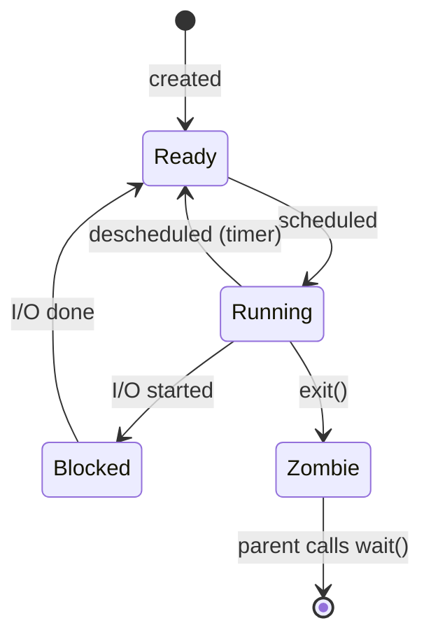

# L02 · Processes & fork / exec / wait

> **Book:** Ch 4–5 (pp. 25–48) · **Priority:** 🔴 must-know · **Time:** 45 min · **Simulators:** `cpu-intro/process-run.py`, `cpu-api/fork.py`

!!! example "In plain words"
    A **program** is a recipe sitting in a book (a file on disk). A **process** is someone actually cooking that recipe right now. They have ingredients on the counter (memory), are at a particular step (the program counter) and have tools in hand (open files).

    You can have several cooks following the same recipe at once: two terminal windows running the same program are two processes.

    - **fork()** = clone the cook, half-made dish and all.
    - **exec()** = the clone throws away the recipe and starts a different one.
    - **wait()** = the original cook waits until the clone is finished.

## TL;DR (the 3 things to remember)

- A **process** is a running program: its memory (address space), its registers (incl. PC and stack pointer) and its open files.
- A process moves between three main states: **Running ⇄ Ready**, and **Running → Blocked → Ready** when it waits for I/O.
- UNIX creates processes with **`fork()`** (copy me), **`exec()`** (replace me with another program) and **`wait()`** (let my child finish). Splitting fork from exec is what makes shells powerful.

## The big question

> How do we create and control processes, and how does the OS give the illusion of many CPUs?

## The story chain

<small>Key: **bold** = the problem or the final design · *italics* = an attempted fix · ❌ = what goes wrong with it · → = "which leads to"</small>

**Want many programs at once** → *one CPU, one program* → ❌ CPU idles while waiting for disk → *time-share: switch between processes* → need to **save/restore each process's state** → keep it in a **process control block (PCB)** in a **process list** → need an API to create them → **fork + exec + wait**.

## Core ideas

### What makes up a process (machine state)

- **Memory** (the address space):
    - **code** — the program's instructions;
    - **static data** — global variables, e.g. `int count = 0;` outside any function;
    - **heap** — memory the program asks for while running (`malloc` in C, `new` in Java);
    - **stack** — local variables, function arguments and return addresses; it grows on each call and shrinks on return.
- **Registers** (tiny, super-fast storage inside the CPU):
    - **program counter (PC)** — address of the next instruction to run;
    - **stack pointer** — where the top of the stack is right now;
    - **frame pointer** — where the current function's stack area starts;
    - general registers — scratch values the code is working on.
- **I/O state:** the list of open files. Every process starts with three: **0 = stdin** (keyboard input), **1 = stdout** (normal output), **2 = stderr** (error output).

!!! info "Never seen a C `main` before? 30-second detour"
    A C program starts at `int main(int argc, char *argv[])`. These two parameters carry the **command-line arguments** — the words you typed to start the program.

    - **argc** = *argument count*: how many words.
    - **argv** = *argument vector*: an array of those words as strings. `argv[0]` is the program's own name.

    Typing `./copy a.txt b.txt` gives **argc = 3** and **argv = ["./copy", "a.txt", "b.txt"]**. (Java's `main(String[] args)` is the same idea: `args.length` ≈ argc, `args` ≈ argv.)

    The OS is the one that puts these words into the new process's memory — that's why they show up in step 2 below.

### How a program becomes a process

1. **Load** the code and static data from the executable file on disk into memory. Modern OSes do this **lazily**: they load a piece (a page) only when the program first touches it, so programs start fast.
2. **Create the stack** and place argc and argv on it, so `main` finds its arguments; **create a small heap** for later `malloc` calls.
3. **Open the three standard files** (stdin, stdout, stderr — fds 0, 1, 2).
4. **Jump to `main()`**: set the PC to the program's first instruction, switch to user mode, and let it run.



### Process states



What the states mean:

- **Running** — on the CPU right now.
- **Ready** — could run, but waiting for its turn on the CPU.
- **Blocked** — waiting for something slow (disk, keyboard, network); can't run even if the CPU is free.
- **Zombie** — finished, but its parent hasn't yet asked "how did it go?" (collected its exit status with `wait()`).

### The process API

| Call | What it does | Returns |
|---|---|---|
| `fork()` | Creates an almost exact copy of the caller. Both continue from the line after `fork()` | `0` in the child, child's PID in the parent, `-1` on error |
| `exec*()` | Replaces the current program's code and data with a new program. **Never returns on success** | only on error |
| `wait()` / `waitpid()` | Parent blocks until a child exits | child's PID |

```c
int rc = fork();
if (rc == 0) {                 // child
    char *args[] = {"wc", "notes.txt", NULL};
    execvp(args[0], args);     // becomes "wc"
} else {                       // parent
    wait(NULL);                // wait for child
}
```

Reading it line by line:

1. `fork()` splits the program in two. From here on, **two copies** run the same code.
2. Each copy checks `rc`. The child sees `0`; the parent sees the child's process ID (a positive number).
3. The child calls `execvp` to **turn itself into** the `wc` program (word count), with the argument `notes.txt`. Its old code is gone.
4. The parent calls `wait` and sleeps until the child (now `wc`) finishes.

This is exactly what your shell does every time you type a command.

### Why fork and exec are separate

The gap between `fork()` and `exec()` lets the shell **change the child's environment** before the new program starts. That's how redirection works:

When you type `wc notes.txt > out.txt`:

1. The shell **forks** a child.
2. The child **closes** file descriptor 1 (stdout, normally the screen).
3. The child **opens** `out.txt`. The OS always hands out the lowest free number, which is now 1, so `out.txt` *becomes* stdout.
4. The child **execs** `wc`. `wc` writes to stdout as usual, without knowing it's now writing into a file.

Pipes (`ls | wc`) use the same trick: the shell connects one child's stdout to the other's stdin before calling exec.

### Other bits

- `kill()` sends a **signal** — a short message to a process. Pressing Ctrl-C sends SIGINT ("please stop"); Ctrl-Z sends SIGTSTP ("pause"). A program can choose to catch a signal and react, using `signal()`.
- You can only signal your own processes. The **superuser (root)**, the administrator account, can signal anyone.

## Worked example

```c
printf("hello\n");
int rc = fork();
printf("rc=%d\n", rc);
```

Output: `hello` once (it was printed *before* the fork, when there was only one process), then two `rc=` lines — `rc=0` from the child and `rc=<some number>` from the parent (the child's process ID). The **order of the two lines is not fixed**: the scheduler decides who runs first. Add `wait()` in the parent and the child's line always comes first.

## Common mistakes

- After `fork()`, the child gets a **copy** of memory. Changing a variable in the child does not change the parent's.
- `exec()` does **not** create a new process. The PID stays the same.
- Output order after `fork()` is nondeterministic without `wait()`.
- Lazy loading means "load the program" doesn't read the whole file up front.

## Recall

**Blurt test** — close this page, then on paper, from memory: draw the state diagram; write the fork–exec–wait snippet; explain `>` redirection in 3 steps.

<details markdown="1"><summary>What does fork() return in the parent and in the child?</summary>

Child's PID in the parent; 0 in the child; −1 on failure.

</details>

<details markdown="1"><summary>When does exec() return?</summary>

Only if it fails. On success the calling program is replaced and the old code is gone.

</details>

<details markdown="1"><summary>Why does UNIX split process creation into fork() and exec()?</summary>

So code can run in the child between the two, to set up redirection, pipes or other environment changes before the new program starts.

</details>

<details markdown="1"><summary>What are the three main process states and their transitions?</summary>

Running, Ready, Blocked. Running→Ready (descheduled), Ready→Running (scheduled), Running→Blocked (I/O starts), Blocked→Ready (I/O done).

</details>

<details markdown="1"><summary>What is a zombie process?</summary>

One that has exited but whose parent hasn't called wait() to collect its exit status.

</details>

<details markdown="1"><summary>What does the OS store in a process control block (PCB)?</summary>

Saved registers (context), state, PID, parent, memory info, open files, and similar per-process data.

</details>

**Explain it out loud (60 seconds, as if to a friend):** "Walk me through what the shell does when you type `ls -l > out.txt`."

**Simulator drill** (book's free Python homework tools — see [the recall system](../start/recall-system.md#four-more-tricks-that-pay-off)): `python3 process-run.py -l 5:100,5:100 -c` then try `-l 4:0,1:100 -S SWITCH_ON_IO -I IO_RUN_IMMEDIATE` and predict CPU utilisation before running with `-c -p`.

## Connects to

- How the OS switches between processes → [L03 LDE](l03-lde.md)
- Which process to run next → [L04 Scheduling](l04-scheduling.md)
- What a process's memory looks like → [L06 Address spaces](l06-address-space.md)
- File descriptors → [L22 Files API](../persistence/l22-files-api.md)

## Read in the book

- 🔴 4.1–4.4 (process, API, creation, states) and 5.1–5.4 (fork, wait, exec, why).
- 🟡 4.5 data structures (look at the xv6 `struct proc`), 5.5.
- Do the Ch 5 coding homework if you have a Linux box — it's the fastest way to make fork stick.
