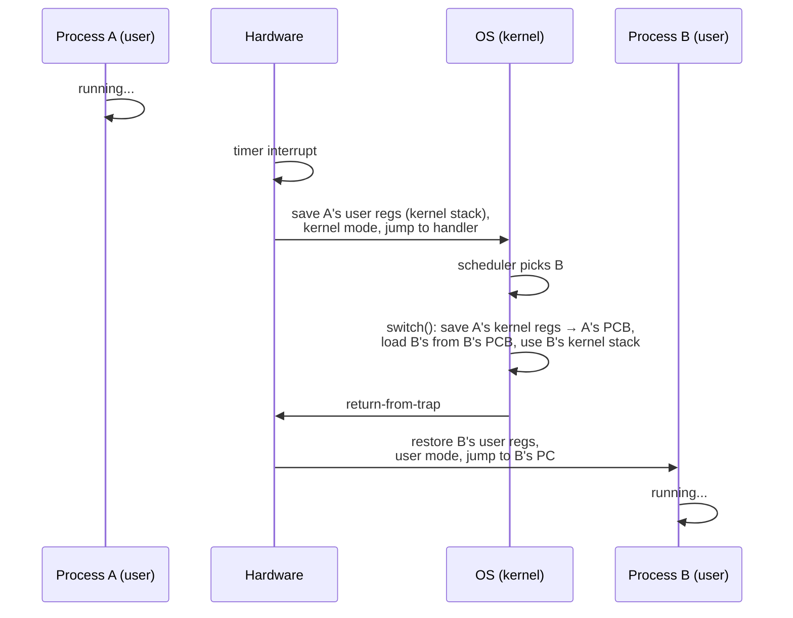

# L03 · Limited direct execution

> **Book:** Ch 6 (pp. 49–62) · **Priority:** 🔴 must-know · **Time:** 40 min

!!! example "In plain words"
    Think of a driving instructor with a learner. For speed, the learner drives the real car directly (programs run on the real CPU). But the instructor keeps **dual controls**:

    - Some actions need permission. The learner can't take the motorway alone, so they *ask* (a system call).
    - An alarm rings every few minutes (the **timer interrupt**), and the instructor can take over the wheel. That stops a learner from driving off forever.
    - Swapping learners means writing down exactly where the first one was (seat, mirrors, route) so they can carry on later. That's a **context switch**.

## TL;DR (the 3 things to remember)

- For speed, the OS lets programs **run directly on the CPU**. For control, it **limits** them: user programs run in **user mode** and must **trap** into the kernel for privileged work.
- The kernel regains the CPU through a **timer interrupt**, even if a program never gives it up.
- Switching processes = **context switch**: save the old process's registers into its kernel structure, restore the next one's, return from trap.

## The big question

> How can the OS run programs efficiently while keeping control of the CPU?

Two sub-problems: (1) **restricted operations** — how does a process do I/O without being able to do *anything*? (2) **switching** — how does the OS get the CPU back to run someone else?

## The story chain

<small>Key: **bold** = the problem or the final design · *italics* = an attempted fix · ❌ = what goes wrong with it · → = "which leads to"</small>

**Run the program directly** → ❌ it could do anything (wipe disk) → *user mode vs kernel mode; privileged work via system calls that trap* → ❌ how does the OS ever run again if a program loops forever? → *cooperative: wait for the program to make a syscall or yield* → ❌ an infinite loop never yields; only fix is reboot → *non-cooperative: a hardware timer interrupt every few ms hands control to the OS* → **limited direct execution + context switch**.

## Core ideas

### Problem 1 — restricted operations

The problem: if a program runs directly on the CPU, what stops it from doing anything it likes, such as erasing the disk or reading another program's memory?

- **The hardware has two modes.** In **user mode** (where programs run), dangerous instructions like talking to the disk are simply refused. In **kernel mode** (where the OS runs), everything is allowed.
- **So how does a program read a file?** It makes a **system call**. That executes a special **trap** instruction, which does three things at once: saves the program's registers, switches the CPU to kernel mode, and jumps into the OS.
- **Jumps where?** Not anywhere the program chooses. That would let it skip the OS's safety checks. At boot, the OS gives the hardware a **trap table**: a list of "for event X, run OS code at address Y". A program only says *which* service it wants by number (e.g. "system call #2 = open a file").
- **Going back:** when the OS is done, it runs **return-from-trap**. This restores the registers, switches back to user mode and resumes the program right after its system call.

### Problem 2 — switching between processes

The problem: while a program runs, the OS **isn't running at all**. The CPU only does one thing at a time. So how does the OS ever get the CPU back to let another program have a turn?

- **Cooperative approach** (old Mac OS): wait politely. The OS only runs when the program makes a system call, voluntarily gives up the CPU (*yields*), or crashes. But a program stuck in an infinite loop never does any of those, and the only fix is rebooting the machine.
- **Non-cooperative approach** (every modern OS): a hardware **timer** interrupts the CPU every few milliseconds, whatever the program is doing. The interrupt forces a jump into the OS. Now the OS can decide: let this program continue, or switch to another one.
- Deciding *who* runs next is the **scheduler's** job ([L04](l04-scheduling.md)). The act of switching is a **context switch**: save the current program's registers, load the next program's registers.

### The timeline of a context switch (A → B)

How to read this: time flows downward. A is running; the timer fires; the OS decides to run B instead; it swaps the saved registers; B continues exactly where it last stopped.

Two saves happen:

1. The **hardware** saves A's user registers automatically when the interrupt hits.
2. The **OS** saves the registers it was using in its own code, in a routine usually called `switch()`, into A's process control block.

Restoring B is the same two steps in reverse.

### Costs to remember

A system call or context switch takes about a **microsecond** or less on modern machines, which is cheap. The bigger hidden cost: after a switch, the CPU's caches and TLB are full of the *old* program's data, so the new program runs slowly for a while until they warm up.

## Common mistakes

- The trap table is set up **at boot**, in kernel mode — not by each program.
- User programs pass a **syscall number**, not a handler address.
- "Who saves the registers?" → both: hardware (user registers, on trap/interrupt) and OS (kernel registers, on switch).
- What if an interrupt happens while handling an interrupt? The OS may **disable interrupts** briefly and uses **locks** on its own data — a preview of concurrency.

## Recall

**Blurt test** — close this page, then on paper, from memory: write the two problems and their solutions; draw the context-switch timeline with who-saves-what.

What does "limited direct execution" mean?

Run the program directly on the CPU for speed, but limit it: user mode, traps for privileged operations, and a timer interrupt so the OS regains control.

What is the trap table and when is it set up?

A table of handler addresses for traps/interrupts. The kernel installs it at boot using a privileged instruction.

Why does the cooperative approach fail?

A process stuck in an infinite loop never makes a syscall, so the OS never runs again; you must reboot.

How does the OS regain control in the non-cooperative approach?

A hardware timer interrupt every few milliseconds jumps into the OS's interrupt handler.

In a context switch, which registers does the hardware save and which does the OS save?

Hardware saves the user registers onto the process's kernel stack on the interrupt. The OS saves the kernel registers into the process's PCB in switch().

Why pass a system-call number instead of an address?

So user code can only reach approved kernel entry points; it can't jump into the middle of the kernel.

**Explain it out loud (60 seconds, as if to a friend):** "Your program runs `while(1);`. Explain step by step how the OS still gets to run another program."

## Connects to

- Which process to switch *to* → [L04 Scheduling](l04-scheduling.md)
- Context switches make the TLB stale → [L10 TLBs](l10-tlb.md)
- Disabling interrupts as a lock → [L14 Locks](../concurrency/l14-locks.md)

## Read in the book

- 🔴 6.1–6.3 including the two protocol tables (Figure 6.2 and 6.3 — redraw these).
- 🟡 6.4 concurrency aside.
- ⚪ Measurement homework unless you enjoy timing syscalls.
