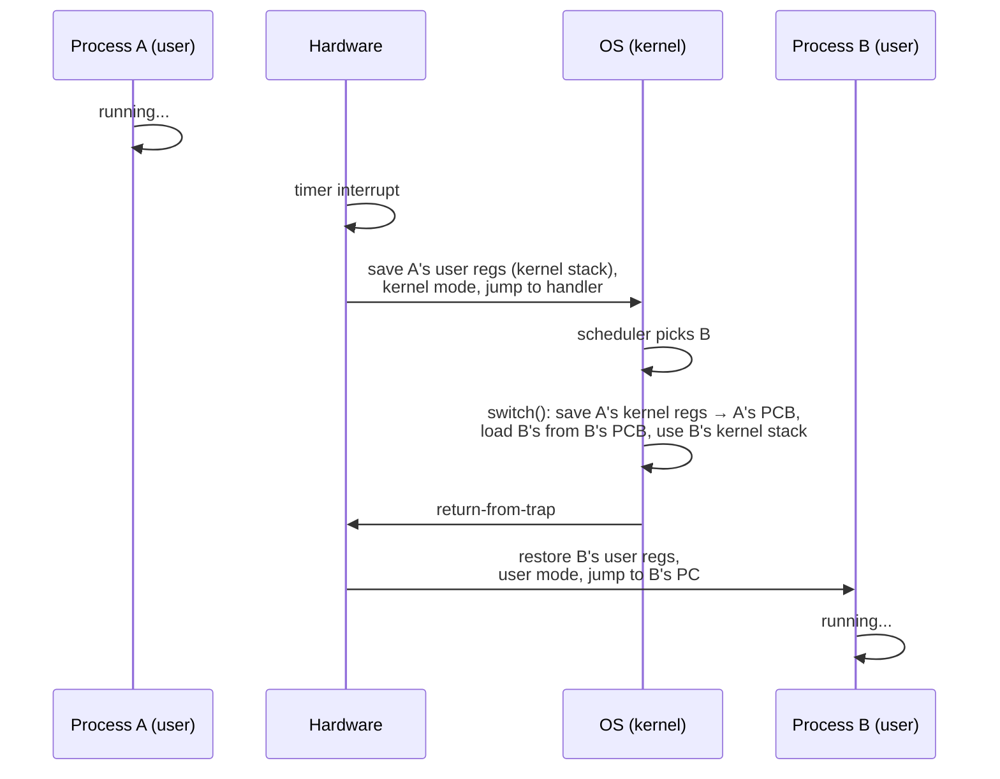

# L03 · Limited direct execution

> **Book:** Ch 6 (pp. 49–62) · **Tier:** 🔴 Must · **Time:** 40 min

## TL;DR

- For speed, the OS lets programs **run directly on the CPU**. For control, it **limits** them: user programs run in **user mode** and must **trap** into the kernel for privileged work.
- The kernel regains the CPU through a **timer interrupt**, even if a program never gives it up.
- Switching processes = **context switch**: save the old process's registers into its kernel structure, restore the next one's, return from trap.

## The crux

> How can the OS run programs efficiently while keeping control of the CPU?

Two sub-problems: (1) **restricted operations** — how does a process do I/O without being able to do *anything*? (2) **switching** — how does the OS get the CPU back to run someone else?

## The story chain

**Run the program directly** → ❌ it could do anything (wipe disk) → *user mode vs kernel mode; privileged work via system calls that trap* → ❌ how does the OS ever run again if a program loops forever? → *cooperative: wait for the program to make a syscall or yield* → ❌ an infinite loop never yields; only fix is reboot → *non-cooperative: a hardware timer interrupt every few ms hands control to the OS* → **limited direct execution + context switch**.

## Core ideas

### Problem 1 — restricted operations

- The CPU has (at least) two modes. **User mode**: no I/O, no changing page tables. **Kernel mode**: everything allowed.
- A **system call** runs a special **trap** instruction: it saves registers to the **kernel stack**, switches to kernel mode, and jumps into the OS.
- Where does it jump? At boot, the kernel sets up a **trap table** that tells the hardware the address of each handler. Setting the trap table is itself privileged. Programs pass a **system-call number**, never an address — so they can't jump to arbitrary kernel code.
- The OS finishes with **return-from-trap**: restore registers, drop to user mode, continue the program.

### Problem 2 — switching between processes

- **Cooperative** approach (old Mac OS): the OS runs only when a process makes a system call, yields, or does something illegal. One infinite loop → reboot.
- **Non-cooperative** approach: a **timer interrupt** fires every few milliseconds. The hardware saves the running program's registers and jumps to the OS's interrupt handler. Now the OS can decide: keep running this process, or switch.
- The decision is made by the **scheduler** ([L04](l04-scheduling.md)). Switching is the **context switch**.

### The timeline of a context switch (A → B)

Two saves happen: **hardware** saves the user registers (on the interrupt), and the **OS** saves the kernel registers (in `switch()`).

### Costs to remember

A system call or context switch takes on the order of **microseconds** (the book quotes sub-microsecond on modern machines for a null syscall). The hidden cost is cache and TLB pollution after the switch.

## Traps

- The trap table is set up **at boot**, in kernel mode — not by each program.
- User programs pass a **syscall number**, not a handler address.
- "Who saves the registers?" → both: hardware (user registers, on trap/interrupt) and OS (kernel registers, on switch).
- What if an interrupt happens while handling an interrupt? The OS may **disable interrupts** briefly and uses **locks** on its own data — a preview of concurrency.

## Recall

**Blurt test:** write the two problems and their solutions; draw the context-switch timeline with who-saves-what.

What does "limited direct execution" mean?

Run the program directly on the CPU for speed, but limit it: user mode, traps for privileged operations, and a timer interrupt so the OS regains control.

What is the trap table and when is it set up?

A table of handler addresses for traps/interrupts. The kernel installs it at boot using a privileged instruction.

Why does the cooperative approach fail?

A process stuck in an infinite loop never makes a syscall, so the OS never runs again; you must reboot.

How does the OS regain control in the non-cooperative approach?

A hardware timer interrupt every few milliseconds jumps into the OS's interrupt handler.

In a context switch, which registers does the hardware save and which does the OS save?

Hardware saves the user registers onto the process's kernel stack on the interrupt. The OS saves the kernel registers into the process's PCB in switch().

Why pass a system-call number instead of an address?

So user code can only reach approved kernel entry points; it can't jump into the middle of the kernel.

**Explain it (60 s):** "Your program runs `while(1);`. Explain step by step how the OS still gets to run another program."

## Connects to

- Which process to switch *to* → [L04 Scheduling](l04-scheduling.md)
- Context switches make the TLB stale → [L10 TLBs](l10-tlb.md)
- Disabling interrupts as a lock → [L14 Locks](../concurrency/l14-locks.md)

## Read in the book

- 🔴 6.1–6.3 including the two protocol tables (Figure 6.2 and 6.3 — redraw these).
- 🟡 6.4 concurrency aside.
- ⚪ Measurement homework unless you enjoy timing syscalls.
