```mermaid
gantt
    dateFormat X
    axisFormat %s
    title FIFO vs SJF (A=100, B=10, C=10)
    section FIFO
    A :0, 100
    B :100, 110
    C :110, 120
    section SJF
    B :0, 10
    C :10, 20
    A :20, 120
```

# L04 · Scheduling basics: FIFO, SJF, STCF, RR

> **Book:** Ch 7 (pp. 63–74) · **Priority:** 🔴 must-know · **Time:** 45 min · **Simulator:** `cpu-sched/scheduler.py`

!!! example "In plain words"
    You're at a supermarket with one checkout (one CPU). Who goes first?

    - **FIFO:** strict arrival order. One person with a full trolley makes everyone with one item wait.
    - **SJF / STCF:** let people with fewer items go first. Great on average, but the full-trolley person may wait a long time.
    - **Round Robin:** scan 1 item per customer in turn. Everyone gets *started* quickly, but everyone *finishes* late.

    There's no single best rule. It depends on whether you care about **finishing fast** (turnaround) or **starting fast** (response).

## TL;DR (the 3 things to remember)

- Two metrics fight each other: **turnaround time** (finish − arrival) favours running short jobs to completion; **response time** (first run − arrival) favours switching often.
- **SJF/STCF** are optimal for average turnaround; **Round Robin** is great for response time but nearly the worst for turnaround.
- Overlap I/O by treating each CPU burst as its own job. And in reality we **don't know job lengths** — that's what MLFQ ([L05](l05-mlfq.md)) fixes.

## The big question

> How should we design a scheduling policy? What assumptions and metrics matter?

## The story chain

<small>Key: **bold** = the problem or the final design · *italics* = an attempted fix · ❌ = what goes wrong with it · → = "which leads to"</small>

Start with unrealistic assumptions — all jobs arrive together, run the same time, no I/O, length known — and relax them one by one:

**FIFO** → ❌ *(jobs differ in length)* a long job in front makes everyone wait — the **convoy effect** → **SJF** (run shortest first) → ❌ *(jobs arrive at different times)* a short job arriving just after a long one starts still waits → **STCF** (preempt; run the job with the least time *remaining*) → ❌ *(users are interactive)* response time is terrible → **Round Robin** (time slices) → ❌ turnaround now awful; *(jobs do I/O)* → **overlap**: run another job while one waits → ❌ *(we don't know lengths)* → **MLFQ**.

## Core ideas

### How do we score a scheduler? (metrics)

In this chapter a **job** just means a process that needs some CPU time.

| Metric | Formula | In words | Who cares |
|---|---|---|---|
| **Turnaround time** | Tcompletion − Tarrival | How long from "job arrives" to "job is **finished**" | Batch work (e.g. a long calculation) |
| **Response time** | Tfirst run − Tarrival | How long from "job arrives" to "job **first gets the CPU**" | People typing or clicking |
| Fairness | e.g. Jain's index | Does everyone get a fair share? | Everyone |

Lower is better for both times. We usually compare the **average** across all jobs.

### The policies

**Preemptive** means the scheduler can pause a running job to run another one. Non-preemptive means a job runs until it finishes (or blocks).

| Policy | Preemptive? | Good at | Bad at |
|---|---|---|---|
| **FIFO** (first in, first out) | No | Simple | Convoy effect: short jobs stuck behind a long one |
| **SJF** (shortest job first) | No | Best average turnaround *if all jobs arrive together* | A short job arriving just after a long one starts still waits |
| **STCF** (shortest time-to-completion first, also called PSJF) | Yes | Best average turnaround in general | Response time; needs to know job lengths |
| **RR** (round robin) | Yes, every time slice | Response time, fairness | Turnaround (every job finishes late) |

### Round Robin's time slice

A **time slice** (or *quantum*) is how long each job runs before RR moves to the next one.

- It must be a multiple of the timer interrupt period. With a 10 ms timer, slices can be 10, 20, 30 ms…
- **Shorter slice** = jobs get started sooner (better response), but more of the CPU's time goes on switching rather than real work.
- **The trade-off in numbers:** if one switch costs 1 ms, a 10 ms slice wastes about 10% of the CPU on switching; a 100 ms slice wastes about 1%. Spreading a fixed cost over more work is called *amortizing* it.
- Switching also throws away "warm" state: caches and the TLB were full of the old job's data.

### Incorporating I/O

Real jobs alternate between using the CPU and waiting for I/O (disk, network). When job A starts a disk read, it's blocked and can't use the CPU, so **run job B meanwhile**. Nothing is wasted.

The trick: treat each short stretch of A's CPU use (each *CPU burst*) as its own little job. Because the bursts are short, STCF runs them first. A gets its next disk request going quickly, and B fills in the gaps. Both the disk and the CPU stay busy.

## Worked example (do this one by hand)

Three jobs need A = 100 ms, B = 10 ms and C = 10 ms of CPU. All arrive at time 0, in the order A, B, C.

- **FIFO** runs A first (0–100), then B (100–110), then C (110–120).
- **SJF** runs the short ones first: B (0–10), C (10–20), then A (20–120).
- Turnaround for each job = its finish time − 0. Response = its start time − 0.

| Policy | Completion times | Avg turnaround | Avg response |
|---|---|---|---|
| FIFO | A 100, B 110, C 120 | (100+110+120)/3 = **110** | (0+100+110)/3 = 70 |
| SJF | B 10, C 20, A 120 | (10+20+120)/3 = **50** | (0+10+20)/3 = 10 |

Now make all three jobs 5 ms long and compare RR (1 ms slice) with SJF:

- **RR** runs A, B, C, A, B, C, … one millisecond each. A starts at 0, B at 1, C at 2 → average response = (0+1+2)/3 = **1 ms**. But they finish at 13, 14, 15 → average turnaround = **14 ms**.
- **SJF** (same as FIFO here, since all are equal) runs A 0–5, B 5–10, C 10–15. Response = (0+5+10)/3 = **5 ms**. Turnaround = (5+10+15)/3 = **10 ms**.

RR wins on response, SJF wins on turnaround. That's the whole trade-off in one example.

## Common mistakes

- Turnaround vs response — they're different formulas; exams love mixing them.
- SJF is optimal **only** when all jobs arrive together; STCF is the general optimum for turnaround.
- RR with a tiny slice is not "free" fairness — the switch cost dominates.
- Response time is measured to the **first** time the job runs, not to completion.

## Recall

**Blurt test** — close this page, then on paper, from memory: write the four assumptions and which policy each relaxation produces; redo the FIFO/SJF example without looking.

Define turnaround time and response time.

Turnaround = completion − arrival. Response = first run − arrival.

What is the convoy effect?

Short jobs stuck waiting behind a long job in FIFO, inflating average turnaround.

What's the difference between SJF and STCF?

SJF is non-preemptive: it picks the shortest job when choosing. STCF preempts the running job whenever a new job has less remaining time.

Why does RR have poor turnaround?

It stretches every job out across many slices, so all jobs finish near the end.

What's the trade-off in choosing RR's time slice?

Shorter = better response but more context-switch overhead; longer amortizes the switch cost but hurts response.

How does the scheduler use I/O to improve utilisation?

When a job blocks on I/O, run another job; treat each CPU burst as a separate job so interactive bursts run quickly and overlap with I/O.

**Explain it out loud (60 seconds, as if to a friend):** "Why is there no single best scheduler? Use turnaround and response time in your answer."

**Simulator drill** (book's free Python homework tools — see [the recall system](../start/recall-system.md#four-more-tricks-that-pay-off)): `python3 scheduler.py -p FIFO -j 3 -s 1` — compute the stats yourself, then add `-c`. Repeat with `-p SJF` and `-p RR -q 1`.

## Connects to

- Not knowing job lengths → [L05 MLFQ](l05-mlfq.md)
- Context-switch cost → [L03](l03-lde.md), [L10 TLB](l10-tlb.md)
- Same SJF idea for disks (SSTF) → [L20 Disks](../persistence/l20-disks.md)

## Read in the book

- 🔴 Whole chapter (it's short). Redraw Figures 7.1–7.7 as Gantt bars.
