# L04 · Scheduling basics: FIFO, SJF, STCF, RR

> **Book:** Ch 7 (pp. 63–74) · **Tier:** 🔴 Must · **Time:** 45 min · **Simulator:** `cpu-sched/scheduler.py`

## TL;DR

- Two metrics fight each other: **turnaround time** (finish − arrival) favours running short jobs to completion; **response time** (first run − arrival) favours switching often.
- **SJF/STCF** are optimal for average turnaround; **Round Robin** is great for response time but nearly the worst for turnaround.
- Overlap I/O by treating each CPU burst as its own job. And in reality we **don't know job lengths** — that's what MLFQ ([L05](l05-mlfq.md)) fixes.

## The crux

> How should we design a scheduling policy? What assumptions and metrics matter?

## The story chain

Start with unrealistic assumptions — all jobs arrive together, run the same time, no I/O, length known — and relax them one by one:

**FIFO** → ❌ *(jobs differ in length)* a long job in front makes everyone wait — the **convoy effect** → **SJF** (run shortest first) → ❌ *(jobs arrive at different times)* a short job arriving just after a long one starts still waits → **STCF** (preempt; run the job with the least time *remaining*) → ❌ *(users are interactive)* response time is terrible → **Round Robin** (time slices) → ❌ turnaround now awful; *(jobs do I/O)* → **overlap**: run another job while one waits → ❌ *(we don't know lengths)* → **MLFQ**.

## Core ideas

### Metrics

| Metric | Formula | Who cares |
|---|---|---|
| Turnaround | Tcompletion − Tarrival | Batch jobs |
| Response | Tfirst run − Tarrival | Interactive users |
| Fairness | e.g. Jain's index | Everyone gets a share |

### The policies

| Policy | Preemptive? | Good at | Bad at |
|---|---|---|---|
| **FIFO** | No | Simple | Convoy effect |
| **SJF** | No | Optimal turnaround if all arrive together | Late short arrivals |
| **STCF** (= PSJF) | Yes | Optimal turnaround in general | Response time; needs lengths |
| **RR** | Yes, every slice | Response time, fairness | Turnaround (stretches everyone out) |

### Round Robin's time slice

- Slice must be a multiple of the timer interrupt period (e.g. 10 ms timer → 10, 20, 30 ms slices).
- **Shorter slice** = better response, but more context-switch overhead. **Amortize**: if a switch costs 1 ms, a 10 ms slice wastes ~10%; a 100 ms slice wastes ~1%.
- Switching also costs warm caches, TLBs, branch predictors.

### Incorporating I/O

When job A issues I/O, it blocks — run B meanwhile. Treat each of A's CPU bursts as an independent short job; STCF then naturally runs A's short bursts quickly, keeping the disk busy and the CPU busy.

## Worked example (do this one by hand)

Jobs A=100, B=10, C=10 (ms), all arrive at t=0, in order A, B, C.

| Policy | Completion times | Avg turnaround | Avg response |
|---|---|---|---|
| FIFO | A 100, B 110, C 120 | (100+110+120)/3 = **110** | (0+100+110)/3 = 70 |
| SJF | B 10, C 20, A 120 | (10+20+120)/3 = **50** | (0+10+20)/3 = 10 |

Now A=B=C=5 ms, RR with 1 ms slice: response = (0+1+2)/3 = **1 ms**. With SJF (same as FIFO here): response = (0+5+10)/3 = **5 ms**. But RR turnaround: A 13, B 14, C 15 → 14 ms vs SJF's 10 ms.

```mermaid
gantt
    dateFormat X
    axisFormat %s
    title FIFO vs SJF (A=100, B=10, C=10)
    section FIFO
    A :0, 100
    B :100, 110
    C :110, 120
    section SJF
    B :0, 10
    C :10, 20
    A :20, 120
```

## Traps

- Turnaround vs response — they're different formulas; exams love mixing them.
- SJF is optimal **only** when all jobs arrive together; STCF is the general optimum for turnaround.
- RR with a tiny slice is not "free" fairness — the switch cost dominates.
- Response time is measured to the **first** time the job runs, not to completion.

## Recall

**Blurt test:** write the four assumptions and which policy each relaxation produces; redo the FIFO/SJF example without looking.

Define turnaround time and response time.

Turnaround = completion − arrival. Response = first run − arrival.

What is the convoy effect?

Short jobs stuck waiting behind a long job in FIFO, inflating average turnaround.

What's the difference between SJF and STCF?

SJF is non-preemptive: it picks the shortest job when choosing. STCF preempts the running job whenever a new job has less remaining time.

Why does RR have poor turnaround?

It stretches every job out across many slices, so all jobs finish near the end.

What's the trade-off in choosing RR's time slice?

Shorter = better response but more context-switch overhead; longer amortizes the switch cost but hurts response.

How does the scheduler use I/O to improve utilisation?

When a job blocks on I/O, run another job; treat each CPU burst as a separate job so interactive bursts run quickly and overlap with I/O.

**Explain it (60 s):** "Why is there no single best scheduler? Use turnaround and response time in your answer."

**Simulator drill:** `python3 scheduler.py -p FIFO -j 3 -s 1` — compute the stats yourself, then add `-c`. Repeat with `-p SJF` and `-p RR -q 1`.

## Connects to

- Not knowing job lengths → [L05 MLFQ](l05-mlfq.md)
- Context-switch cost → [L03](l03-lde.md), [L10 TLB](l10-tlb.md)
- Same SJF idea for disks (SSTF) → [L20 Disks](../persistence/l20-disks.md)

## Read in the book

- 🔴 Whole chapter (it's short). Redraw Figures 7.1–7.7 as Gantt bars.
