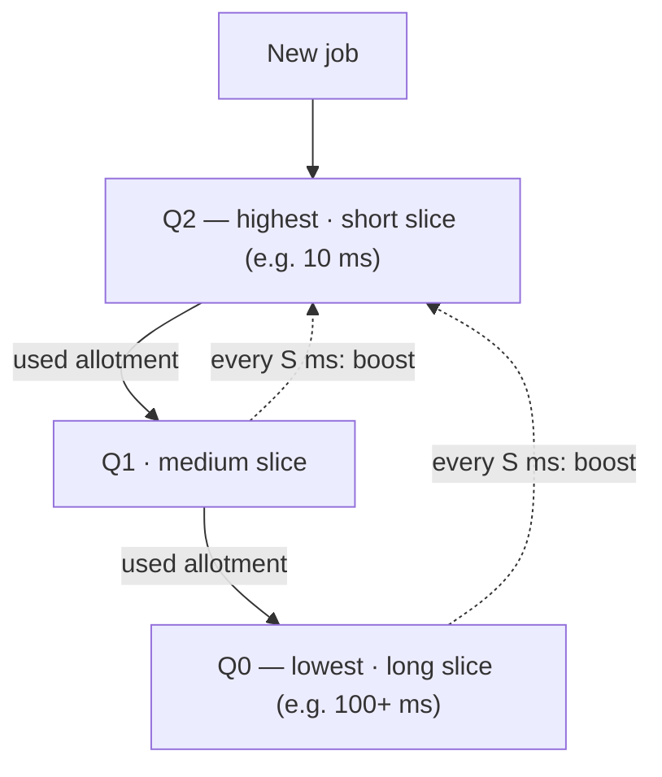

# L05 · MLFQ, lottery & multiprocessor scheduling

> **Book:** Ch 8 (pp. 75–86) 🔴 · Ch 9 (pp. 87–96) 🟡 · Ch 10 (pp. 97–108) 🟡 · **Time:** 50 min · **Simulators:** `cpu-sched-mlfq/mlfq.py`, `cpu-sched-lottery/lottery.py`

## TL;DR

- **MLFQ** learns a job's behaviour from history: jobs that use their whole time slice drift down to low priority (CPU-bound), jobs that give up the CPU early stay high (interactive).
- Two fixes make it safe: **priority boost** (stop starvation) and **better accounting** of total time used at a level (stop gaming).
- **Lottery/stride** give each job a proportional share using tickets. **Multi-CPU** scheduling adds cache affinity and load balancing.

## The crux

> How can a scheduler minimise turnaround *and* response time without knowing how long jobs run?

## The story chain

**Don't know job lengths** → *several queues with different priorities; learn from behaviour* → *new jobs start at the top; drop a job down when it uses a full slice* → ❌ **starvation**: many interactive jobs keep long jobs from ever running; also a job can change from CPU-bound to interactive and be stuck low → *Rule 5: periodically boost everyone to the top* → ❌ **gaming**: a job yields just before its slice ends and stays on top forever → *Rule 4 rewritten: count total time used at a level, regardless of how many times it yields* → **final MLFQ**.

## Core ideas

### The five rules (memorise these exactly)

1. If Priority(A) > Priority(B), **A runs**.
2. If Priority(A) = Priority(B), A and B run in **round robin**.
3. A new job starts at the **highest** priority.
4. Once a job uses up its **time allotment** at a level (no matter how many times it gave up the CPU), its priority is **reduced**.
5. After some period **S**, move **all** jobs to the topmost queue.

**Tuning:** high queues get **short** slices (interactive jobs), low queues get **long** slices (CPU-bound jobs). Choosing S is "voodoo constant" territory: too long → starvation, too short → interactive jobs lose their edge. Solaris uses a table; FreeBSD computes priority from CPU usage with decay.

### Proportional share (Ch 9) — the short version

- **Lottery:** each job holds **tickets**; every slice, draw a random ticket; the holder runs. Share of CPU ≈ share of tickets. Simple, no global state, but only fair over **long** runs.
- Extras: **ticket currency** (users split their tickets locally), **transfer** (a client lends tickets to a server), **inflation** (a trusted job raises its own tickets).
- **Stride scheduling:** deterministic version. stride = big number / tickets; always run the job with the lowest **pass** value, then add its stride. Exactly fair, but needs global state (a new job — what pass value?).
- **Linux CFS** (not in v0.90 of the book — later editions add it; worth knowing for interviews): tracks **virtual runtime** per process and runs the lowest vruntime (kept in a **red-black tree**). Weights come from **nice** values; `sched_latency` (e.g. 48 ms) is divided among runnable jobs, with `min_granularity` (e.g. 6 ms) as the floor.

### Multiprocessor scheduling (Ch 10) — the short version

- Each CPU has its own **cache**; caches are kept consistent by hardware **cache coherence** (bus snooping). Shared data still needs locks.
- **Cache affinity:** a process runs faster on the CPU it ran on last (warm cache).
- **SQMS** (single queue): simple, balances load, but the one queue's lock limits scaling and jobs bounce between CPUs (poor affinity).
- **MQMS** (queue per CPU): scales, keeps affinity, but **load imbalance** → fix by **migration** / **work stealing** (an idle CPU peeks at others' queues).
- Linux: O(1) and CFS are multi-queue; BFS is single-queue.

## Worked example

Two jobs: A is CPU-bound (long), B is interactive (runs 1 ms then does I/O). Three queues, 10 ms slice.

- A starts in Q2, uses 10 ms → Q1 → uses 10 ms → Q0, stays there.
- B arrives, starts in Q2, runs 1 ms, blocks; each time it returns it's still in Q2 (under the old Rule 4b). B gets fast response; A runs whenever B is blocked.
- Gaming: if A ran 9.9 ms then did a pointless I/O, under the old rule it would stay in Q2 forever. The new Rule 4 counts A's 9.9 + 9.9 + … against Q2's allotment and moves it down.

## Traps

- The old rules 4a/4b (drop if slice used, stay if you yield) are **replaced** by the new Rule 4 — know both and why.
- Boost (Rule 5) solves **two** problems: starvation and jobs that change behaviour.
- Lottery is **probabilistically** fair; short jobs may get unlucky.
- Stride needs global state; lottery doesn't.

## Recall

**Blurt test:** write all five MLFQ rules, then the two problems each fix (starvation, gaming).

What is MLFQ's key idea?

Use several priority queues and adjust a job's priority based on its observed behaviour, so it approximates SJF without knowing job lengths.

Which MLFQ rule prevents starvation, and what else does it fix?

Rule 5 (periodic priority boost). It also lets a job that became interactive get back to high priority.

How could a program game the original MLFQ, and what fixes it?

Issue an I/O just before its slice ends to stay at high priority. Fixed by accounting for total time used at a level (new Rule 4).

Why do higher MLFQ queues get shorter time slices?

They hold interactive jobs that need fast switching; lower queues hold CPU-bound jobs that benefit from long slices with less switching.

Lottery vs stride scheduling?

Lottery picks a random ticket each slice — simple, no global state, fair on average. Stride is deterministic (run lowest pass, add stride) — exactly fair but needs global state.

How does Linux CFS pick the next process?

The one with the lowest virtual runtime, stored in a red-black tree; nice values weight how fast vruntime grows.

Single-queue vs multi-queue multiprocessor scheduling?

Single-queue: simple, balanced, but lock contention and poor cache affinity. Multi-queue: scalable and affinity-friendly, but needs migration/work stealing to fix load imbalance.

**Explain it (60 s):** "How does MLFQ figure out which jobs are interactive, and how do you stop a clever program from cheating?"

**Simulator drill:** `python3 mlfq.py -n 3 -q 10 -l 0,50,0:0,20,5 -c` — trace which queue each job is in over time. Then try `-B 50` to see boosting.

## Connects to

- Basic policies → [L04](l04-scheduling.md)
- Cache coherence and locks → [L14 Locks](../concurrency/l14-locks.md)
- Red-black trees and vruntime appear again in [L15](../concurrency/l15-concurrent-ds.md) style structures

## Read in the book

- 🔴 Ch 8 entirely — short and very examinable. Summary box 8.6 lists the rules.
- 🟡 Ch 9: 9.1–9.2 (tickets, mechanisms) and 9.6 (stride). Newer editions add a CFS section — read it if yours has one.
- 🟡 Ch 10: 10.3–10.5 (affinity, SQMS, MQMS). Skip the hardware background if you know caches.
