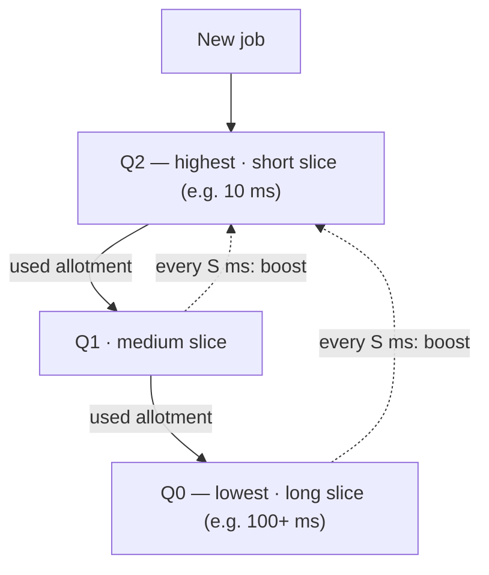

# L05 · MLFQ, lottery & multiprocessor scheduling

> **Book:** Ch 8 (pp. 75–86) 🔴 · Ch 9 (pp. 87–96) 🟡 · Ch 10 (pp. 97–108) 🟡 · **Time:** 50 min · **Simulators:** `cpu-sched-mlfq/mlfq.py`, `cpu-sched-lottery/lottery.py`

!!! example "In plain words"
    A doctor's waiting room with no appointment times. The receptionist doesn't know who needs 2 minutes and who needs an hour, so she **watches and learns**:

    - Everyone new starts in the "quick" line.
    - If you keep the doctor busy for a long time, you're moved to a slower line.
    - Every so often, everyone is moved back to the quick line, so nobody waits forever and people whose needs changed get another chance.
    - She counts your **total** time with the doctor, so you can't cheat by stepping out briefly and coming back.

    That is MLFQ. **Lottery scheduling** is the raffle version: hold 75% of the tickets and you win about 75% of the CPU time.

## TL;DR (the 3 things to remember)

- **MLFQ** learns a job's behaviour from history: jobs that use their whole time slice drift down to low priority (CPU-bound), jobs that give up the CPU early stay high (interactive).
- Two fixes make it safe: **priority boost** (stop starvation) and **better accounting** of total time used at a level (stop gaming).
- **Lottery/stride** give each job a proportional share using tickets. **Multi-CPU** scheduling adds cache affinity and load balancing.

## The big question

> How can a scheduler minimise turnaround *and* response time without knowing how long jobs run?

## The story chain

<small>Key: **bold** = the problem or the final design · *italics* = an attempted fix · ❌ = what goes wrong with it · → = "which leads to"</small>

**Don't know job lengths** → *several queues with different priorities; learn from behaviour* → *new jobs start at the top; drop a job down when it uses a full slice* → ❌ **starvation**: many interactive jobs keep long jobs from ever running; also a job can change from CPU-bound to interactive and be stuck low → *Rule 5: periodically boost everyone to the top* → ❌ **gaming**: a job yields just before its slice ends and stays on top forever → *Rule 4 rewritten: count total time used at a level, regardless of how many times it yields* → **final MLFQ**.

## Core ideas

MLFQ keeps several queues, each with a **priority** level. Jobs in a higher queue always run before jobs in a lower one. The clever part is that a job's priority isn't fixed: the scheduler moves jobs between queues based on **how they behaved so far**.

- A job that keeps using its full slice is probably a long, **CPU-bound** job (e.g. a video export), so it moves down.
- A job that keeps giving up the CPU early, because it's waiting for keyboard or disk, is probably **interactive** (e.g. a text editor), so it stays high and feels snappy.

### The five rules (memorise these exactly)

1. If Priority(A) > Priority(B), **A runs**.
2. If Priority(A) = Priority(B), A and B run in **round robin**.
3. A new job starts at the **highest** priority.
4. Once a job uses up its **time allotment** at a level (no matter how many times it gave up the CPU), its priority is **reduced**.
5. After some period **S**, move **all** jobs to the topmost queue.

**What each rule is for:**

- Rules 1–2: the basic "higher priority first, take turns at the same level".
- Rule 3: assume every new job might be short and interactive. If it is, it finishes quickly; if not, it sinks.
- Rule 4: sinking. Its "no matter how many times" wording stops cheating (see the worked example).
- Rule 5: the **boost**. Without it, a steady stream of interactive jobs could keep long jobs from *ever* running (**starvation**).

**Tuning:** high queues get **short** slices (interactive jobs switch quickly), low queues get **long** slices (CPU-bound jobs waste less time switching). How often to boost (S) has no perfect value: too rarely and long jobs starve, too often and interactive jobs lose their advantage. Real systems tune it by experiment (Solaris uses a configurable table; FreeBSD computes priority from recent CPU use).

### Proportional share (Ch 9) — the short version

A different goal: instead of fast turnaround or response, give each job a **guaranteed share** of the CPU (e.g. "A gets 75%, B gets 25%").

- **Lottery scheduling:** each job holds **tickets** (A has 75, B has 25). Every time slice, draw a random ticket number; whoever holds it runs. Over many draws A wins about 75% of the time. It's simple, but only fair **on average**: over a short period, B might get lucky or unlucky.
- **Ticket tricks:** a user can split their tickets among their own jobs (**currency**); a job waiting on a server can lend its tickets to that server (**transfer**); a trusted job can temporarily give itself more (**inflation**).
- **Stride scheduling:** the non-random version. Each job has a *stride* = (a big number) ÷ (its tickets), so more tickets = smaller stride. Keep a running total (*pass*) per job. Always run the job with the **lowest pass**, then add its stride to its pass. Jobs with small strides get picked more often, in exact proportion. Downside: when a new job joins, what pass should it start with? (Lottery has no such problem.)
- **Linux CFS** (not in v0.90 of the book — later editions add it; worth knowing for interviews): counts how much CPU each process has had, its **virtual runtime**, and always runs the process that has had the **least**. Processes are kept in a sorted tree (a red-black tree) so finding the smallest is fast. **Nice** values (priorities) make vruntime grow slower for important processes. A target period (`sched_latency`, e.g. 48 ms) is shared among runnable processes, with a minimum slice (`min_granularity`, e.g. 6 ms).

### Multiprocessor scheduling (Ch 10) — the short version

With several CPUs (cores), new issues appear:

- Each CPU has its own **cache**. Hardware keeps the caches in agreement with each other (**cache coherence**), but code that shares data still needs locks.
- **Cache affinity:** a process runs faster if it goes back to the **same CPU** as last time, because that CPU's cache still holds its data.
- **Single-queue (SQMS):** one shared list of jobs for all CPUs. Simple and balanced, but every CPU fights over that one list's lock, and jobs hop between CPUs (losing their warm cache).
- **Multi-queue (MQMS):** one list per CPU. Scales well and keeps jobs on their CPU, but one CPU can end up busy while another sits idle (**load imbalance**). Fix: **work stealing**, where an idle CPU takes jobs from a busy CPU's list.
- Linux's O(1) and CFS schedulers are multi-queue; BFS was single-queue.

## Worked example

Two jobs: **A** is CPU-bound (it would happily run for seconds); **B** is interactive (runs 1 ms, then waits for the keyboard). Three queues, Q2 = top, 10 ms slices.

- A starts in Q2, uses its full 10 ms → drops to Q1 → uses another full 10 ms → drops to Q0 and stays there.
- B arrives, starts in Q2, runs 1 ms, then waits for input. When it comes back it's still in Q2, because it hasn't used up its allotment. So B always runs ahead of A: fast response. A runs whenever B is waiting.
- **Cheating ("gaming the scheduler"):** suppose A is crafty. It runs 9.9 ms, then does a pointless tiny I/O just before its slice ends, so it never "uses a full slice". Under the book's first draft of Rule 4 (*drop only if you use the whole slice*), A would stay in Q2 forever and hog the CPU. The final Rule 4 counts **total** time at a level (9.9 + 9.9 + … ms), so A still drops once it reaches 10 ms.

## Common mistakes

- The old rules 4a/4b (drop if slice used, stay if you yield) are **replaced** by the new Rule 4 — know both and why.
- Boost (Rule 5) solves **two** problems: starvation and jobs that change behaviour.
- Lottery is **probabilistically** fair; short jobs may get unlucky.
- Stride needs global state; lottery doesn't.

## Recall

**Blurt test** — close this page, then on paper, from memory: write all five MLFQ rules, then the two problems each fix (starvation, gaming).

What is MLFQ's key idea?

Use several priority queues and adjust a job's priority based on its observed behaviour, so it approximates SJF without knowing job lengths.

Which MLFQ rule prevents starvation, and what else does it fix?

Rule 5 (periodic priority boost). It also lets a job that became interactive get back to high priority.

How could a program game the original MLFQ, and what fixes it?

Issue an I/O just before its slice ends to stay at high priority. Fixed by accounting for total time used at a level (new Rule 4).

Why do higher MLFQ queues get shorter time slices?

They hold interactive jobs that need fast switching; lower queues hold CPU-bound jobs that benefit from long slices with less switching.

Lottery vs stride scheduling?

Lottery picks a random ticket each slice — simple, no global state, fair on average. Stride is deterministic (run lowest pass, add stride) — exactly fair but needs global state.

How does Linux CFS pick the next process?

The one with the lowest virtual runtime, stored in a red-black tree; nice values weight how fast vruntime grows.

Single-queue vs multi-queue multiprocessor scheduling?

Single-queue: simple, balanced, but lock contention and poor cache affinity. Multi-queue: scalable and affinity-friendly, but needs migration/work stealing to fix load imbalance.

**Explain it out loud (60 seconds, as if to a friend):** "How does MLFQ figure out which jobs are interactive, and how do you stop a clever program from cheating?"

**Simulator drill** (book's free Python homework tools — see [the recall system](../start/recall-system.md#four-more-tricks-that-pay-off)): `python3 mlfq.py -n 3 -q 10 -l 0,50,0:0,20,5 -c` — trace which queue each job is in over time. Then try `-B 50` to see boosting.

## Connects to

- Basic policies → [L04](l04-scheduling.md)
- Cache coherence and locks → [L14 Locks](../concurrency/l14-locks.md)
- Red-black trees and vruntime appear again in [L15](../concurrency/l15-concurrent-ds.md) style structures

## Read in the book

- 🔴 Ch 8 entirely — short and very examinable. Summary box 8.6 lists the rules.
- 🟡 Ch 9: 9.1–9.2 (tickets, mechanisms) and 9.6 (stride). Newer editions add a CFS section — read it if yours has one.
- 🟡 Ch 10: 10.3–10.5 (affinity, SQMS, MQMS). Skip the hardware background if you know caches.
