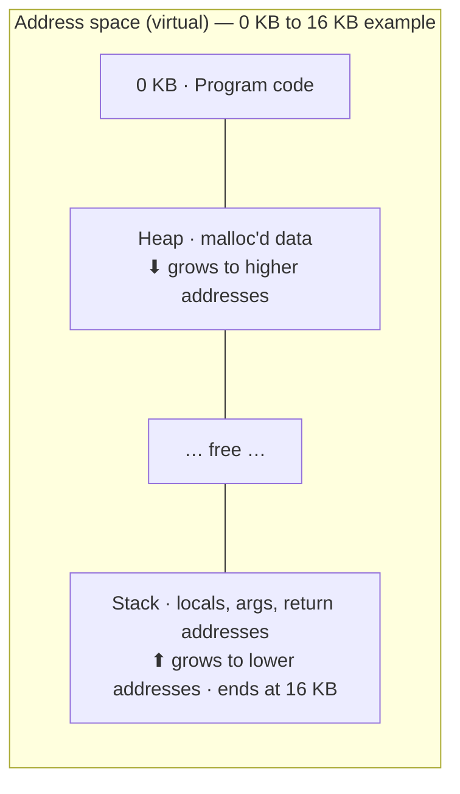

# L06 · Address spaces & the memory API

> **Book:** Ch 13 (pp. 113–121) 🔴 · Ch 14 (pp. 123–133) 🟡 · **Time:** 30 min · **Tool:** `valgrind`

## TL;DR

- The **address space** is the process's private view of memory: **code** at the bottom, then **heap** growing up, **stack** at the top growing down.
- Every address a program sees is **virtual**. The OS + hardware translate it to a physical address.
- Goals of virtual memory: **transparency**, **efficiency**, **protection**. Stack memory is automatic; heap memory is `malloc`/`free` and is where the bugs live.

## The crux

> How can the OS build the abstraction of a private, possibly large address space for many processes, all sharing one physical memory?

## The story chain

**Early machines: one program in memory** → ❌ CPU idle while waiting for I/O → *multiprogramming: several programs in memory, switch between them* → *time sharing: interactive users* → ❌ saving whole memory to disk on each switch is far too slow → *leave everyone in memory at once* → ❌ now one process can read or overwrite another → **give each process an address space, translated and protected by hardware**.

## Core ideas

(The two growing regions face each other, so either can use the free space in the middle.)

### The three goals

| Goal | Meaning |
|---|---|
| **Transparency** | Programs don't know memory is virtualized |
| **Efficiency** | Fast (hardware help, e.g. TLB) and small (little memory spent on bookkeeping) |
| **Protection** | A process can't touch another's memory or the OS — **isolation** |

> Every address you print in a user program (`printf("%p", &x)`) is virtual.

### Memory API (Ch 14)

- **Stack** (automatic): `int x;` inside a function. Freed when the function returns.
- **Heap** (manual): `int *p = malloc(10 * sizeof(int));` … `free(p);`
- Use `sizeof` for types; for strings, `malloc(strlen(s) + 1)` (room for `'\0'`).
- `malloc`/`free` are **library calls**, not syscalls. The library asks the OS for more memory using `brk`/`sbrk` (move the heap end) or `mmap` (anonymous memory).
- Also: `calloc` (zeroes memory), `realloc` (grow/shrink).

### The classic heap bugs

| Bug | What happens |
|---|---|
| Forgetting to allocate | Segfault (e.g. `strcpy` into an uninitialised pointer) |
| Not allocating enough | **Buffer overflow** — may "work", may corrupt, security hole |
| Forgetting to initialise | Reads garbage (**uninitialised read**) |
| Forgetting to free | **Memory leak** — deadly in long-running programs |
| Freeing too early | **Dangling pointer** |
| Freeing twice | **Double free** — undefined behaviour |
| Freeing a bad pointer | **Invalid free** |

When the process exits, the OS reclaims **all** its memory anyway — leaks matter in long-running programs and the OS itself.

## Traps

- `malloc` is not a system call.
- `sizeof(p)` on a pointer gives the pointer size (8 bytes), not the array size.
- "It ran without crashing" doesn't mean it's correct — use `valgrind` or AddressSanitizer.

## Recall

**Blurt test:** draw the address space with code/heap/stack and growth directions; list the three goals; list five heap bugs.

What are the three segments of a typical address space and how do they grow?

Code (fixed), heap (grows towards higher addresses), stack (grows towards lower addresses).

What are the three goals of virtual memory?

Transparency, efficiency (time and space), protection/isolation.

Is malloc() a system call?

No. It's a library routine; it gets memory from the OS with brk/sbrk or mmap.

Why must you allocate strlen(s)+1 bytes to copy a string?

To leave room for the terminating null byte.

What is a dangling pointer?

A pointer to memory that has already been freed; using it is undefined behaviour.

**Explain it (60 s):** "Why don't we just let all programs share physical memory directly?"

## Connects to

- How translation is done → [L07 Base/bounds & segmentation](l07-segmentation.md), [L09 Paging](l09-paging.md)
- How malloc manages the heap → [L08 Free space](l08-free-space.md)
- Stack per thread → [L13 Threads](../concurrency/l13-threads.md)

## Read in the book

- 🔴 Ch 13 entirely (short), especially 13.3 and 13.4.
- 🟡 Ch 14: 14.4 Common Errors — the table above is the summary.
