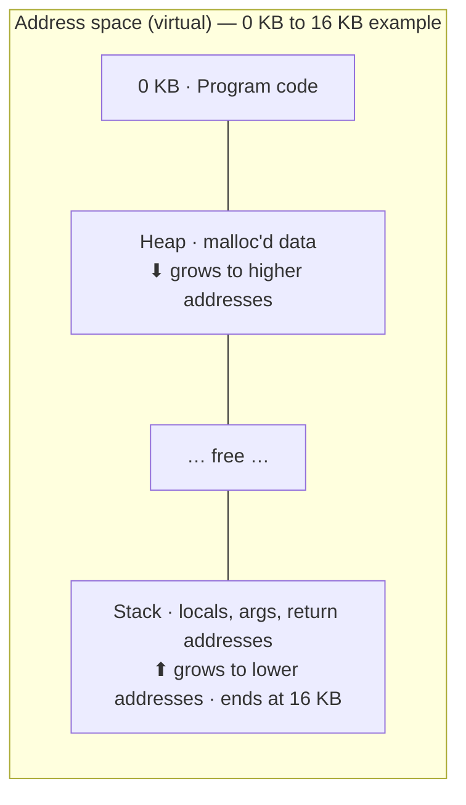

# L06 · Address spaces & the memory API

> **Book:** Ch 13 (pp. 113–121) 🔴 · Ch 14 (pp. 123–133) 🟡 · **Time:** 30 min · **Tool:** `valgrind`

!!! example "In plain words"
    Every process gets its **own private map of memory**, like every flat in a building having rooms numbered "1, 2, 3…". Two flats can both have a "room 3"; they're different rooms. The building manager (OS + hardware) knows which real room each one is.

    On that map, the program's code sits at the bottom. The **heap** (memory you ask for while running) grows upward, and the **stack** (local variables) grows downward from the top. They grow toward each other into the free space in the middle.

## TL;DR (the 3 things to remember)

- The **address space** is the process's private view of memory: **code** at the bottom, then **heap** growing up, **stack** at the top growing down.
- Every address a program sees is **virtual**. The OS + hardware translate it to a physical address.
- Goals of virtual memory: **transparency**, **efficiency**, **protection**. Stack memory is automatic; heap memory is `malloc`/`free` and is where the bugs live.

## The big question

> How can the OS build the abstraction of a private, possibly large address space for many processes, all sharing one physical memory?

## The story chain

<small>Key: **bold** = the problem or the final design · *italics* = an attempted fix · ❌ = what goes wrong with it · → = "which leads to"</small>

**Early machines: one program in memory** → ❌ CPU idle while waiting for I/O → *multiprogramming: several programs in memory, switch between them* → *time sharing: interactive users* → ❌ saving whole memory to disk on each switch is far too slow → *leave everyone in memory at once* → ❌ now one process can read or overwrite another → **give each process an address space, translated and protected by hardware**.

## Core ideas

Read it top to bottom as addresses going up, from 0 KB to 16 KB:

- **Code** sits at the start and never changes size.
- The **heap** starts just after it and grows **up** as the program calls `malloc`.
- The **stack** starts at the very end and grows **down** with each function call.

The heap and stack grow toward each other, so either one can use the free space in the middle. Real address spaces are much bigger (gigabytes), but the shape is the same.

### The three goals

| Goal | Meaning |
|---|---|
| **Transparency** | Programs behave as if they had their own real memory; they never notice the trick |
| **Efficiency** | Translating addresses must be fast (the hardware helps, e.g. the TLB), and the OS's bookkeeping must not eat much memory |
| **Protection** | A process can't read or change another process's memory, or the OS's. This is called **isolation** |

> Every address you can see in a program is virtual. If you print the address of a variable (`printf("%p", &x)` in C), you get a virtual address, not a real location in RAM.

### Memory API (Ch 14)

C programs get memory in two ways:

- **Stack memory is automatic.** Write `int x;` inside a function and the space appears; when the function returns, it's gone. You never free it yourself.
- **Heap memory is manual.** `int *p = malloc(10 * sizeof(int));` asks for room for 10 integers and gives you its address in `p`. You must later call `free(p);` to give it back. (In Java or Python, the garbage collector does the freeing for you.)
- `sizeof(int)` is "how many bytes an int needs", so you don't hard-code the number. For text, ask for `strlen(s) + 1` bytes: C strings end with a hidden zero byte (`'\0'`) that needs room too.
- `malloc` and `free` are **library functions**, not system calls. The library manages a pool of heap memory itself, and only asks the OS for a bigger pool now and then (using the system calls `brk`/`sbrk`, which move the end of the heap, or `mmap`).
- Related calls: `calloc` (like malloc, but zeroes the memory) and `realloc` (make an allocation bigger or smaller).

### The classic heap bugs

| Bug | What happens |
|---|---|
| Forgetting to allocate | Writing through a pointer that points nowhere → crash (**segmentation fault**, "segfault") |
| Not allocating enough | Writing past the end (**buffer overflow**) — may seem to work, may corrupt other data, and is a classic security hole |
| Forgetting to initialise | Reading memory you never set → random leftover values |
| Forgetting to free | **Memory leak** — memory use grows and grows; deadly in programs that run for days |
| Freeing too early | **Dangling pointer** — you still use memory that's been handed back and may be reused |
| Freeing twice | **Double free** — confuses the allocator; anything can happen |
| Freeing a bad pointer | **Invalid free** — passing `free` an address malloc never gave you |

When the process exits, the OS reclaims **all** its memory anyway — leaks matter in long-running programs and the OS itself.

## Common mistakes

- `malloc` is not a system call.
- `sizeof(p)` on a pointer gives the pointer size (8 bytes), not the array size.
- "It ran without crashing" doesn't mean it's correct — use `valgrind` or AddressSanitizer.

## Recall

**Blurt test** — close this page, then on paper, from memory: draw the address space with code/heap/stack and growth directions; list the three goals; list five heap bugs.

What are the three segments of a typical address space and how do they grow?

Code (fixed), heap (grows towards higher addresses), stack (grows towards lower addresses).

What are the three goals of virtual memory?

Transparency, efficiency (time and space), protection/isolation.

Is malloc() a system call?

No. It's a library routine; it gets memory from the OS with brk/sbrk or mmap.

Why must you allocate strlen(s)+1 bytes to copy a string?

To leave room for the terminating null byte.

What is a dangling pointer?

A pointer to memory that has already been freed; using it is undefined behaviour.

**Explain it out loud (60 seconds, as if to a friend):** "Why don't we just let all programs share physical memory directly?"

## Connects to

- How translation is done → [L07 Base/bounds & segmentation](l07-segmentation.md), [L09 Paging](l09-paging.md)
- How malloc manages the heap → [L08 Free space](l08-free-space.md)
- Stack per thread → [L13 Threads](../concurrency/l13-threads.md)

## Read in the book

- 🔴 Ch 13 entirely (short), especially 13.3 and 13.4.
- 🟡 Ch 14: 14.4 Common Errors — the table above is the summary.
