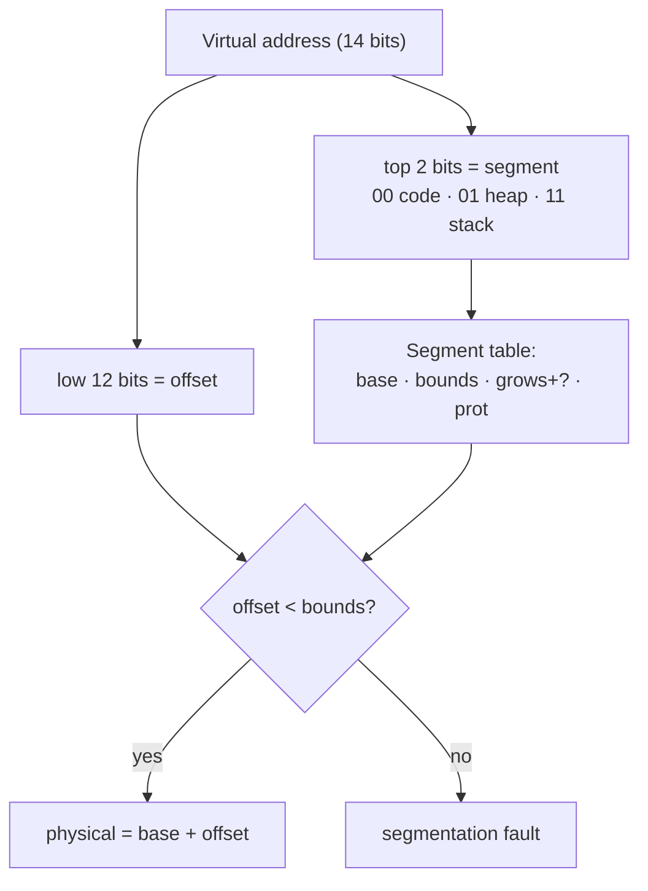

# L07 · Address translation: base/bounds & segmentation

> **Book:** Ch 15 (pp. 135–148) · Ch 16 (pp. 149–160) · **Tier:** 🔴 Must · **Time:** 45 min · **Simulators:** `vm-mechanism/relocation.py`, `vm-segmentation/segmentation.py`

## TL;DR

- **Base and bounds** (dynamic relocation): physical = virtual + **base**; if virtual ≥ **bounds**, raise an exception. Two registers in the **MMU**, changed only in kernel mode.
- It wastes the free space between heap and stack (**internal fragmentation**) — so give each **segment** (code, heap, stack) its own base/bounds pair: **segmentation**.
- Segmentation leaves variable-sized holes in physical memory (**external fragmentation**) → paging ([L09](l09-paging.md)).

## The crux

> How can we virtualize memory efficiently and flexibly, while keeping control over which addresses each process can touch?

## The story chain

**Need translation on every access, fast** → *hardware-based dynamic relocation: base + bounds per process* → ❌ the whole address space must be contiguous in memory, and the unused middle (between heap and stack) wastes physical memory → *one base/bounds pair per segment* (**segmentation**) → *add a grows-negative bit for the stack and protection bits for sharing code* → ❌ segments are different sizes, so free memory breaks into small holes (**external fragmentation**); compaction is expensive → **paging**: fixed-size pieces.

## Core ideas

### Base and bounds

```
physical address = virtual address + base
if (virtual address >= bounds) → raise exception (segfault)
```

What the hardware must provide: kernel/user mode, base/bounds registers, privileged instructions to change them, the ability to raise exceptions and run OS handlers.

What the OS must do:

| When | OS job |
|---|---|
| Process created | Find free physical slot (**free list**), set base/bounds |
| Process exits | Put its memory back on the free list |
| Context switch | Save/restore base & bounds in the PCB |
| Exception | Handle it — usually kill the offending process |

### Segmentation

Each segment has: **base**, **size (bounds)**, **grows-positive?**, **protection** (read/write/execute).

**Which segment?** Explicit approach: use the **top bits** of the virtual address. With a 14-bit address and 3 segments, the top 2 bits pick the segment, the low 12 bits are the **offset**.



**The stack grows backwards:** for a negative-growing segment, physical = base + (offset − max segment size). Example: offset 3 KB, max 4 KB → −1 KB → base 28 KB − 1 KB = 27 KB.

**Sharing:** mark code read-execute only and many processes can map the same physical code segment.

**Coarse vs fine-grained:** a few big segments (code/heap/stack) vs many small ones (Multics), which need a segment table in memory.

### The OS problem: external fragmentation

Different-sized segments leave odd-sized holes. Options: **compaction** (copy segments to close holes — expensive) or a smarter **free-list** algorithm ([L08](l08-free-space.md)). Neither solves it fully.

## Worked example (base & bounds)

Process loaded at physical 32 KB, base = 32768, bounds = 16 KB (16384).

| Virtual | Check | Physical |
|---|---|---|
| 0 | 0 < 16384 ✔ | 32768 |
| 1 KB (1024) | ✔ | 33792 |
| 3000 | ✔ | 35768 |
| 4400 | ✔ | 37168 |
| 16384 | ✘ | fault |

## Traps

- Bounds holds the **size** (check before adding base) in the book's version; some versions store the physical end. Be explicit in your answer.
- Base/bounds wastes memory **inside** the address space (internal); segmentation wastes memory **between** segments (external).
- The stack's negative-offset calculation is a favourite exam question — practise it.

## Recall

**Blurt test:** the base/bounds formula; four OS duties; the segmentation translation diagram; the stack formula.

<details markdown="1"><summary>How does base-and-bounds translation work?</summary>

Physical = virtual + base; if virtual ≥ bounds, the hardware raises an exception.

</details>

<details markdown="1"><summary>Where do base and bounds live, and who can change them?</summary>

In the CPU's MMU; only privileged (kernel-mode) instructions can change them. The OS saves/restores them in the PCB on a context switch.

</details>

<details markdown="1"><summary>What problem does segmentation solve over base-and-bounds?</summary>

It avoids wasting physical memory for the unused space between heap and stack, by relocating each segment separately.

</details>

<details markdown="1"><summary>How does the hardware know which segment a virtual address is in?</summary>

Typically the top bits of the virtual address select the segment; the rest is the offset.

</details>

<details markdown="1"><summary>What is external fragmentation and why does segmentation cause it?</summary>

Free memory split into many small variable-sized holes. Segments have different sizes, so allocating and freeing them leaves gaps too small to use.

</details>

<details markdown="1"><summary>How are code segments shared between processes?</summary>

With protection bits: a read-execute-only code segment can be mapped into many address spaces safely.

</details>

**Explain it (60 s):** "What would go wrong if a user process could set its own base register?"

**Simulator drill:** `python3 relocation.py -s 1` and `python3 segmentation.py -a 128 -p 512 -b 0 -l 20 -B 512 -L 20 -s 0` — translate every address, then check with `-c`.

## Connects to

- Free lists and holes → [L08 Free space](l08-free-space.md)
- Fixed-size pages remove external fragmentation → [L09 Paging](l09-paging.md)
- Hybrid paging + segments → [L11](l11-smaller-tables.md)

## Read in the book

- 🔴 15.2–15.5 (example, dynamic relocation, HW/OS duties — the two summary tables).
- 🔴 16.1–16.4 (generalized base/bounds, which segment, the stack, sharing).
- 🟡 16.5–16.6.
