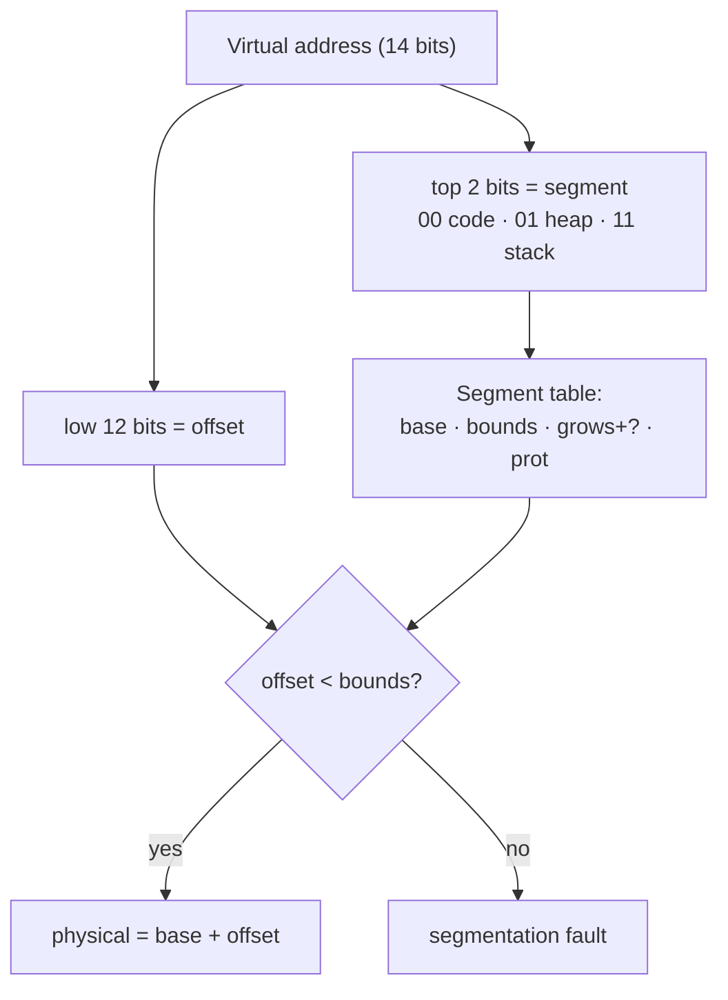

# L07 · Address translation: base/bounds & segmentation

> **Book:** Ch 15 (pp. 135–148) · Ch 16 (pp. 149–160) · **Priority:** 🔴 must-know · **Time:** 45 min · **Simulators:** `vm-mechanism/relocation.py`, `vm-segmentation/segmentation.py`

!!! example "In plain words"
    Every address a program uses has to be turned into a real memory address, on every single access, so it must be cheap.

    - **Base and bounds:** "Your flat is the block of rooms starting at room 32,000 (base), and it's 16 rooms long (bounds). Room 5 for you = real room 32,005. Ask for room 20 and you're stopped."
    - **Segmentation:** the same, but the code, heap and stack each get their own base and bounds, so the empty space between heap and stack doesn't waste real memory.
    - **The catch:** pieces of different sizes leave awkward gaps in memory, like a car park where cars of every length come and go.

## TL;DR (the 3 things to remember)

- **Base and bounds** (dynamic relocation): physical = virtual + **base**; if virtual ≥ **bounds**, raise an exception. Two registers in the **MMU**, changed only in kernel mode.
- It wastes the free space between heap and stack (**internal fragmentation**) — so give each **segment** (code, heap, stack) its own base/bounds pair: **segmentation**.
- Segmentation leaves variable-sized holes in physical memory (**external fragmentation**) → paging ([L09](l09-paging.md)).

## The big question

> How can we virtualize memory efficiently and flexibly, while keeping control over which addresses each process can touch?

## The story chain

<small>Key: **bold** = the problem or the final design · *italics* = an attempted fix · ❌ = what goes wrong with it · → = "which leads to"</small>

**Need translation on every access, fast** → *hardware-based dynamic relocation: base + bounds per process* → ❌ the whole address space must be contiguous in memory, and the unused middle (between heap and stack) wastes physical memory → *one base/bounds pair per segment* (**segmentation**) → *add a grows-negative bit for the stack and protection bits for sharing code* → ❌ segments are different sizes, so free memory breaks into small holes (**external fragmentation**); compaction is expensive → **paging**: fixed-size pieces.

## Core ideas

### Base and bounds

The idea: put each process's whole address space in one **continuous chunk** of real memory, and give the CPU two registers:

- **base** = where the chunk starts in real memory;
- **bounds** = how big the chunk is.

On *every* memory access, the hardware does this:

```
physical address = virtual address + base
if (virtual address >= bounds) → raise exception (segfault)
```

The part of the CPU that does this is the **MMU** (memory management unit). "Raise an exception" means: stop the program and jump into the OS, which usually kills it. That's the familiar "segmentation fault".

What the hardware must provide: user and kernel modes, the base and bounds registers, instructions to change them that only the OS may use (otherwise a program could just point its base at someone else's memory), and a way to raise exceptions.

What the OS must do:

| When | OS job |
|---|---|
| Process created | Find free physical slot (**free list**), set base/bounds |
| Process exits | Put its memory back on the free list |
| Context switch | Save/restore base & bounds in the PCB |
| Exception | Handle it — usually kill the offending process |

### Segmentation

Base and bounds wastes real memory: the whole address space, including the big empty gap between heap and stack, must sit in real memory. **Segmentation** fixes this by giving each part (**segment**) of the address space — code, heap, stack — its **own** base and bounds. Each segment can then sit anywhere in real memory, and the empty gap takes no real memory at all.

Each segment's entry records: **base** (where it starts in real memory), **size** (its bounds), **which direction it grows** (the stack grows down), and **protection** (may it be read / written / executed?).

**How does the hardware know which segment an address belongs to?** It uses the **top bits** of the address. Example: with 14-bit addresses, the top 2 bits say which segment (00 = code, 01 = heap, 11 = stack). The remaining 12 bits are the **offset**: how far into that segment the address is.



**The stack is special because it grows downward.** Its base marks the *top* of the stack in real memory, so addresses are counted backwards from there: physical = base + (offset − maximum segment size), which gives a negative distance below the base.

*Example:* the stack's base is 28 KB, the maximum segment size is 4 KB, and we access offset 3 KB. Then 3 KB − 4 KB = −1 KB, so the physical address is 28 KB − 1 KB = **27 KB**.

**Sharing:** if the code segment is marked read-and-execute only, many processes running the same program can safely share **one copy** of it in real memory.

**Coarse vs fine-grained:** most systems use a few big segments (code, heap, stack). Some early systems (Multics) used thousands of small ones, which needs a segment table stored in memory.

### The OS problem: external fragmentation

Segments come in different sizes. As processes start and stop, real memory fills with odd-sized holes, which is **external fragmentation**. You might have 20 KB free in total but no single hole bigger than 5 KB.

Options: **compaction** (stop processes and slide segments together to merge the holes — slow), or a smarter way of choosing holes ([L08](l08-free-space.md)). Neither solves it completely, which is why the next idea, paging, uses pieces that are all the same size.

## Worked example (base & bounds)

A process's 16 KB address space is loaded at real address 32 KB. So base = 32 KB = 32768 and bounds = 16 KB = 16384. For each virtual address, check it's below the bounds, then add the base:

| Virtual | Check | Physical |
|---|---|---|
| 0 | 0 < 16384 ✔ | 32768 |
| 1 KB (1024) | ✔ | 33792 |
| 3000 | ✔ | 35768 |
| 4400 | ✔ | 37168 |
| 16384 | ✘ | fault |

## Common mistakes

- Bounds holds the **size** (check before adding base) in the book's version; some versions store the physical end. Be explicit in your answer.
- Base/bounds wastes memory **inside** the address space (internal); segmentation wastes memory **between** segments (external).
- The stack's negative-offset calculation is a favourite exam question — practise it.

## Recall

**Blurt test** — close this page, then on paper, from memory: the base/bounds formula; four OS duties; the segmentation translation diagram; the stack formula.

<details markdown="1"><summary>How does base-and-bounds translation work?</summary>

Physical = virtual + base; if virtual ≥ bounds, the hardware raises an exception.

</details>

<details markdown="1"><summary>Where do base and bounds live, and who can change them?</summary>

In the CPU's MMU; only privileged (kernel-mode) instructions can change them. The OS saves/restores them in the PCB on a context switch.

</details>

<details markdown="1"><summary>What problem does segmentation solve over base-and-bounds?</summary>

It avoids wasting physical memory for the unused space between heap and stack, by relocating each segment separately.

</details>

<details markdown="1"><summary>How does the hardware know which segment a virtual address is in?</summary>

Typically the top bits of the virtual address select the segment; the rest is the offset.

</details>

<details markdown="1"><summary>What is external fragmentation and why does segmentation cause it?</summary>

Free memory split into many small variable-sized holes. Segments have different sizes, so allocating and freeing them leaves gaps too small to use.

</details>

<details markdown="1"><summary>How are code segments shared between processes?</summary>

With protection bits: a read-execute-only code segment can be mapped into many address spaces safely.

</details>

**Explain it out loud (60 seconds, as if to a friend):** "What would go wrong if a user process could set its own base register?"

**Simulator drill** (book's free Python homework tools — see [the recall system](../start/recall-system.md#four-more-tricks-that-pay-off)): `python3 relocation.py -s 1` and `python3 segmentation.py -a 128 -p 512 -b 0 -l 20 -B 512 -L 20 -s 0` — translate every address, then check with `-c`.

## Connects to

- Free lists and holes → [L08 Free space](l08-free-space.md)
- Fixed-size pages remove external fragmentation → [L09 Paging](l09-paging.md)
- Hybrid paging + segments → [L11](l11-smaller-tables.md)

## Read in the book

- 🔴 15.2–15.5 (example, dynamic relocation, HW/OS duties — the two summary tables).
- 🔴 16.1–16.4 (generalized base/bounds, which segment, the stack, sharing).
- 🟡 16.5–16.6.
