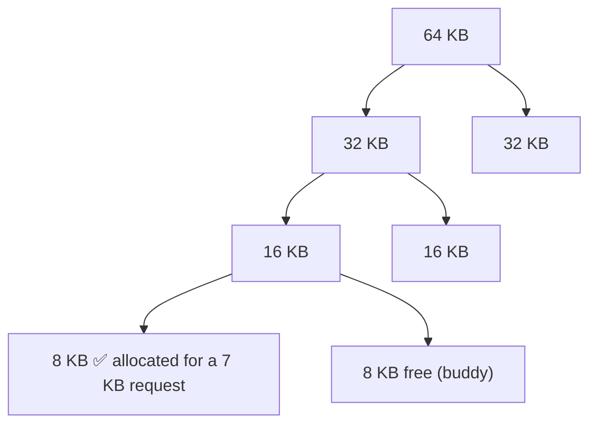

# L08 · Free-space management

> **Book:** Ch 17 (pp. 161–177) · **Tier:** 🟡 Skim · **Time:** 25 min · **Simulator:** `vm-freespace/malloc.py`

## TL;DR

- A **free list** tracks holes. To allocate, **split** a hole; on free, **coalesce** with neighbours.
- Each allocated block carries a small **header** (size + magic number) just before the pointer you get back, so `free(ptr)` knows the size.
- Policies: **best fit**, **worst fit**, **first fit**, **next fit**. Smarter tricks: **segregated lists / slab allocator**, **buddy allocation**. All trade speed for fragmentation; none is perfect.

## The crux

> How should we manage variable-sized free space to minimise fragmentation, and what do the time/space trade-offs look like?

## The story chain

**Variable-sized requests** → *keep a list of free chunks* → *split a chunk to satisfy a request* → ❌ after frees, the list has many small adjacent chunks → *coalesce neighbours on free* → ❌ `free(ptr)` gets no size → *store a header in front of each block* → ❌ which hole to pick? → *fit policies* → ❌ searching is slow and still fragments → *segregated lists for popular sizes (slab), buddy for fast coalescing*.

## Core ideas

### Mechanisms

- **Splitting:** request 1 byte from a 10-byte hole → 1 byte used, 9-byte hole left.
- **Coalescing:** freeing a chunk next to free chunks merges them into one bigger hole.
- **Header:** `free(ptr)` looks at `ptr - sizeof(header)`, reads the size and a **magic** value (sanity check). A request for N bytes really uses N + header size.
- **Embedding the list:** the free list lives *inside* the free memory itself — each free chunk starts with `{size, next}`.
- **Growing the heap:** when nothing fits, ask the OS (`sbrk`).

### Policies

| Policy | Rule | Pro | Con |
|---|---|---|---|
| **Best fit** | Smallest hole that fits | Little waste per allocation | Full search; leaves tiny unusable slivers |
| **Worst fit** | Largest hole | Leaves big leftovers | Full search; studies show it fragments badly |
| **First fit** | First hole that fits | Fast | Small slivers pile up at the start of the list |
| **Next fit** | First fit, starting where last search ended | Spreads allocations | Similar to first fit |

### Other approaches

- **Segregated lists / slab allocator** (Solaris kernel): keep separate caches of ready-made objects for common sizes (inodes, locks). Fast, little fragmentation. Objects kept pre-initialised.
- **Buddy allocator:** memory is a power of two; split in halves until the block just fits. On free, check the **buddy** (its address differs in one bit) — if free, merge, recursively. Fast coalescing, but **internal fragmentation** (round up to powers of two).

## Traps

- Internal fragmentation = waste *inside* an allocated block (buddy rounding). External = waste *between* blocks (holes).
- `malloc(N)` uses more than N bytes because of the header.
- Best fit isn't automatically best — it leaves tiny slivers.

## Recall

**Blurt test:** splitting, coalescing, header, four fit policies with one con each, slab and buddy in one line each.

How does free() know the size of the block?

It reads a header stored just before the returned pointer, which holds the size (and a magic number for integrity).

What is coalescing?

Merging a freed chunk with adjacent free chunks into a single larger free chunk.

Best fit vs first fit?

Best fit searches the whole list for the smallest hole that fits (less waste, slow, slivers). First fit takes the first hole that fits (fast, slivers at the list head).

How does the buddy allocator make coalescing easy?

Blocks are powers of two; a block's buddy address differs by a single bit, so checking and merging is quick and recursive.

What's the main downside of the buddy allocator?

Internal fragmentation, because requests are rounded up to a power of two.

**Explain it (60 s):** "Why can't a C allocator just compact the heap to fix fragmentation?" *(Hint: the program holds raw pointers.)*

**Simulator drill:** `python3 malloc.py -n 10 -H 0 -p BEST -s 0` then `-p WORST` and `-p FIRST`; add `-C` to coalesce.

## Connects to

- External fragmentation from segmentation → [L07](l07-segmentation.md)
- Paging sidesteps it with fixed sizes → [L09](l09-paging.md)

## Read in the book

- 🔴 17.2 (low-level mechanisms) — the header and embedded list figures.
- 🟡 17.3–17.4.
