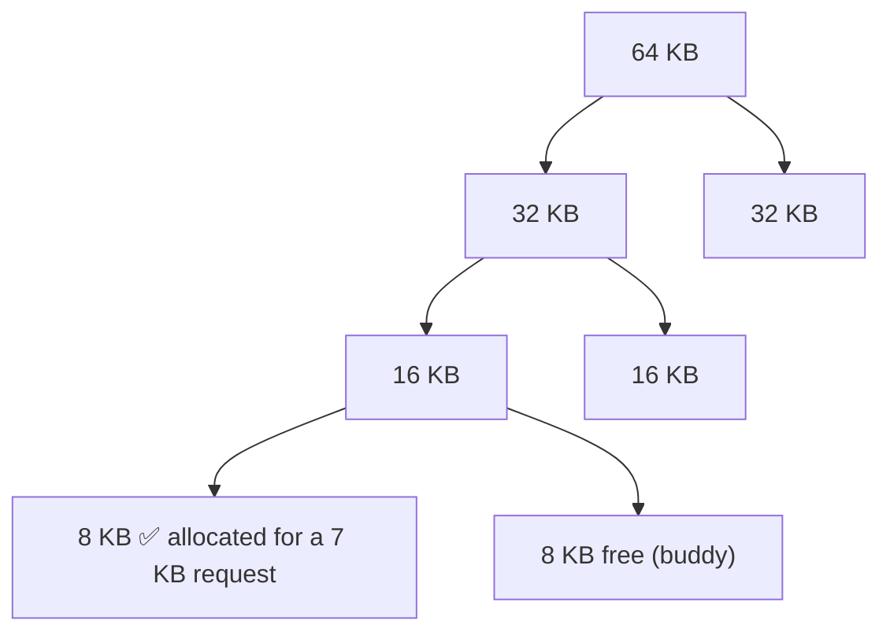

# L08 · Free-space management

> **Book:** Ch 17 (pp. 161–177) · **Priority:** 🟡 good to know · **Time:** 25 min · **Simulator:** `vm-freespace/malloc.py`

!!! example "In plain words"
    Like a car park with no marked spaces. Cars (memory requests) of every length arrive and leave. When one leaves, it leaves a gap. The attendant (malloc) must decide where each new car goes:

    - **Best fit:** the smallest gap that fits.
    - **First fit:** the first gap that fits.
    - **Worst fit:** the biggest gap.

    Each choice leaves different leftover gaps. The attendant also merges neighbouring gaps (**coalescing**), and each car carries a small tag saying how long it is (the **header**).

## TL;DR (the 3 things to remember)

- A **free list** tracks holes. To allocate, **split** a hole; on free, **coalesce** with neighbours.
- Each allocated block carries a small **header** (size + magic number) just before the pointer you get back, so `free(ptr)` knows the size.
- Policies: **best fit**, **worst fit**, **first fit**, **next fit**. Smarter tricks: **segregated lists / slab allocator**, **buddy allocation**. All trade speed for fragmentation; none is perfect.

## The big question

> How should we manage variable-sized free space to minimise fragmentation, and what do the time/space trade-offs look like?

## The story chain

<small>Key: **bold** = the problem or the final design · *italics* = an attempted fix · ❌ = what goes wrong with it · → = "which leads to"</small>

**Variable-sized requests** → *keep a list of free chunks* → *split a chunk to satisfy a request* → ❌ after frees, the list has many small adjacent chunks → *coalesce neighbours on free* → ❌ `free(ptr)` gets no size → *store a header in front of each block* → ❌ which hole to pick? → *fit policies* → ❌ searching is slow and still fragments → *segregated lists for popular sizes (slab), buddy for fast coalescing*.

## Core ideas

This lesson is about how `malloc` and `free` manage the heap. (The same problem appears wherever variable-size pieces are handed out, e.g. segments in [L07](l07-segmentation.md).) The allocator keeps a **free list**: a list of the holes it can still hand out.

### Mechanisms (how it works)

- **Splitting:** asked for 1 byte from a 10-byte hole, hand out 1 byte and keep the other 9 as a smaller hole.
- **Coalescing:** when a chunk is freed and its neighbours are free too, merge them into one bigger hole. Otherwise memory ends up as lots of tiny holes.
- **The header:** `free(p)` is only given an address, not a size, so how does it know how much to free? `malloc` secretly reserves a few extra bytes **just before** the address it returns, and writes the size there (plus a "magic number" to detect mistakes). `free` looks just before `p` to read it. So a request for N bytes really uses N + header bytes.
- **Where does the free list live?** Inside the free memory itself. Each hole begins with a small note: "I'm this big, and the next hole is over there".
- **Running out:** if no hole is big enough, the allocator asks the OS to make the heap bigger (`sbrk`).

### Policies (which hole to pick)

| Policy | Rule | Pro | Con |
|---|---|---|---|
| **Best fit** | Smallest hole that fits | Little waste per allocation | Full search; leaves tiny unusable slivers |
| **Worst fit** | Largest hole | Leaves big leftovers | Full search; studies show it fragments badly |
| **First fit** | First hole that fits | Fast | Small slivers pile up at the start of the list |
| **Next fit** | First fit, starting where last search ended | Spreads allocations | Similar to first fit |

### Other approaches

- **Segregated lists / slab allocator** (used inside the Solaris and Linux kernels): if a program keeps asking for the same few sizes, keep a separate ready-made stock of each, like a café pre-cutting sandwiches into the sizes people always order. Very fast, and little fragmentation.
- **Buddy allocator:** memory comes in power-of-two sizes (64, 32, 16, 8 KB…). For a request, keep **halving** a block until the next halving would be too small. Each half has a twin, its **buddy**. When a block is freed, check whether its buddy is free too; if so, merge them back into the bigger block, and repeat upward. Merging is quick, but requests are rounded up to a power of two, so space is wasted *inside* blocks (**internal fragmentation**). In the picture, a 7 KB request gets an 8 KB block and 1 KB is wasted.

## Common mistakes

- Internal fragmentation = waste *inside* an allocated block (buddy rounding). External = waste *between* blocks (holes).
- `malloc(N)` uses more than N bytes because of the header.
- Best fit isn't automatically best — it leaves tiny slivers.

## Recall

**Blurt test** — close this page, then on paper, from memory: splitting, coalescing, header, four fit policies with one con each, slab and buddy in one line each.

How does free() know the size of the block?

It reads a header stored just before the returned pointer, which holds the size (and a magic number for integrity).

What is coalescing?

Merging a freed chunk with adjacent free chunks into a single larger free chunk.

Best fit vs first fit?

Best fit searches the whole list for the smallest hole that fits (less waste, slow, slivers). First fit takes the first hole that fits (fast, slivers at the list head).

How does the buddy allocator make coalescing easy?

Blocks are powers of two; a block's buddy address differs by a single bit, so checking and merging is quick and recursive.

What's the main downside of the buddy allocator?

Internal fragmentation, because requests are rounded up to a power of two.

**Explain it out loud (60 seconds, as if to a friend):** "Why can't a C allocator just compact the heap to fix fragmentation?" *(Hint: the program holds raw pointers.)*

**Simulator drill** (book's free Python homework tools — see [the recall system](../start/recall-system.md#four-more-tricks-that-pay-off)): `python3 malloc.py -n 10 -H 0 -p BEST -s 0` then `-p WORST` and `-p FIRST`; add `-C` to coalesce.

## Connects to

- External fragmentation from segmentation → [L07](l07-segmentation.md)
- Paging sidesteps it with fixed sizes → [L09](l09-paging.md)

## Read in the book

- 🔴 17.2 (low-level mechanisms) — the header and embedded list figures.
- 🟡 17.3–17.4.
