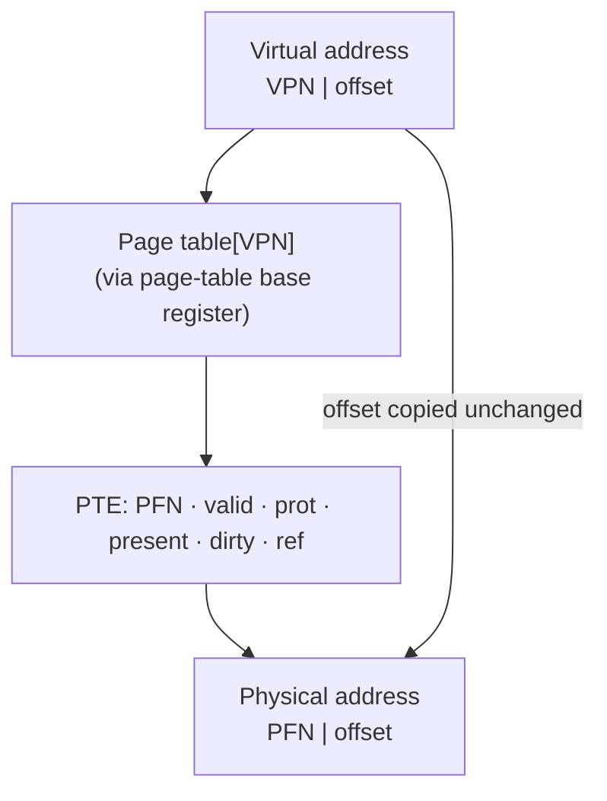

# L09 · Paging

> **Book:** Ch 18 (pp. 179–191) · **Tier:** 🔴 Must · **Time:** 45 min · **Simulator:** `vm-paging/paging-linear-translate.py`

## TL;DR

- Split the virtual address space into fixed-size **pages** and physical memory into same-size **page frames**. No external fragmentation, and sparse address spaces are easy.
- Virtual address = **VPN** (virtual page number) + **offset**. A per-process **page table** maps VPN → **PFN**; the offset is copied unchanged.
- Two problems: page tables are **big** (4 MB per process on 32-bit with 4 KB pages) and paging is **slow** (an extra memory access per access). Fixes: TLB ([L10](l10-tlb.md)) and smaller tables ([L11](l11-smaller-tables.md)).

## The crux

> How can we virtualize memory with pages, avoiding segmentation's problems? What are the basic techniques, and how do we make them work with minimal space and time overhead?

## The story chain

**Segments fragment memory** → *chop everything into fixed-size pages* → *page table per process: VPN → PFN* → ❌ page table is huge → *keep it in memory, find it via a page-table base register* → ❌ every load/store now needs an **extra memory access** to read the page table → ❌ too slow → TLB; ❌ too big → multi-level tables.

## Core ideas

### Splitting the address

With page size 2<sup>k</sup> bytes, the low **k** bits are the offset, the remaining high bits are the VPN.

Example: 64-byte address space (6-bit addresses), 16-byte pages → 4 pages → 2 bits of VPN, 4 bits of offset. Virtual address 21 = `01 0101` → VPN 1, offset 5.



### What's in a page-table entry (PTE)

| Bit | Purpose |
|---|---|
| **PFN** | Physical frame number |
| **Valid** | Is this part of the address space at all? (unused pages invalid → no frame needed) |
| **Protection** | Read / write / execute |
| **Present** | In memory or swapped to disk? ([L12](l12-swapping.md)) |
| **Dirty** | Modified since loaded? |
| **Reference / accessed** | Used recently? (for replacement) |
| **User/supervisor** | Can user mode touch it? |

The simplest page table is a **linear page table**: an array indexed by VPN.

### The translation steps (in hardware)

```
VPN     = (VirtualAddress & VPN_MASK) >> SHIFT
PTEAddr = PTBR + (VPN * sizeof(PTE))
PTE     = AccessMemory(PTEAddr)          ← the extra access
if (PTE.Valid == False)        → raise SEGMENTATION_FAULT
else if (!CanAccess(PTE.Prot)) → raise PROTECTION_FAULT
else
    offset   = VirtualAddress & OFFSET_MASK
    PhysAddr = (PTE.PFN << SHIFT) | offset
    Register = AccessMemory(PhysAddr)
```

## Numbers to remember

- 32-bit address, 4 KB pages → 12-bit offset, 20-bit VPN → 2<sup>20</sup> ≈ 1 million PTEs × 4 bytes = **4 MB page table per process**. 100 processes = 400 MB of page tables.
- Paging **doubles** memory accesses without a TLB (one for the PTE, one for the data). An instruction fetch also needs translation.

## Worked example (do it)

32 KB address space, 4 KB pages, physical memory 128 KB.

- Pages in address space = 32/4 = **8** → VPN is **3 bits**; offset is **12 bits**; virtual address is **15 bits**.
- Physical frames = 128/4 = **32** → PFN is **5 bits**; physical address **17 bits**.
- Virtual address `0x3229` = binary `011 0010 0010 1001` → VPN 3, offset `0x229`. If PT[3] = PFN 7 → physical = `7 << 12 | 0x229` = **`0x7229`**.

## Traps

- The **offset is not translated** — only the VPN changes.
- Count bits from sizes: offset bits = log<sub>2</sub>(page size); VPN bits = log<sub>2</sub>(address space / page size).
- Valid bit ≠ present bit. Invalid = not part of the address space (fault → kill). Not present = swapped out (page fault → load it).
- Page tables live in **memory** (kernel space), not in the MMU.

## Recall

**Blurt test:** the VPN/offset split; the PTE bits; the 7-line translation pseudo-code; the 4 MB calculation.

<details markdown="1"><summary>What is a page vs a page frame?</summary>

A page is a fixed-size chunk of virtual memory; a page frame is the same-size slot in physical memory.

</details>

<details markdown="1"><summary>How is a virtual address split under paging?</summary>

High bits = virtual page number (VPN); low log2(page size) bits = offset.

</details>

<details markdown="1"><summary>Which part of the address does the page table translate?</summary>

Only the VPN → PFN. The offset is copied unchanged.

</details>

<details markdown="1"><summary>How large is a linear page table for a 32-bit space with 4 KB pages and 4-byte PTEs?</summary>

2^20 entries × 4 bytes = 4 MB per process.

</details>

<details markdown="1"><summary>Why is basic paging slow?</summary>

Each memory reference needs an extra memory access to fetch the PTE first.

</details>

<details markdown="1"><summary>Valid bit vs present bit?</summary>

Valid: the page belongs to the address space. Present: the page is currently in physical memory (not swapped out).

</details>

<details markdown="1"><summary>Two advantages of paging over segmentation?</summary>

No external fragmentation (all frames same size), and flexible support for sparse address spaces.

</details>

**Explain it (60 s):** "Translate a virtual address under paging, and tell me the two reasons paging alone isn't good enough."

**Simulator drill:** `python3 paging-linear-translate.py -P 1k -a 16k -p 32k -v -s 1` — translate each address, check with `-c`.

## Connects to

- Speed fix → [L10 TLBs](l10-tlb.md)
- Size fix → [L11 Smaller tables](l11-smaller-tables.md)
- Present bit and page faults → [L12 Swapping](l12-swapping.md)

## Read in the book

- 🔴 18.1–18.5 — especially 18.5 "A Memory Trace": follow the figure once, it makes the cost of paging obvious.
