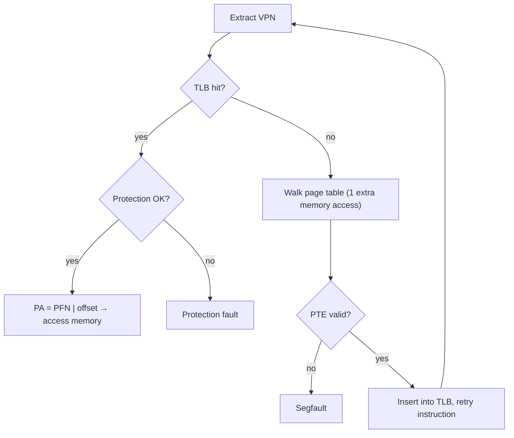

# L10 · TLBs: making paging fast

> **Book:** Ch 19 (pp. 193–209) · **Tier:** 🔴 Must · **Time:** 40 min

## TL;DR

- The **TLB** (translation-lookaside buffer) is a small, fast hardware cache of VPN → PFN translations inside the MMU. A **hit** skips the page-table access.
- It works because of **locality**: spatial (nearby addresses share a page) and temporal (the same page is used again soon).
- Context switches make old entries wrong: either **flush** the TLB or tag entries with an **ASID** (address-space ID).

## The crux

> How can we speed up address translation and avoid the extra memory reference paging needs?

## The story chain

**Paging needs an extra memory access per access** → *cache translations in hardware: the TLB* → ❌ on a miss someone must walk the page table → *hardware-managed (x86) or software-managed (MIPS: trap to OS)* → ❌ after a context switch, entries belong to the wrong process → *flush on switch* → ❌ flushing throws away useful entries → *tag entries with an ASID* → ❌ TLB is full → *replacement: LRU or random*.

## Core ideas

### The TLB control flow

### Locality example

An array of 10 ints (4 bytes each) starting at virtual 100, page size 16 bytes. The 10 elements span 3 pages. Access pattern: miss, hit, hit, **miss**, hit, hit, hit, **miss**, hit, hit → **70% hit rate** thanks to spatial locality alone. Bigger pages → even fewer misses. Run the loop again → near 100% (temporal locality).

### Who handles a miss?

| | Hardware-managed (CISC, e.g. x86) | Software-managed (RISC, e.g. MIPS) |
|---|---|---|
| On miss | HW walks the page table (using the page-table base register, e.g. CR3) | HW raises an exception; OS trap handler walks the table and inserts with a privileged instruction |
| Page table format | Fixed by the hardware | OS can use any structure |
| Watch out | — | Return-from-trap must **retry** the instruction, not skip it; handler must not itself miss (keep it in unmapped memory or wired TLB entries) |

### A TLB entry

`VPN | PFN | valid | protection | ASID | dirty | global …` — the TLB is usually **fully associative** (any entry can hold any translation). Typical size: 32, 64, 128 entries.

**Note:** the TLB's valid bit means "this entry holds a translation" — different from the PTE's valid bit.

### Context switches

- **Flush** on every switch (set all valid bits to 0): correct, but each switch starts cold.
- **ASID**: each entry is tagged with a process ID-like value; the TLB only matches entries with the current ASID. Two processes can even share a physical page (same PFN, different VPNs/ASIDs).

### Replacement

LRU (exploits locality) or **random** (simple, and avoids worst cases like a loop over n+1 pages with an n-entry LRU TLB).

## Numbers to remember

- TLB hit takes ~1 cycle; a miss costs one or more memory accesses (hundreds of cycles with multi-level tables).
- **TLB coverage** = entries × page size. 64 entries × 4 KB = 256 KB. Programs touching more than that pages miss a lot → **huge pages** (2 MB/1 GB) help databases.

## Traps

- The TLB caches **translations**, not data. (The CPU caches hold data.)
- Software-managed TLB miss handler: return-from-trap must re-execute the faulting instruction.
- "RAM isn't always RAM": randomly accessing more pages than the TLB covers can be far slower than you expect.

## Recall

**Blurt test:** the hit/miss flowchart; the array example's hit rate; hardware vs software miss handling; flush vs ASID.

What does the TLB store?

Recently used virtual-to-physical page translations (VPN → PFN plus protection and other bits).

Why does the TLB work well for most programs?

Spatial and temporal locality: nearby accesses fall in the same page and pages get reused.

Hardware-managed vs software-managed TLB miss?

Hardware: the CPU walks the page table itself (x86). Software: the CPU traps to the OS, which walks the table and installs the entry (MIPS) — more flexible.

What's special about returning from a TLB-miss trap?

It must retry the instruction that caused the miss, unlike a syscall return which continues with the next instruction.

How do ASIDs help with context switches?

Entries are tagged with the address-space ID, so the TLB can hold translations for several processes without flushing.

What is TLB coverage?

Number of entries × page size — the amount of memory reachable without a TLB miss.

**Explain it (60 s):** "Why is a TLB hit rate of 99% still not enough for some programs, and what can you do about it?"

**Hands-on:** the Ch 19 measurement homework (`tlb.c`) — time accesses over 1, 2, 4 … 1024 pages and watch the jumps where you exceed each TLB level.

## Connects to

- Context switches → [L03 LDE](l03-lde.md)
- Bigger pages vs smaller tables → [L11](l11-smaller-tables.md)
- Caching + locality appears again in page replacement → [L12](l12-swapping.md)

## Read in the book

- 🔴 19.1–19.5 (algorithm, array example, who handles the miss, contents, context switches).
- 🟡 19.6–19.7 (replacement, the MIPS entry).
