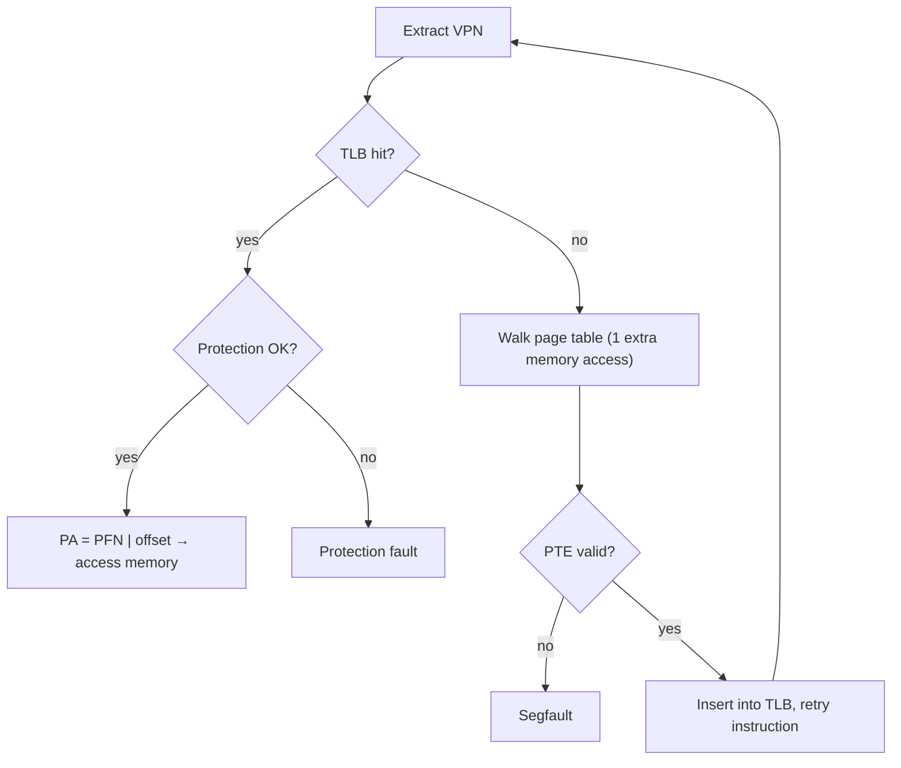

# L10 · TLBs: making paging fast

> **Book:** Ch 19 (pp. 193–209) · **Priority:** 🔴 must-know · **Time:** 40 min

!!! example "In plain words"
    Looking up the page table on every memory access is like checking the phone book every time you call a friend. The **TLB** is your **speed-dial**: a tiny list of the few translations you used most recently, built into the CPU. Most of the time the number is on speed-dial (a *hit*) and you skip the phone book.

    It works because programs keep touching the same few pages (**locality**).

## TL;DR (the 3 things to remember)

- The **TLB** (translation-lookaside buffer) is a small, fast hardware cache of VPN → PFN translations inside the MMU. A **hit** skips the page-table access.
- It works because of **locality**: spatial (nearby addresses share a page) and temporal (the same page is used again soon).
- Context switches make old entries wrong: either **flush** the TLB or tag entries with an **ASID** (address-space ID).

## The big question

> How can we speed up address translation and avoid the extra memory reference paging needs?

## The story chain

<small>Key: **bold** = the problem or the final design · *italics* = an attempted fix · ❌ = what goes wrong with it · → = "which leads to"</small>

**Paging needs an extra memory access per access** → *cache translations in hardware: the TLB* → ❌ on a miss someone must walk the page table → *hardware-managed (x86) or software-managed (MIPS: trap to OS)* → ❌ after a context switch, entries belong to the wrong process → *flush on switch* → ❌ flushing throws away useful entries → *tag entries with an ASID* → ❌ TLB is full → *replacement: LRU or random*.

## Core ideas

### The TLB control flow

On every memory access, the hardware first checks the TLB. **Hit**: the translation is there, so use it and you're done, with no extra memory access. **Miss**: look in the page table the slow way, copy the answer into the TLB, and try the instruction again. This time it hits.

### Locality example

A loop reads an array of 10 integers (4 bytes each) that starts at virtual address 100. Pages are tiny here, 16 bytes, so one page holds 4 integers and the array covers 3 pages.

- Reading `a[0]` → its page isn't in the TLB yet: **miss**. The translation is now cached.
- `a[1]`, `a[2]` → same page: **hit, hit**.
- `a[3]` → new page: **miss**; then `a[4]`–`a[6]`: hit, hit, hit.
- `a[7]` → new page: **miss**; then `a[8]`, `a[9]`: hit, hit.

That's 3 misses and 7 hits, a **70% hit rate**, purely because neighbouring elements share a page (**spatial locality**). With real 4 KB pages, 1,000 integers fit per page, so the hit rate would be over 99.9%. Run the loop a second time and everything hits, because the pages were used recently (**temporal locality**).

### Who handles a miss?

On a TLB miss, someone has to look in the page table. Two designs exist:

| | Hardware does it (e.g. Intel/AMD x86) | The OS does it (e.g. MIPS) |
|---|---|---|
| On a miss | The CPU walks the page table itself, using a register that holds the table's address (CR3 on x86) | The CPU raises an exception; OS code finds the entry and loads it into the TLB with a special instruction |
| Page-table layout | Must be exactly what the hardware expects | The OS can store page tables any way it likes |
| Watch out | — | After handling the miss, the OS must **re-run** the instruction that missed (not skip to the next one). And the miss-handling code must not itself cause a TLB miss, or it would loop forever |

### A TLB entry

Each TLB entry holds a VPN, the matching PFN, and a few flag bits (valid, protection, ASID, dirty…). Any entry can hold any translation, and the hardware searches all of them at once (*fully associative*). TLBs are tiny: typically 32 to 128 entries.

**Don't mix up the two "valid" bits:** in the TLB, valid means "this slot holds a translation"; in the page table, valid means "this page is part of the program's address space".

### Context switches

Problem: process A's "page 10" and process B's "page 10" are different pages. After switching from A to B, the TLB still holds A's translations, and B would use them by mistake.

- **Option 1 — flush:** empty the TLB on every switch. Correct, but each process restarts with an empty TLB and many misses.
- **Option 2 — ASID** (address-space identifier): label every entry with which process it belongs to, like a name tag. The TLB only uses entries whose label matches the current process, so entries for several processes can live side by side.

### Replacement

When the TLB is full, which entry gets replaced? Either the **least recently used** one (LRU — works well thanks to locality) or a **random** one. Random sounds silly but is simple and avoids LRU's worst case: a loop over 65 pages with a 64-entry TLB, where LRU always throws out exactly the entry needed next.

## Numbers to remember

- TLB hit takes ~1 cycle; a miss costs one or more memory accesses (hundreds of cycles with multi-level tables).
- **TLB coverage** = entries × page size. 64 entries × 4 KB = 256 KB. Programs touching more than that pages miss a lot → **huge pages** (2 MB/1 GB) help databases.

## Common mistakes

- The TLB caches **translations**, not data. (The CPU caches hold data.)
- Software-managed TLB miss handler: return-from-trap must re-execute the faulting instruction.
- "RAM isn't always RAM": randomly accessing more pages than the TLB covers can be far slower than you expect.

## Recall

**Blurt test** — close this page, then on paper, from memory: the hit/miss flowchart; the array example's hit rate; hardware vs software miss handling; flush vs ASID.

What does the TLB store?

Recently used virtual-to-physical page translations (VPN → PFN plus protection and other bits).

Why does the TLB work well for most programs?

Spatial and temporal locality: nearby accesses fall in the same page and pages get reused.

Hardware-managed vs software-managed TLB miss?

Hardware: the CPU walks the page table itself (x86). Software: the CPU traps to the OS, which walks the table and installs the entry (MIPS) — more flexible.

What's special about returning from a TLB-miss trap?

It must retry the instruction that caused the miss, unlike a syscall return which continues with the next instruction.

How do ASIDs help with context switches?

Entries are tagged with the address-space ID, so the TLB can hold translations for several processes without flushing.

What is TLB coverage?

Number of entries × page size — the amount of memory reachable without a TLB miss.

**Explain it out loud (60 seconds, as if to a friend):** "Why is a TLB hit rate of 99% still not enough for some programs, and what can you do about it?"

**Hands-on:** the Ch 19 measurement homework (`tlb.c`) — time accesses over 1, 2, 4 … 1024 pages and watch the jumps where you exceed each TLB level.

## Connects to

- Context switches → [L03 LDE](l03-lde.md)
- Bigger pages vs smaller tables → [L11](l11-smaller-tables.md)
- Caching + locality appears again in page replacement → [L12](l12-swapping.md)

## Read in the book

- 🔴 19.1–19.5 (algorithm, array example, who handles the miss, contents, context switches).
- 🟡 19.6–19.7 (replacement, the MIPS entry).
