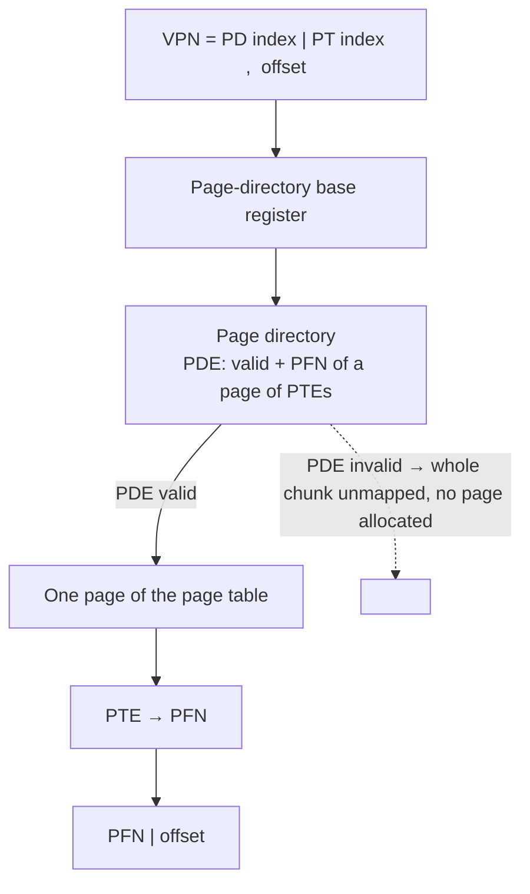

# L11 · Smaller page tables: multi-level & friends

> **Book:** Ch 20 (pp. 211–226) · **Tier:** 🔴 Must · **Time:** 45 min · **Simulator:** `vm-smalltables/paging-multilevel-translate.py`

## TL;DR

- Linear page tables waste memory on **invalid** entries for the huge unused middle of the address space.
- **Multi-level page table:** chop the page table into page-sized pieces; a **page directory** points only to the pieces that have valid entries. Unused regions cost nothing.
- Cost: a TLB miss now needs **one memory access per level** (time–space trade-off). Alternatives: bigger pages, paging+segments hybrid, inverted page tables.

## The crux

> How can we make page tables smaller, without making translation too slow?

## The story chain

**4 MB of page table per process, mostly invalid entries** → *bigger pages (16 KB → 1 MB table)* → ❌ internal fragmentation, waste inside pages → *hybrid: a page table per segment, with bounds* → ❌ still needs segmentation, tables are variable-sized again (external fragmentation) → *multi-level: page the page table itself* → ❌ more memory accesses on a TLB miss, more complex → *accept it, because the TLB hits most of the time* → **x86-64 uses 4 levels**.

## Core ideas

### Two-level page table



- The page directory has one **PDE** per page of the page table. If a PDE is invalid, that page of PTEs simply isn't allocated.
- Every piece is exactly one page → easy to allocate, no fragmentation, and pieces can even be swapped.

### Translation on a TLB miss (two levels)

```
PDIndex = (VPN & PD_MASK) >> PD_SHIFT
PDE     = Memory[PDBR + PDIndex * sizeof(PDE)]       ← access 1
if PDE.Valid:
    PTIndex = VPN & PT_MASK
    PTE     = Memory[(PDE.PFN << SHIFT) + PTIndex * sizeof(PTE)]   ← access 2
    if PTE.Valid → insert in TLB, retry
```

### How many levels?

Each piece must fit in a page. With 4 KB pages and 4-byte PTEs, one page holds **1024 PTEs** → 10 bits of index per level.

- 32-bit address: 12 offset + 20 VPN = 10 (directory) + 10 (table) → **2 levels** (classic x86).
- With 8-byte PTEs (512 per page = 9 bits) and a 48-bit address: 48 − 12 = 36 bits = 4 × 9 → **4 levels** (x86-64).

### The other options (one line each)

| Option | Idea | Downside |
|---|---|---|
| Bigger pages | Fewer PTEs | Internal fragmentation |
| Hybrid (paging + segments) | Page table per segment, bounded | Rigid; tables vary in size |
| **Inverted page table** | One table for the whole machine: entry per **physical** frame, which process/VPN owns it; use a hash table to search | Lookups need hashing; sharing is awkward |
| Swap page tables to disk | Page tables in kernel virtual memory | Complex (VAX/VMS does this) |

## Worked example

16 KB address space, 64-byte pages, 14-bit address → 8-bit VPN, 6-bit offset. 256 PTEs × 4 bytes = 1 KB table = **16 pages** of PTEs (16 PTEs per page).

- Index into the directory: top **4** bits of VPN. Index into a page of PTEs: next **4** bits.
- If only code (pages 0–1), heap (4–5) and stack (254–255) are used, only **2** of the 16 PTE pages are needed: one for VPNs 0–15 and one for 240–255. Directory (1 page) + 2 = **3 pages instead of 16**.

## Traps

- The page directory itself must fit in one page — otherwise add a level.
- More levels = smaller tables but **more accesses per TLB miss**; no extra cost on a TLB hit.
- Inverted tables are indexed by **physical** frame, not virtual page.

## Recall

**Blurt test:** the story chain; the two-level diagram; compute levels needed for 32-bit and 48-bit addresses.

<details markdown="1"><summary>Why are linear page tables wasteful?</summary>

They allocate a PTE for every virtual page, even the vast unused region between heap and stack.

</details>

<details markdown="1"><summary>How does a multi-level page table save space?</summary>

The page table is split into page-sized chunks; a page directory tracks them, and chunks with no valid entries are never allocated.

</details>

<details markdown="1"><summary>What's the cost of a two-level page table?</summary>

On a TLB miss, two memory accesses instead of one to translate (plus more complexity).

</details>

<details markdown="1"><summary>How many 4-byte PTEs fit in a 4 KB page, and what does that imply?</summary>

1024 → each level indexes with 10 bits.

</details>

<details markdown="1"><summary>What's an inverted page table?</summary>

A single system-wide table with one entry per physical frame, recording which process and virtual page use it; searched with a hash table.

</details>

<details markdown="1"><summary>Why not just use bigger pages?</summary>

Internal fragmentation: most of each big page goes unused for small allocations.

</details>

**Explain it (60 s):** "Why is a multi-level page table a time–space trade-off, and why is it usually a good one?"

**Simulator drill:** `python3 paging-multilevel-translate.py -s 0` — walk each address through PDE → PTE → physical, check with `-c`.

## Connects to

- The 4 MB problem → [L09 Paging](l09-paging.md)
- TLB hides the extra accesses → [L10](l10-tlb.md)
- The same "indirection tree" idea → inode indirect blocks in [L23](../persistence/l23-vsfs.md)

## Read in the book

- 🔴 20.3 Multi-level page tables (including the detailed example and Figure 20.6 control flow).
- 🟡 20.1, 20.2, 20.4.
