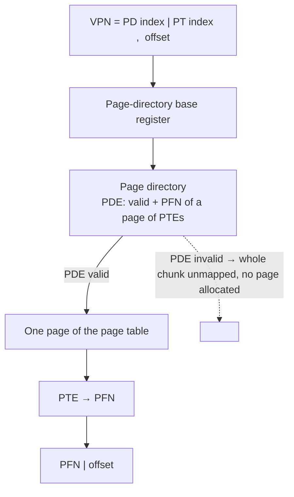

# L11 · Smaller page tables: multi-level & friends

> **Book:** Ch 20 (pp. 211–226) · **Priority:** 🔴 must-know · **Time:** 45 min · **Simulator:** `vm-smalltables/paging-multilevel-translate.py`

!!! example "In plain words"
    A simple page table has one entry for **every** possible page, even though most of a program's address range is empty. It's like a 1,000-page phone book where 990 pages are blank.

    A **multi-level page table** is a phone book with a **table of contents** (the page directory). The contents page says which sections exist, and empty sections are simply not printed. You save a lot of paper. The cost is one extra lookup (contents, then section), and the TLB hides that most of the time.

## TL;DR (the 3 things to remember)

- Linear page tables waste memory on **invalid** entries for the huge unused middle of the address space.
- **Multi-level page table:** chop the page table into page-sized pieces; a **page directory** points only to the pieces that have valid entries. Unused regions cost nothing.
- Cost: a TLB miss now needs **one memory access per level** (time–space trade-off). Alternatives: bigger pages, paging+segments hybrid, inverted page tables.

## The big question

> How can we make page tables smaller, without making translation too slow?

## The story chain

<small>Key: **bold** = the problem or the final design · *italics* = an attempted fix · ❌ = what goes wrong with it · → = "which leads to"</small>

**4 MB of page table per process, mostly invalid entries** → *bigger pages (16 KB → 1 MB table)* → ❌ internal fragmentation, waste inside pages → *hybrid: a page table per segment, with bounds* → ❌ still needs segmentation, tables are variable-sized again (external fragmentation) → *multi-level: page the page table itself* → ❌ more memory accesses on a TLB miss, more complex → *accept it, because the TLB hits most of the time* → **x86-64 uses 4 levels**.

## Core ideas

### Two-level page table

Take the big page table and cut it into page-sized pieces. Then add a small top-level index, the **page directory**, with one entry per piece. Each entry says either "this piece exists, and it's at frame X" or "this piece is all empty, so it isn't stored at all".

The VPN is now read in two parts: the first part picks the entry in the page directory, the second part picks the entry inside that piece.



- Each page-directory entry (**PDE**) covers one page-sized piece of the page table. If the PDE is marked invalid, that piece isn't allocated at all. This is where the savings come from.
- Every piece is exactly one page in size, so the OS can store it in any free frame: no fragmentation, and pieces can even be moved out to disk.

### Translation on a TLB miss (two levels)

In words: use the top part of the VPN to read the page-directory entry (memory read 1) → if valid, it tells you which frame holds the right piece → use the next part of the VPN to read the PTE inside that piece (memory read 2) → put the result in the TLB and retry.

```
PDIndex = (VPN & PD_MASK) >> PD_SHIFT
PDE     = Memory[PDBR + PDIndex * sizeof(PDE)]       ← access 1
if PDE.Valid:
    PTIndex = VPN & PT_MASK
    PTE     = Memory[(PDE.PFN << SHIFT) + PTIndex * sizeof(PTE)]   ← access 2
    if PTE.Valid → insert in TLB, retry
```

### How many levels?

Rule: every piece (including the top directory) must fit in one page.

- A 4 KB page holds 4096 ÷ 4 = **1024 entries** of 4 bytes. Choosing one of 1024 entries takes 10 bits, so **each level uses 10 bits** of the VPN.
- **32-bit machine:** 32 bits − 12 offset bits = 20 VPN bits = 10 + 10 → **2 levels** (classic 32-bit x86).
- **64-bit machine** (uses 48-bit addresses, 8-byte entries): 4096 ÷ 8 = 512 entries per page → 9 bits per level. 48 − 12 = 36 VPN bits = 4 × 9 → **4 levels** (today's x86-64).

### The other options (one line each)

| Option | Idea | Downside |
|---|---|---|
| Bigger pages | Fewer pages means fewer entries | Small programs waste most of each big page (internal fragmentation) |
| Hybrid (paging + segments) | A separate page table for code, heap and stack, each only as long as needed | Inflexible; tables of different sizes bring fragmentation back |
| **Inverted page table** | One table for the whole machine, with one entry per **real frame** saying which process and page is in it; found quickly with a hash table | Every lookup needs a search; sharing pages is awkward |
| Swap page tables to disk | Page tables can themselves be paged out | Complex (VAX/VMS did this) |

## Worked example

A small machine: 16 KB address space, tiny 64-byte pages.

1. **Count the pages:** 16 KB ÷ 64 B = 256 pages, so the VPN is 8 bits (2<sup>8</sup> = 256) and the offset is 6 bits (2<sup>6</sup> = 64).
2. **Size of a simple linear table:** 256 entries × 4 bytes = 1 KB. That's 1 KB ÷ 64 B = **16 pages** of page table, each holding 16 entries.
3. **Make it two-level:** the directory needs one entry per piece, so 16 entries, chosen by the **top 4 bits** of the VPN. The **next 4 bits** choose the entry inside a piece.
4. **What's actually used?** Say the program only uses code (pages 0–1), heap (pages 4–5) and stack (pages 254–255). Pages 0–15 fall in piece #0, and pages 240–255 fall in piece #15. The other 14 pieces are completely empty and are never allocated.
5. **Result:** 1 directory page + 2 pieces = **3 pages instead of 16**.

## Common mistakes

- The page directory itself must fit in one page — otherwise add a level.
- More levels = smaller tables but **more accesses per TLB miss**; no extra cost on a TLB hit.
- Inverted tables are indexed by **physical** frame, not virtual page.

## Recall

**Blurt test** — close this page, then on paper, from memory: the story chain; the two-level diagram; compute levels needed for 32-bit and 48-bit addresses.

<details markdown="1"><summary>Why are linear page tables wasteful?</summary>

They allocate a PTE for every virtual page, even the vast unused region between heap and stack.

</details>

<details markdown="1"><summary>How does a multi-level page table save space?</summary>

The page table is split into page-sized chunks; a page directory tracks them, and chunks with no valid entries are never allocated.

</details>

<details markdown="1"><summary>What's the cost of a two-level page table?</summary>

On a TLB miss, two memory accesses instead of one to translate (plus more complexity).

</details>

<details markdown="1"><summary>How many 4-byte PTEs fit in a 4 KB page, and what does that imply?</summary>

1024 → each level indexes with 10 bits.

</details>

<details markdown="1"><summary>What's an inverted page table?</summary>

A single system-wide table with one entry per physical frame, recording which process and virtual page use it; searched with a hash table.

</details>

<details markdown="1"><summary>Why not just use bigger pages?</summary>

Internal fragmentation: most of each big page goes unused for small allocations.

</details>

**Explain it out loud (60 seconds, as if to a friend):** "Why is a multi-level page table a time–space trade-off, and why is it usually a good one?"

**Simulator drill** (book's free Python homework tools — see [the recall system](../start/recall-system.md#four-more-tricks-that-pay-off)): `python3 paging-multilevel-translate.py -s 0` — walk each address through PDE → PTE → physical, check with `-c`.

## Connects to

- The 4 MB problem → [L09 Paging](l09-paging.md)
- TLB hides the extra accesses → [L10](l10-tlb.md)
- The same "indirection tree" idea → inode indirect blocks in [L23](../persistence/l23-vsfs.md)

## Read in the book

- 🔴 20.3 Multi-level page tables (including the detailed example and Figure 20.6 control flow).
- 🟡 20.1, 20.2, 20.4.
