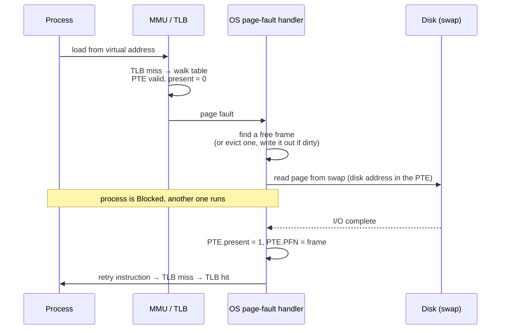

# L12 · Swapping: going beyond physical memory

> **Book:** Ch 21 (pp. 227–235) · Ch 22 (pp. 237–254) · **Priority:** 🔴 must-know · Ch 23 ⚪ · **Time:** 55 min · **Simulator:** `vm-beyondphys-policy/paging-policy.py`

!!! example "In plain words"
    Your desk (RAM) is small; the filing cabinet (disk) is huge but slow. When your desk is full and you need another folder:

    - **Mechanism:** each page's entry has a "present?" flag. If a program touches a page that's in the cabinet, the hardware raises a **page fault**, and the OS fetches it from disk.
    - **Policy:** which folder do you put back to make room? Ideally the one you'll need **furthest in the future** (OPT). Since nobody knows the future, the usual guess is "the one you haven't touched for the longest" (LRU), or a cheap approximation of it (**Clock**).

    If you need more folders than fit on the desk at once, you spend all day walking to the cabinet. That's **thrashing**.

## TL;DR (the 3 things to remember)

- **Mechanism:** pages can live in **swap space** on disk. The PTE's **present bit** says whether a page is in memory. Touching a non-present page → **page fault** → the OS reads it from disk, updates the PTE, retries.
- **Policy:** when memory is full, evict a page. **OPT** (evict the page used furthest in the future) is the unbeatable benchmark; **LRU** approximates it using history; **Clock** approximates LRU cheaply with a **use bit**.
- If the working sets don't fit, the system **thrashes**. Evicting **clean** pages is cheaper than **dirty** ones.

## The big question

> How can the OS use a larger, slower device to give the illusion of a large virtual memory — and how does it decide which page to evict?

## The story chain

<small>Key: **bold** = the problem or the final design · *italics* = an attempted fix · ❌ = what goes wrong with it · → = "which leads to"</small>

**Address spaces larger than RAM** → *store some pages on disk; present bit in the PTE* → *page fault handler loads the page* → ❌ memory full → *evict something* → *which? OPT* → ❌ needs the future → *FIFO* → ❌ ignores importance, and suffers **Belady's anomaly** → *Random* → ❌ luck-based → *LRU, uses history* → ❌ exact LRU means updating a data structure on **every** memory access → *Clock: a use bit set by hardware, a sweeping hand* → *prefer clean pages; evict in the background with a swap daemon* → ❌ too many processes for memory → *admission control or the OOM killer*.

## Core ideas

### The page-fault path

How to read the diagram: the program touches a page; the hardware finds its "present" flag is 0 and calls the OS (a **page fault**); the OS finds room, reads the page from disk (the process sleeps meanwhile and others run), marks it present and re-runs the instruction.

Note the difference from L09: a page that is **not valid** isn't part of the program at all, so touching it is a bug and the program is killed. A page that is valid but **not present** is legitimate; it's just on disk right now.

**When are pages evicted?** Not at the last moment. A background OS thread (the **swap daemon**) wakes up when free memory drops below a *low watermark* and evicts pages in a batch until free memory reaches a *high watermark*. Batching is faster because several pages can be written to disk together.

### Average memory access time

**AMAT = TM + Pmiss × TD**

In words: every access costs one memory access (TM), plus — for the fraction of accesses that miss (Pmiss) — a trip to disk (TD).

*Example:* memory takes 100 ns; disk takes 10 ms, which is 10,000,000 ns.

- 90% hits (Pmiss = 0.1): 100 ns + 0.1 × 10,000,000 ns ≈ **1 ms** per access — 10,000× slower than memory.
- 99.9% hits (Pmiss = 0.001): 100 ns + 10,000 ns ≈ **10.1 µs** — still **100× slower** than memory.

Lesson: disk is so slow that even a tiny miss rate dominates. Swapping is a safety net, not something to rely on.

### The policies (which page to throw out)

Here RAM acts as a **cache** for the disk. A **hit** means the page was already in memory; a **miss** (page fault) means it had to be fetched from disk. To **evict** a page means to remove it from memory to make room.

| Policy | Evicts | Notes |
|---|---|---|
| **OPT** (optimal, by Belady) | The page that won't be needed for the longest time | The best possible, but needs to know the future. Used only as a benchmark for the others |
| **FIFO** | The page that arrived first | Simple, but may throw out a page in constant use. Strange quirk (**Belady's anomaly**): giving it *more* memory can cause *more* misses |
| **Random** | Any page, at random | Simple; no bad worst case, but no cleverness either |
| **LRU** | The page not used for the longest time | Usually good, because recently used pages tend to be used again. Never shows Belady's anomaly |
| **LFU** | The page used the fewest times | Same spirit as LRU, counting uses instead of recency |
| **Clock** | See below | A cheap approximation of LRU, used in real systems |

**How Clock works:** imagine the pages arranged in a circle, with a clock hand pointing at one. The hardware sets a page's **use bit** to 1 whenever it's accessed. To evict, look at the page under the hand. If its use bit is 1, it was used recently: give it a second chance (set the bit to 0) and move on. If its use bit is 0, it hasn't been used since the hand last passed, so evict it. A common variant also prefers pages that haven't been modified (**clean** pages), because those don't need writing back to disk first.

### Workload lessons

How well a policy does depends on the program's access pattern:

- **Random accesses (no locality):** every realistic policy does the same; only the amount of memory matters.
- **"80-20" pattern** (80% of accesses go to 20% of the pages): LRU wins, because it keeps the popular pages.
- **A loop over slightly too many pages** (e.g. 51 pages, room for 50): LRU and FIFO **miss every single time**, because they always evict exactly the page needed next. Random does much better here.

### Other VM policy bits

- **Demand paging:** load a page only when it's first touched. **Prefetching:** guess which page will be needed next and load it early.
- **Thrashing:** the pages that running programs actively need (their **working sets**) don't all fit in memory, so the system spends nearly all its time moving pages to and from disk and gets almost no work done. Fixes: run fewer programs at once (**admission control**), or kill one (Linux's **OOM killer**, "out of memory").
- Two tricks from VAX/VMS (Ch 23):
    - **Demand zeroing:** when a program asks for a new page, don't clear it yet; clear it only when it's first used (many are never used).
    - **Copy-on-write:** after `fork()`, parent and child *share* their pages instead of copying them all. A page is copied only when one of them **writes** to it. Since the child usually calls `exec()` straight away, most pages are never copied, which makes fork + exec cheap.

## Worked example (do by hand)

A program accesses pages in this order (the *reference string*): **0 1 2 0 1 3 0 3 1 2 1**. Memory has room for **3 pages**. For each policy, go through the list: a page already in memory is a **hit**; otherwise it's a **miss**, and if memory is full the policy chooses a victim. The first three misses (0, 1, 2) happen no matter what, because memory starts empty (*compulsory* or *cold-start* misses).

- **OPT:** misses on 0, 1, 2 (cold), 3 (evict 2, used furthest), 2 (evict 3 or 0) → **6 hits / 11 = 54.5%** (5 misses, 3 of them compulsory).
- **FIFO:** 0 1 2 miss; 0 1 hit; 3 miss (evict 0); 0 miss (evict 1); 3 hit; 1 miss (evict 2); 2 miss (evict 3); 1 hit → **4 hits = 36.4%**.
- **LRU:** 0 1 2 miss; 0 1 hit; 3 miss (evict 2); 0 3 1 hit; 2 miss (evict 0); 1 hit → **6 hits = 54.5%** — matches OPT here.

## Common mistakes

- **Valid** but not **present** → page fault (normal). **Invalid** → segfault.
- Page faults are handled by the **OS** even on hardware-managed TLBs (disk I/O needs the OS).
- LRU has no Belady's anomaly; FIFO does.
- Evicting a **dirty** page costs a disk write first.

## Recall

**Blurt test** — close this page, then on paper, from memory: the page-fault sequence; AMAT formula with the 99.9% example; the policy table; redo the FIFO trace.

What is the present bit?

A PTE bit saying whether the page is in physical memory (1) or swapped out to disk (0).

What happens on a page fault?

The OS finds a free frame (evicting one if needed), reads the page from swap, sets present=1 and the PFN, and the faulting instruction is retried. The process is blocked during the I/O.

Write the average memory access time formula.

AMAT = T_M + P_miss × T_D.

What does OPT evict and why can't we use it?

The page that will be used furthest in the future; it requires knowing the future.

What is Belady's anomaly?

With FIFO, increasing cache size can increase the number of misses. LRU and OPT (stack algorithms) don't have it.

How does the Clock algorithm work?

Pages in a circle with a hardware-set use bit. The hand sweeps: use bit 1 → clear it and move on; use bit 0 → evict.

Which workload makes LRU and FIFO miss every time?

Looping sequentially over one more page than the cache holds.

What is thrashing and how is it handled?

Memory is oversubscribed so the system spends its time paging. Run fewer processes (admission control) or kill one (OOM killer).

What is copy-on-write?

After fork, parent and child share pages read-only; a page is copied only when one of them writes to it.

**Explain it out loud (60 seconds, as if to a friend):** "Why does a 99.9% memory hit rate still make a program feel slow if the misses go to disk?"

**Simulator drill** (book's free Python homework tools — see [the recall system](../start/recall-system.md#four-more-tricks-that-pay-off)): `python3 paging-policy.py -p FIFO -a 0,1,2,0,1,3,0,3,1,2,1 -C 3 -c`, then `-p LRU`, `-p OPT`, `-p CLOCK`.

## Connects to

- Present bit in the PTE → [L09](l09-paging.md)
- LRU-style caching → the buffer cache in [L23](../persistence/l23-vsfs.md)
- Disk speed numbers → [L20 Disks](../persistence/l20-disks.md)

## Read in the book

- 🔴 Ch 21: 21.1–21.6 (short).
- 🔴 Ch 22: 22.1–22.8 and 22.11. Do the workload figures in 22.6.
- ⚪ Ch 23 except 23.5 (demand zeroing, copy-on-write).
